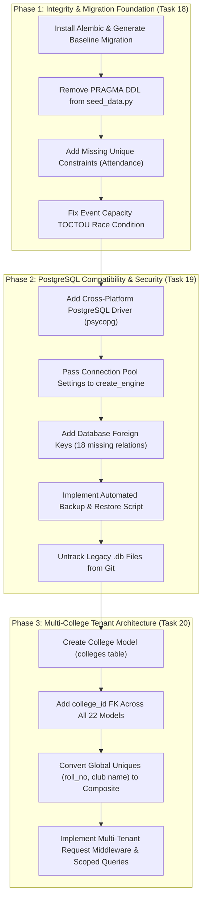

# TASK 17 & 17B: COMPREHENSIVE DATABASE SECURITY, DATA INTEGRITY & MULTI-COLLEGE ARCHITECTURE AUDIT REPORT

**Audit Date**: November 1, 2026
**Auditor**: Antigravity Database Architecture & Security Specialist
**Repository**: `C:\Users\ruetk\OneDrive\Desktop\Campus-Automation-System\MARVEL-main`
**Branch**: `main`
**Commit**: `9d7bf38f21eb0b1d55454a1cd49e8b2ec65f27be`
**Audit Scope**: Read-Only Architecture, Relational Integrity, Concurrency, Security, Compatibility, Multi-Tenancy & Test Evidence

---

## 1. Executive Summary

A comprehensive, model-by-model architectural and security audit of the Campus Automation System (MARVEL) database tier was conducted. The application targets **SQLite** (`campus_automation.db` file-based in development/production and in-memory `sqlite://` for automated tests) via **SQLAlchemy 2.0+** ORM.

### Verdict on Multi-College Platform Readiness
**VERDICT: NOT READY FOR MULTI-COLLEGE DEPLOYMENT (FATAL CONSTRAINT & ISOLATION GAPS)**
The existing database schema is strictly single-tenant:
1. **Zero Tenant Isolation**: No `College` or `Institution` model exists. No `college_id` or equivalent tenant identifier column exists in any of the 22 tables.
2. **Fatal Database Constraint Collision**: [`backend/models/student.py:10`](file:///C:/Users/ruetk/OneDrive/Desktop/Campus-Automation-System/MARVEL-main/backend/models/student.py#L10) defines `roll_no = Column(String, unique=True, nullable=False)`. If multiple colleges share the database, two colleges cannot enroll students with the same roll number (e.g. `21BCS101` or `2024CS001`). Attempting to do so triggers an unrecoverable `sqlite3.IntegrityError: UNIQUE constraint failed: students.roll_no`. Similarly, [`backend/models/club.py:11`](file:///C:/Users/ruetk/OneDrive/Desktop/Campus-Automation-System/MARVEL-main/backend/models/club.py#L11) enforces global uniqueness on `Club.name`, preventing two institutions from both hosting a "Coding Club".
3. **Pervasive Cross-Tenant Data Access**: Faculty, staff, and administrative queries filter records by department string or role, never by institution. Any faculty user can view student rosters, attendance logs, and academic risk profiles across all institutions.

### Verdict on PostgreSQL Compatibility
**VERDICT: PARTIALLY COMPATIBLE (NOT PRODUCTION-READY FOR POSTGRESQL)**
While queries use SQLAlchemy ORM, production startup and migrations rely on procedural `PRAGMA table_info(...)` queries inside [`backend/seed_data.py::ensure_schema()`](file:///C:/Users/ruetk/OneDrive/Desktop/Campus-Automation-System/MARVEL-main/backend/seed_data.py#L42-L132), which fail immediately under PostgreSQL (`SyntaxError: syntax error at or near "PRAGMA"`). Furthermore, [`requirements.txt:9`](file:///C:/Users/ruetk/OneDrive/Desktop/Campus-Automation-System/MARVEL-main/requirements.txt#L9) explicitly excludes `psycopg2-binary` on Windows platforms (`platform_system != "Windows"`).

### Summary of Audit Metrics
- **Total ORM Models Inspected**: Exactly **22 SQLAlchemy models** (across 11 source files in `backend/models/`).
- **Total Database-Level Foreign Keys**: **13 enforced foreign keys**.
- **Total Missing Foreign Keys**: **18 unconstrained relationships** across core entities.
- **Total Bidirectional ORM Relationships**: **9 relationships**.
- **Audit Findings**: 4 Critical, 4 High, 5 Medium, 3 Low/Informational (16 total).

---

## 2. Complete Model-by-Model ORM Inventory (22 Models)

The table below documents every SQLAlchemy ORM model discovered through direct Python metadata reflection on `Base.metadata.tables`.

| # | Python Class Name | Database Table Name | Source File | Primary Key | All Columns & Types | Enforced Foreign Keys | ORM Relationships | Unique Constraints & Indexes | Nullable Fields | Sensitive Fields | Ownership Relationship |
|---|---|---|---|---|---|---|---|---|---|---|---|
| 1 | `User` | `users` | `backend/models/user.py` | `id` (INTEGER) | `id` (INTEGER), `username` (VARCHAR 50), `email` (VARCHAR 100), `hashed_password` (VARCHAR 255), `full_name` (VARCHAR 100), `avatar` (TEXT), `role` (VARCHAR 20), `is_active` (BOOLEAN), `linked_student_id` (INTEGER), `created_at` (DATETIME), `updated_at` (DATETIME), `last_login` (DATETIME) | `linked_student_id` $\to$ `students.id` | `student` $\to$ `Student` (backref `user_account`), `study_tasks` $\to$ `StudyTask` | `ix_users_username` (UQ), `ix_users_email` (UQ), `ix_users_id` (IDX) | `full_name`, `avatar`, `linked_student_id`, `last_login` | `hashed_password`, `email`, `full_name`, `avatar`, `last_login` | Authenticated account; optionally owns `Student` via `linked_student_id`. |
| 2 | `Student` | `students` | `backend/models/student.py` | `id` (INTEGER) | `id` (INTEGER), `name` (VARCHAR), `roll_no` (VARCHAR), `department` (VARCHAR), `semester` (INTEGER), `section` (VARCHAR) | None | `user_account` $\to$ `User` | `roll_no` (UQ), `ix_students_id` (IDX) | `semester`, `section` | Student PII (`name`, `roll_no`, `department`, `section`) | Primary academic identity. |
| 3 | `Attendance` | `attendance` | `backend/models/attendance.py` | `id` (INTEGER) | `id` (INTEGER), `student_id` (INTEGER), `subject_code` (VARCHAR 50), `faculty_id` (VARCHAR 50), `session_name` (VARCHAR 100), `date` (DATETIME), `status` (VARCHAR), `remarks` (VARCHAR), `created_at` (DATETIME), `updated_at` (DATETIME) | `student_id` $\to$ `students.id` | None | `ix_attendance_id` (IDX), `ix_attendance_subject_code` (IDX), `ix_attendance_faculty_id` (IDX) | `subject_code`, `faculty_id`, `session_name`, `remarks`, `created_at`, `updated_at` | Student attendance records | Owned by `Student` via `student_id`. |
| 4 | `Complaint` | `complaints` | `backend/models/complaint.py` | `id` (INTEGER) | `id` (INTEGER), `student_id` (INTEGER), `title` (VARCHAR), `description` (TEXT), `category` (VARCHAR), `status` (VARCHAR), `priority` (VARCHAR), `resolution_notes` (TEXT), `assigned_to` (INTEGER), `created_at` (DATETIME), `updated_at` (DATETIME) | `student_id` $\to$ `students.id` | `history` $\to$ `ComplaintHistory` (cascade delete, orphan) | `ix_complaints_id` (IDX) | `resolution_notes`, `assigned_to`, `created_at`, `updated_at` | Student grievances, disciplinary records | Owned by `Student` via `student_id`. |
| 5 | `ComplaintHistory` | `complaint_history` | `backend/models/complaint.py` | `id` (INTEGER) | `id` (INTEGER), `complaint_id` (INTEGER), `changed_by_user_id` (INTEGER), `changed_by_name` (VARCHAR 100), `old_status` (VARCHAR 50), `new_status` (VARCHAR 50), `remarks` (TEXT), `created_at` (DATETIME) | `complaint_id` $\to$ `complaints.id` (ON DELETE CASCADE) | `complaint` $\to$ `Complaint` | `ix_complaint_history_id` (IDX), `ix_complaint_history_complaint_id` (IDX) | `changed_by_user_id`, `changed_by_name`, `old_status`, `remarks`, `created_at` | Investigation remarks, staff actions | Owned by `Complaint` via `complaint_id`. |
| 6 | `Schedule` | `schedules` | `backend/models/schedule.py` | `id` (INTEGER) | `id` (INTEGER), `title` (VARCHAR), `description` (TEXT), `event_type` (VARCHAR), `start_date` (DATETIME), `end_date` (DATETIME), `location` (VARCHAR), `audience` (VARCHAR), `is_active` (INTEGER), `created_at` (DATETIME), `updated_at` (DATETIME) | None | None | `ix_schedules_id` (IDX) | `description`, `location`, `audience`, `is_active`, `created_at`, `updated_at` | Institutional schedule data | Institutional ownership. |
| 7 | `ScheduleFeedback` | `schedule_feedback` | `backend/models/schedule_feedback.py` | `id` (INTEGER) | `id` (INTEGER), `name` (VARCHAR 100), `roll_number` (VARCHAR 50), `issue_type` (VARCHAR 100), `preferred_timing` (VARCHAR 200), `additional_comments` (TEXT), `status` (VARCHAR 50), `created_at` (DATETIME), `resolved_at` (DATETIME) | None | None | `ix_schedule_feedback_id` (IDX) | `preferred_timing`, `additional_comments`, `status`, `created_at`, `resolved_at` | Student grievances on schedules | Loose student ownership by `roll_number`. |
| 8 | `Announcement` | `announcements` | `backend/models/schedule_feedback.py` | `id` (INTEGER) | `id` (INTEGER), `title` (VARCHAR 200), `content` (TEXT), `author` (VARCHAR 100), `priority` (VARCHAR 20), `target_audience` (VARCHAR 100), `is_active` (INTEGER), `created_at` (DATETIME), `expires_at` (DATETIME) | None | None | `ix_announcements_id` (IDX) | `priority`, `target_audience`, `is_active`, `created_at`, `expires_at` | Campus public notices | Faculty author (by string name). |
| 9 | `Event` | `events` | `backend/models/events.py` | `id` (INTEGER) | `id` (INTEGER), `name` (VARCHAR 200), `description` (TEXT), `category` (VARCHAR Enum), `banner_image` (VARCHAR 500), `thumbnail_image` (VARCHAR 500), `gallery_images` (TEXT), `registration_start_date` (DATETIME), `registration_end_date` (DATETIME), `event_start_date` (DATETIME), `event_end_date` (DATETIME), `venue` (VARCHAR 300), `max_participants` (INTEGER), `current_participants` (INTEGER), `entry_fee` (FLOAT), `organizer_name` (VARCHAR 200), `organizer_email` (VARCHAR 200), `organizer_phone` (VARCHAR 20), `status` (VARCHAR Enum), `requires_approval` (BOOLEAN), `team_event` (BOOLEAN), `min_team_size` (INTEGER), `max_team_size` (INTEGER), `rules` (TEXT), `eligibility_criteria` (TEXT), `prizes` (TEXT), `created_at` (DATETIME), `updated_at` (DATETIME), `created_by` (INTEGER) | None | `registrations` $\to$ `EventRegistration`, `leaderboard` $\to$ `EventLeaderboard`, `announcements` $\to$ `EventAnnouncement` | `ix_events_id` (IDX), `ix_events_name` (IDX), `ix_events_category` (IDX) | `banner_image`, `thumbnail_image`, `gallery_images`, `venue`, `max_participants`, `current_participants`, `entry_fee`, `organizer_phone`, `status`, `requires_approval`, `team_event`, `min_team_size`, `max_team_size`, `rules`, `eligibility_criteria`, `prizes`, `created_at`, `updated_at`, `created_by` | Financial fees, organizer contacts | Event organizer (`created_by`). |
| 10 | `EventRegistration` | `event_registrations` | `backend/models/events.py` | `id` (INTEGER) | `id` (INTEGER), `event_id` (INTEGER), `student_id` (VARCHAR 50), `student_name` (VARCHAR 200), `student_email` (VARCHAR 200), `student_phone` (VARCHAR 20), `branch` (VARCHAR 100), `year` (VARCHAR 20), `roll_number` (VARCHAR 50), `team_name` (VARCHAR 200), `team_members` (TEXT), `team_leader` (BOOLEAN), `registration_date` (DATETIME), `status` (VARCHAR Enum), `payment_status` (VARCHAR 50), `transaction_id` (VARCHAR 100), `previous_experience` (TEXT), `expectations` (TEXT), `special_requirements` (TEXT), `emergency_contact` (VARCHAR 20), `approved_by` (INTEGER), `approval_date` (DATETIME), `rejection_reason` (TEXT), `created_at` (DATETIME), `updated_at` (DATETIME) | `event_id` $\to$ `events.id` (ON DELETE CASCADE) | `event` $\to$ `Event` | `uq_event_student_reg` (`event_id`, `student_id`), `ix_event_registrations_id` (IDX), `ix_event_registrations_student_id` (IDX) | `branch`, `year`, `roll_number`, `team_name`, `team_members`, `team_leader`, `registration_date`, `status`, `payment_status`, `transaction_id`, `previous_experience`, `expectations`, `special_requirements`, `emergency_contact`, `approved_by`, `approval_date`, `rejection_reason`, `created_at`, `updated_at` | Student phone, emergency contact, transaction ID | Owned by `Event` and `Student` (`student_id`). |
| 11 | `EventLeaderboard` | `event_leaderboard` | `backend/models/events.py` | `id` (INTEGER) | `id` (INTEGER), `event_id` (INTEGER), `participant_id` (VARCHAR 50), `participant_name` (VARCHAR 200), `participant_type` (VARCHAR 20), `score` (FLOAT), `rank` (INTEGER), `points` (INTEGER), `matches_played` (INTEGER), `matches_won` (INTEGER), `matches_lost` (INTEGER), `matches_draw` (INTEGER), `statistics` (TEXT), `position` (VARCHAR 50), `prize_won` (VARCHAR 200), `certificate_url` (VARCHAR 500), `last_updated` (DATETIME), `created_at` (DATETIME) | `event_id` $\to$ `events.id` (ON DELETE CASCADE) | `event` $\to$ `Event` | `ix_event_leaderboard_id` (IDX) | `score`, `rank`, `points`, `matches_played`, `matches_won`, `matches_lost`, `matches_draw`, `statistics`, `position`, `prize_won`, `certificate_url`, `last_updated`, `created_at` | Participant scores, ranks, awards | Owned by `Event` (`event_id`). |
| 12 | `EventAnnouncement` | `event_announcements` | `backend/models/events.py` | `id` (INTEGER) | `id` (INTEGER), `event_id` (INTEGER), `title` (VARCHAR 300), `message` (TEXT), `announcement_type` (VARCHAR 50), `target_audience` (VARCHAR 100), `is_pinned` (BOOLEAN), `is_active` (BOOLEAN), `publish_date` (DATETIME), `expiry_date` (DATETIME), `image_url` (VARCHAR 500), `attachment_url` (VARCHAR 500), `link_url` (VARCHAR 500), `link_text` (VARCHAR 100), `created_by` (INTEGER), `created_at` (DATETIME), `updated_at` (DATETIME) | `event_id` $\to$ `events.id` (ON DELETE CASCADE) | `event` $\to$ `Event` | `ix_event_announcements_id` (IDX) | `event_id`, `announcement_type`, `target_audience`, `is_pinned`, `is_active`, `publish_date`, `expiry_date`, `image_url`, `attachment_url`, `link_url`, `link_text`, `created_by`, `created_at`, `updated_at` | Internal event updates | Owned by `Event` (`event_id`). |
| 13 | `Club` | `clubs` | `backend/models/club.py` | `id` (INTEGER) | `id` (INTEGER), `name` (VARCHAR), `description` (TEXT), `category` (VARCHAR), `detailed_description` (TEXT), `mission_statement` (TEXT), `vision_statement` (TEXT), `logo_url` (VARCHAR 500), `banner_image` (VARCHAR 500), `cover_image` (VARCHAR 500), `gallery_images` (TEXT), `social_media_links` (TEXT), `advisor` (VARCHAR), `advisor_email` (VARCHAR 200), `president` (VARCHAR), `president_email` (VARCHAR 200), `contact_email` (VARCHAR 200), `contact_phone` (VARCHAR 20), `member_count` (INTEGER), `total_events` (INTEGER), `founding_year` (INTEGER), `is_active` (BOOLEAN), `accepting_members` (BOOLEAN), `membership_fee` (INTEGER), `created_at` (DATETIME), `updated_at` (DATETIME), `created_by` (INTEGER) | None | `activities` $\to$ `ClubActivity`, `members` $\to$ `ClubMember` | `name` (UQ), `ix_clubs_id` (IDX) | `description`, `detailed_description`, `mission_statement`, `vision_statement`, `logo_url`, `banner_image`, `cover_image`, `gallery_images`, `social_media_links`, `advisor_email`, `president`, `president_email`, `contact_email`, `contact_phone`, `member_count`, `total_events`, `founding_year`, `is_active`, `accepting_members`, `membership_fee`, `created_at`, `updated_at`, `created_by` | Financial fees, contact emails/phones | Club leadership / Advisor. |
| 14 | `ClubActivity` | `club_activities` | `backend/models/club.py` | `id` (INTEGER) | `id` (INTEGER), `club_id` (INTEGER), `title` (VARCHAR), `description` (TEXT), `activity_type` (VARCHAR), `start_date` (DATETIME), `end_date` (DATETIME), `location` (VARCHAR), `expected_participants` (INTEGER), `actual_participants` (INTEGER), `status` (VARCHAR), `remarks` (TEXT), `created_at` (DATETIME), `updated_at` (DATETIME) | `club_id` $\to$ `clubs.id` | `club` $\to$ `Club` | `ix_club_activities_id` (IDX) | `description`, `end_date`, `location`, `expected_participants`, `actual_participants`, `status`, `remarks`, `created_at`, `updated_at` | Activity schedules, budgets | Owned by `Club` (`club_id`). |
| 15 | `ClubMember` | `club_members` | `backend/models/club.py` | `id` (INTEGER) | `id` (INTEGER), `club_id` (INTEGER), `student_id` (INTEGER), `position` (VARCHAR), `join_date` (DATETIME), `is_active` (BOOLEAN) | `club_id` $\to$ `clubs.id`, `student_id` $\to$ `students.id` | `club` $\to$ `Club` | `uq_club_student_member` (`club_id`, `student_id`), `ix_club_members_id` (IDX) | `position`, `join_date`, `is_active` | Student club membership roster | Owned by `Club` and `Student`. |
| 16 | `ClubAttendance` | `club_attendance` | `backend/models/club.py` | `id` (INTEGER) | `id` (INTEGER), `club_id` (INTEGER), `student_name` (VARCHAR), `roll_number` (VARCHAR), `section` (VARCHAR), `status` (VARCHAR), `attendance_date` (DATETIME), `created_at` (DATETIME) | `club_id` $\to$ `clubs.id` | None | `ix_club_attendance_id` (IDX) | `roll_number`, `section`, `created_at` | Student club participation | Owned by `Club` (`club_id`). |
| 17 | `QRAttendanceSession` | `qr_attendance_sessions` | `backend/models/qr_attendance.py` | `id` (INTEGER) | `id` (INTEGER), `session_id` (VARCHAR 100), `faculty_id` (VARCHAR 50), `faculty_name` (VARCHAR 200), `faculty_email` (VARCHAR 200), `subject_code` (VARCHAR 50), `subject_name` (VARCHAR 200), `branch` (VARCHAR 100), `semester` (VARCHAR 20), `section` (VARCHAR 50), `lecture_date` (DATETIME), `lecture_start_time` (DATETIME), `lecture_end_time` (DATETIME), `lecture_duration_minutes` (INTEGER), `qr_code_data` (TEXT), `qr_code_hash` (VARCHAR 256), `qr_generated_at` (DATETIME), `qr_expires_at` (DATETIME), `qr_validity_minutes` (INTEGER), `center_latitude` (FLOAT), `center_longitude` (FLOAT), `geo_fence_radius_meters` (FLOAT), `location_name` (VARCHAR 300), `is_active` (BOOLEAN), `is_expired` (BOOLEAN), `is_cancelled` (BOOLEAN), `total_students_expected` (INTEGER), `total_students_present` (INTEGER), `total_students_absent` (INTEGER), `total_late_entries` (INTEGER), `max_scan_attempts_per_student` (INTEGER), `allow_screenshot_scan` (BOOLEAN), `require_device_verification` (BOOLEAN), `created_at` (DATETIME), `closed_at` (DATETIME), `notes` (TEXT) | None | `attendance_records` $\to$ `QRAttendanceRecord` (cascade delete, orphan) | `ix_qr_attendance_sessions_session_id` (UQ), `ix_qr_attendance_sessions_id` (IDX), `ix_qr_attendance_sessions_faculty_id` (IDX) | `faculty_email`, `section`, `lecture_end_time`, `lecture_duration_minutes`, `qr_generated_at`, `qr_validity_minutes`, `geo_fence_radius_meters`, `location_name`, `is_active`, `is_expired`, `is_cancelled`, `total_students_expected`, `total_students_present`, `total_students_absent`, `total_late_entries`, `max_scan_attempts_per_student`, `allow_screenshot_scan`, `require_device_verification`, `created_at`, `closed_at`, `notes` | QR secrets, SHA-256 hash, faculty GPS coordinates | Owned by Faculty (`faculty_id`). |
| 18 | `QRAttendanceRecord` | `qr_attendance_records` | `backend/models/qr_attendance.py` | `id` (INTEGER) | `id` (INTEGER), `session_id` (INTEGER), `student_id` (VARCHAR 50), `roll_number` (VARCHAR 50), `student_name` (VARCHAR 200), `student_email` (VARCHAR 200), `branch` (VARCHAR 100), `semester` (VARCHAR 20), `section` (VARCHAR 50), `marked_at` (DATETIME), `attendance_status` (VARCHAR 20), `is_late_entry` (BOOLEAN), `late_by_minutes` (INTEGER), `student_latitude` (FLOAT), `student_longitude` (FLOAT), `distance_from_center` (FLOAT), `is_within_geofence` (BOOLEAN), `location_accuracy` (FLOAT), `device_id` (VARCHAR 200), `device_model` (VARCHAR 200), `device_os` (VARCHAR 100), `browser` (VARCHAR 200), `ip_address` (VARCHAR 50), `user_agent` (TEXT), `scan_attempt_number` (INTEGER), `is_screenshot_scan` (BOOLEAN), `is_duplicate_device` (BOOLEAN), `is_proxy_suspected` (BOOLEAN), `qr_validation_passed` (BOOLEAN), `location_validation_passed` (BOOLEAN), `device_validation_passed` (BOOLEAN), `time_validation_passed` (BOOLEAN), `scan_duration_ms` (INTEGER), `remarks` (TEXT), `validation_errors` (TEXT), `created_at` (DATETIME), `updated_at` (DATETIME) | `session_id` $\to$ `qr_attendance_sessions.id` (ON DELETE CASCADE) | `session` $\to$ `QRAttendanceSession` | `uq_session_roll` (`session_id`, `roll_number`), `ix_qr_attendance_records_id` (IDX), `ix_qr_attendance_records_student_id` (IDX), `ix_qr_attendance_records_roll_number` (IDX) | `student_email`, `section`, `marked_at`, `attendance_status`, `is_late_entry`, `late_by_minutes`, `is_within_geofence`, `location_accuracy`, `device_id`, `device_model`, `device_os`, `browser`, `ip_address`, `user_agent`, `scan_attempt_number`, `is_screenshot_scan`, `is_duplicate_device`, `is_proxy_suspected`, `qr_validation_passed`, `location_validation_passed`, `device_validation_passed`, `time_validation_passed`, `scan_duration_ms`, `remarks`, `validation_errors`, `created_at`, `updated_at` | Precise student GPS latitude/longitude, client IP, device fingerprint | Owned by `QRAttendanceSession` and `Student`. |
| 19 | `QRAttendanceLog` | `qr_attendance_logs` | `backend/models/qr_attendance.py` | `id` (INTEGER) | `id` (INTEGER), `session_id` (INTEGER), `student_id` (VARCHAR 50), `attempt_time` (DATETIME), `attempt_status` (VARCHAR 50), `failure_reason` (VARCHAR 500), `latitude` (FLOAT), `longitude` (FLOAT), `distance_from_center` (FLOAT), `device_id` (VARCHAR 200), `ip_address` (VARCHAR 50), `qr_valid` (BOOLEAN), `location_valid` (BOOLEAN), `device_valid` (BOOLEAN), `time_valid` (BOOLEAN), `error_message` (TEXT), `created_at` (DATETIME) | None | None | `ix_qr_attendance_logs_id` (IDX), `ix_qr_attendance_logs_session_id` (IDX), `ix_qr_attendance_logs_student_id` (IDX) | `attempt_time`, `failure_reason`, `latitude`, `longitude`, `distance_from_center`, `device_id`, `ip_address`, `qr_valid`, `location_valid`, `device_valid`, `time_valid`, `error_message`, `created_at` | Failed attempt reasons, scan GPS coordinates, IP | Audit trail entity. |
| 20 | `DeviceFingerprint` | `device_fingerprints` | `backend/models/qr_attendance.py` | `id` (INTEGER) | `id` (INTEGER), `device_id` (VARCHAR 200), `student_id` (VARCHAR 50), `student_name` (VARCHAR 200), `device_model` (VARCHAR 200), `device_os` (VARCHAR 100), `browser` (VARCHAR 200), `screen_resolution` (VARCHAR 50), `first_registered` (DATETIME), `last_used` (DATETIME), `total_scans` (INTEGER), `is_active` (BOOLEAN), `is_blocked` (BOOLEAN), `block_reason` (TEXT), `created_at` (DATETIME), `updated_at` (DATETIME) | None | None | `ix_device_fingerprints_device_id` (UQ), `ix_device_fingerprints_id` (IDX), `ix_device_fingerprints_student_id` (IDX) | `device_model`, `device_os`, `browser`, `screen_resolution`, `first_registered`, `last_used`, `total_scans`, `is_active`, `is_blocked`, `block_reason`, `created_at`, `updated_at` | Hardware device ID, browser, resolution, block reason | Owned by `Student` (`student_id`). |
| 21 | `RiskLog` | `risk_logs` | `backend/models/risk.py` | `id` (INTEGER) | `id` (INTEGER), `student_id` (INTEGER), `risk_type` (VARCHAR), `severity` (VARCHAR), `description` (TEXT), `action_taken` (TEXT), `resolved` (INTEGER), `created_at` (DATETIME), `updated_at` (DATETIME) | None | None | `ix_risk_logs_id` (IDX) | `student_id`, `severity`, `action_taken`, `resolved`, `created_at`, `updated_at` | Disciplinary, behavioral, academic risk profiles | Owned by `Student` (`student_id`). |
| 22 | `StudyTask` | `study_tasks` | `backend/models/study_task.py` | `id` (INTEGER) | `id` (INTEGER), `user_id` (INTEGER), `title` (VARCHAR 200), `description` (TEXT), `duration_minutes` (INTEGER), `remaining_seconds` (INTEGER), `is_completed` (BOOLEAN), `due_date` (DATETIME), `created_at` (DATETIME), `updated_at` (DATETIME) | `user_id` $\to$ `users.id` (ON DELETE CASCADE) | `user` $\to$ `User` (backref `study_tasks`) | `ix_study_tasks_id` (IDX), `ix_study_tasks_user_id` (IDX) | `description`, `due_date` | Student daily study tasks | Owned by `User` (`user_id`). |

---

## 3. Exact Inventory of 18 Missing Database Foreign Keys

The table below provides exact technical evidence for all 18 unconstrained relational pathways across the 22 models.

| # | Source Model | Source Column | Expected Target Model & Column | Existing DB FK? | Code Evidence (File & Line) | Current App-Level Validation | Orphan Record Scenario | Relational Risk Level |
|---|---|---|---|:---:|---|---|---|:---:|
| 1 | `QRAttendanceRecord` | `student_id` | `Student.id` | **NO** | [`backend/models/qr_attendance.py:140`](file:///C:/Users/ruetk/OneDrive/Desktop/Campus-Automation-System/MARVEL-main/backend/models/qr_attendance.py#L140) (`String(50)`) | Checked in `backend/routes/qr_attendance.py:500-514` against `Student.id` or `Student.roll_no`. | When a `Student` is deleted, all their QR attendance rows persist permanently with no cascade. | **HIGH** |
| 2 | `QRAttendanceRecord` | `roll_number` | `Student.roll_no` | **NO** | [`backend/models/qr_attendance.py:141`](file:///C:/Users/ruetk/OneDrive/Desktop/Campus-Automation-System/MARVEL-main/backend/models/qr_attendance.py#L141) (`String(50)`) | Checked in `backend/routes/qr_attendance.py:529-538` (`roll_number == student.roll_no`). | If student roll number is updated, existing QR attendance records become desynchronized. | **MEDIUM** |
| 3 | `QRAttendanceLog` | `session_id` | `QRAttendanceSession.id` | **NO** | [`backend/models/qr_attendance.py:221`](file:///C:/Users/ruetk/OneDrive/Desktop/Campus-Automation-System/MARVEL-main/backend/models/qr_attendance.py#L221) (`Integer`) | Populated from active `session.id` in `backend/routes/qr_attendance.py:738`. | Deleting a QR session leaves scan attempt audit logs dangling with invalid session IDs. | **MEDIUM** |
| 4 | `QRAttendanceLog` | `student_id` | `Student.id` | **NO** | [`backend/models/qr_attendance.py:222`](file:///C:/Users/ruetk/OneDrive/Desktop/Campus-Automation-System/MARVEL-main/backend/models/qr_attendance.py#L222) (`String(50)`) | Populated from `str(student.id)` during log creation. | Student account removal leaves orphaned scan logs. | **LOW** |
| 5 | `DeviceFingerprint` | `student_id` | `Student.id` | **NO** | [`backend/models/qr_attendance.py:262`](file:///C:/Users/ruetk/OneDrive/Desktop/Campus-Automation-System/MARVEL-main/backend/models/qr_attendance.py#L262) (`String(50)`) | Populated from `str(student.id)` in `update_device_fingerprint`. | Deleting a student leaves their hardware device locked to a non-existent student ID. | **HIGH** |
| 6 | `QRAttendanceSession` | `faculty_id` | `User.id` | **NO** | [`backend/models/qr_attendance.py:24`](file:///C:/Users/ruetk/OneDrive/Desktop/Campus-Automation-System/MARVEL-main/backend/models/qr_attendance.py#L24) (`String(50)`) | Set to `str(current_user.user_id)` in `backend/routes/qr_attendance.py:65`. | Deleting a faculty member leaves QR sessions pointing to an invalid user. | **HIGH** |
| 7 | `Attendance` | `faculty_id` | `User.id` | **NO** | [`backend/models/attendance.py:13`](file:///C:/Users/ruetk/OneDrive/Desktop/Campus-Automation-System/MARVEL-main/backend/models/attendance.py#L13) (`String(50)`) | Set to `str(current_user.user_id)` in `backend/routes/attendance.py:61`. | Historical attendance audit trails point to non-existent faculty IDs upon account deletion. | **MEDIUM** |
| 8 | `Complaint` | `assigned_to` | `User.id` | **NO** | [`backend/models/complaint.py:18`](file:///C:/Users/ruetk/OneDrive/Desktop/Campus-Automation-System/MARVEL-main/backend/models/complaint.py#L18) (`Integer`) | Passed in update payload; optional check against staff role. | When staff user is deleted, complaints remain assigned to a ghost user ID. | **HIGH** |
| 9 | `ComplaintHistory` | `changed_by_user_id` | `User.id` | **NO** | [`backend/models/complaint.py:30`](file:///C:/Users/ruetk/OneDrive/Desktop/Campus-Automation-System/MARVEL-main/backend/models/complaint.py#L30) (`Integer`) | Set to `current_user.user_id` in `backend/routes/complaint.py:102`. | Audit trail loses integrity if the modifying user is purged. | **MEDIUM** |
| 10 | `EventRegistration` | `student_id` | `Student.id` | **NO** | [`backend/models/events.py:134`](file:///C:/Users/ruetk/OneDrive/Desktop/Campus-Automation-System/MARVEL-main/backend/models/events.py#L134) (`String(50)`) | Verified in `backend/routes/events.py:300-318` against `current_user`. | Student deletion leaves registrations in `event_registrations`, causing capacity counts to diverge. | **HIGH** |
| 11 | `EventRegistration` | `approved_by` | `User.id` | **NO** | [`backend/models/events.py:160`](file:///C:/Users/ruetk/OneDrive/Desktop/Campus-Automation-System/MARVEL-main/backend/models/events.py#L160) (`Integer`) | Set during approval in `backend/routes/events.py`. | Approval audit points to deleted administrator. | **LOW** |
| 12 | `Event` | `created_by` | `User.id` | **NO** | [`backend/models/events.py:90`](file:///C:/Users/ruetk/OneDrive/Desktop/Campus-Automation-System/MARVEL-main/backend/models/events.py#L90) (`Integer`) | Set to `current_user.user_id` in `backend/routes/events.py:101`. | Deleting event creator leaves `created_by` dangling. | **MEDIUM** |
| 13 | `EventAnnouncement` | `created_by` | `User.id` | **NO** | [`backend/models/events.py:255`](file:///C:/Users/ruetk/OneDrive/Desktop/Campus-Automation-System/MARVEL-main/backend/models/events.py#L255) (`Integer`) | Set during creation in `backend/routes/events.py:683`. | Announcements persist with dangling creator IDs. | **LOW** |
| 14 | `Club` | `created_by` | `User.id` | **NO** | [`backend/models/club.py:48`](file:///C:/Users/ruetk/OneDrive/Desktop/Campus-Automation-System/MARVEL-main/backend/models/club.py#L48) (`Integer`) | Set in `backend/routes/clubs.py:44`. | Deleting advisor leaves club with invalid creator reference. | **MEDIUM** |
| 15 | `ClubAttendance` | `student_name` / `roll_number` | `Student.id` | **NO** | [`backend/models/club.py:99-100`](file:///C:/Users/ruetk/OneDrive/Desktop/Campus-Automation-System/MARVEL-main/backend/models/club.py#L99-L100) (`String`) | **None.** Accepted directly as strings in `backend/routes/clubs.py:698`. | Completely detached attendance. Fictitious student names can be submitted with zero DB verification. | **HIGH** |
| 16 | `RiskLog` | `student_id` | `Student.id` | **NO** | [`backend/models/risk.py:10`](file:///C:/Users/ruetk/OneDrive/Desktop/Campus-Automation-System/MARVEL-main/backend/models/risk.py#L10) (`Integer`) | Queries verify `Student` existence if provided (`backend/routes/risk.py:161`). | Student deletion leaves sensitive academic/behavioral risk records orphaned in the database. | **HIGH** |
| 17 | `ScheduleFeedback` | `roll_number` | `Student.roll_no` | **NO** | [`backend/models/schedule_feedback.py:20`](file:///C:/Users/ruetk/OneDrive/Desktop/Campus-Automation-System/MARVEL-main/backend/models/schedule_feedback.py#L20) (`String(50)`) | **None.** Read directly from input payload without verifying student existence. | Feedback records can be submitted with non-existent roll numbers, untethered to enrolled students. | **MEDIUM** |
| 18 | `Announcement` | `author` | `User.id` / `User.username` | **NO** | [`backend/models/schedule_feedback.py:38`](file:///C:/Users/ruetk/OneDrive/Desktop/Campus-Automation-System/MARVEL-main/backend/models/schedule_feedback.py#L38) (`String(100)`) | **None.** Plain string accepted directly from schema. | No relational integrity between author and user account; impossible to audit or cascade. | **LOW** |

---

## 4. Concurrency Vulnerabilities & Race Conditions

### 1. TOCTOU Race Condition on Event Capacity
* **Location**: [`backend/routes/events.py:336-405`](file:///C:/Users/ruetk/OneDrive/Desktop/Campus-Automation-System/MARVEL-main/backend/routes/events.py#L336-L405) in `register_for_event()`
* **Mechanism**:
  ```python
  # 1. Non-atomic capacity check (application memory)
  if event.is_full():
      raise HTTPException(status_code=400, detail="Event has reached maximum capacity")
  ...
  # 2. Write registration and increment counter
  new_registration = EventRegistration(**reg_dict)
  db.add(new_registration)
  event.current_participants += 1
  db.commit()
  ```
* **Failure Scenario**:
  Suppose `event.max_participants = 100` and `event.current_participants = 99`. One seat remains.
  Two students (Student A and Student B) issue simultaneous `POST /events/registrations` calls.
  1. Request A executes `SELECT ... FROM events WHERE id = 1` $\to$ `current_participants = 99`. `event.is_full()` evaluates to `False`.
  2. Request B executes `SELECT ... FROM events WHERE id = 1` $\to$ `current_participants = 99`. `event.is_full()` evaluates to `False`.
  3. Request A inserts registration row, sets `event.current_participants = 100`, and executes `db.commit()`.
  4. Request B inserts registration row, sets `event.current_participants = 101`, and executes `db.commit()`.
  - **Result**: The event is now **over-subscribed** (101 participants for a 100-seat capacity).
* **Missing Database Constraint**: No `CHECK (current_participants <= max_participants)` constraint exists in [`backend/models/events.py`](file:///C:/Users/ruetk/OneDrive/Desktop/Campus-Automation-System/MARVEL-main/backend/models/events.py#L42). No row-level lock (`with_for_update()`) is acquired during the check.

### 2. Denormalized Counter Drift in Club Memberships
* **Location**: [`backend/routes/clubs.py:448-454`](file:///C:/Users/ruetk/OneDrive/Desktop/Campus-Automation-System/MARVEL-main/backend/routes/clubs.py#L448-L454) (`join_club`) and [`backend/routes/clubs.py:485-492`](file:///C:/Users/ruetk/OneDrive/Desktop/Campus-Automation-System/MARVEL-main/backend/routes/clubs.py#L485-L492) (`leave_club`)
* **Mechanism**:
  - `join_club()` counts active members in the database and adds 1:
    `club.member_count = db.query(ClubMember).filter(...).count() + 1`
  - `leave_club()` decrements the in-memory counter directly:
    `club.member_count = max(0, club.member_count - 1)`
* **Failure Scenario**:
  If User A joins while User B leaves concurrently:
  - Thread A counts active members ($N$) and flushes $N + 1$.
  - Thread B reads existing `club.member_count` ($N$) and flushes $N - 1$.
  - Depending on commit order, the final value in `clubs.member_count` permanently diverges from the actual count of rows in `club_members`.
* **Missing Database Mechanism**: Counter should be derived on read or updated via atomic SQL expressions (`UPDATE clubs SET member_count = member_count + 1 WHERE id = :id`).

### 3. General Attendance Duplicate Insertion Vulnerability
* **Location**: [`backend/routes/attendance.py:43-68`](file:///C:/Users/ruetk/OneDrive/Desktop/Campus-Automation-System/MARVEL-main/backend/routes/attendance.py#L43-L68)
* **Mechanism**:
  ```python
  dup_query = db.query(Attendance).filter(
      Attendance.student_id == attendance.student_id,
      Attendance.date >= start_of_day,
      Attendance.date <= end_of_day
  )
  if attendance.subject_code:
      dup_query = dup_query.filter(Attendance.subject_code == attendance.subject_code)
  existing = dup_query.first()
  if existing:
      raise HTTPException(status_code=400, detail="Attendance already recorded...")
  new_attendance = Attendance(...)
  db.add(new_attendance)
  db.commit()
  ```
* **Failure Scenario**:
  Because [`backend/models/attendance.py`](file:///C:/Users/ruetk/OneDrive/Desktop/Campus-Automation-System/MARVEL-main/backend/models/attendance.py#L7) **lacks a database-level unique constraint on `(student_id, date, subject_code)`**, two simultaneous requests for the same student on the same date will both evaluate `existing == None`, and both insert duplicate attendance rows.
* **Positive Comparison**: In contrast, [`backend/models/qr_attendance.py:133`](file:///C:/Users/ruetk/OneDrive/Desktop/Campus-Automation-System/MARVEL-main/backend/models/qr_attendance.py#L133) defines `UniqueConstraint("session_id", "roll_number", name="uq_session_roll")`, and [`backend/routes/qr_attendance.py:745-754`](file:///C:/Users/ruetk/OneDrive/Desktop/Campus-Automation-System/MARVEL-main/backend/routes/qr_attendance.py#L745-L754) properly catches `IntegrityError` and rolls back, completely neutralizing concurrent duplicate QR scans.

---

## 5. Database Transaction & Session Lifecycle Analysis

### Session Lifecycle Architecture
Sessions are provisioned per HTTP request using FastAPI's dependency injection ([`backend/database.py:41-50`](file:///C:/Users/ruetk/OneDrive/Desktop/Campus-Automation-System/MARVEL-main/backend/database.py#L41-L50)):
```python
def get_db():
    db = SessionLocal()
    try:
        yield db
    except Exception as e:
        db.rollback()
        raise
    finally:
        db.close()
```
* **Strengths**: Guarantees that unhandled exceptions exiting the route handler trigger session rollback and close.
* **Weaknesses**: If a route executes multiple separate commits, failure in step 2 leaves step 1 permanently committed.

### Non-Atomic Multi-Commit Operations
1. **Complaint Creation Partial Write**:
   In [`backend/routes/complaint.py:80-109`](file:///C:/Users/ruetk/OneDrive/Desktop/Campus-Automation-System/MARVEL-main/backend/routes/complaint.py#L80-L109):
   ```python
   # Step 1: Insert and commit Complaint
   new_complaint = Complaint(...)
   db.add(new_complaint)
   db.commit()
   db.refresh(new_complaint)

   # Step 2: Insert and commit ComplaintHistory
   history_entry = ComplaintHistory(complaint_id=new_complaint.id, ...)
   db.add(history_entry)
   db.commit()
   ```
   If step 2 fails due to a network disruption, server crash, or database lock, the complaint is permanently stored **without an initial history entry**, corrupting audit history. Both models should be flushed in a single transaction before committing.

2. **Inconsistent Route-Level Rollback Hygiene**:
   - Explicit `try...except IntegrityError: db.rollback()` is present in:
     - [`backend/routes/clubs.py`](file:///C:/Users/ruetk/OneDrive/Desktop/Campus-Automation-System/MARVEL-main/backend/routes/clubs.py) (14 rollback handlers)
     - [`backend/routes/events.py:407`](file:///C:/Users/ruetk/OneDrive/Desktop/Campus-Automation-System/MARVEL-main/backend/routes/events.py#L407)
     - [`backend/routes/qr_attendance.py:746`](file:///C:/Users/ruetk/OneDrive/Desktop/Campus-Automation-System/MARVEL-main/backend/routes/qr_attendance.py#L746)
   - Zero route-level rollback handlers exist in:
     - [`backend/routes/attendance.py`](file:///C:/Users/ruetk/OneDrive/Desktop/Campus-Automation-System/MARVEL-main/backend/routes/attendance.py)
     - [`backend/routes/auth.py`](file:///C:/Users/ruetk/OneDrive/Desktop/Campus-Automation-System/MARVEL-main/backend/routes/auth.py)
     - [`backend/routes/complaint.py`](file:///C:/Users/ruetk/OneDrive/Desktop/Campus-Automation-System/MARVEL-main/backend/routes/complaint.py)
     - [`backend/routes/risk.py`](file:///C:/Users/ruetk/OneDrive/Desktop/Campus-Automation-System/MARVEL-main/backend/routes/risk.py)
     - [`backend/routes/schedule.py`](file:///C:/Users/ruetk/OneDrive/Desktop/Campus-Automation-System/MARVEL-main/backend/routes/schedule.py)
     - [`backend/routes/schedule_feedback.py`](file:///C:/Users/ruetk/OneDrive/Desktop/Campus-Automation-System/MARVEL-main/backend/routes/schedule_feedback.py)
     - [`backend/routes/students.py`](file:///C:/Users/ruetk/OneDrive/Desktop/Campus-Automation-System/MARVEL-main/backend/routes/students.py)
     - [`backend/routes/study_task.py`](file:///C:/Users/ruetk/OneDrive/Desktop/Campus-Automation-System/MARVEL-main/backend/routes/study_task.py)
   - When an unhandled database error occurs in these routes, the request crashes with an unhandled 500 Internal Server Error rather than returning a 400 or 409 client response.

---

## 6. SQLite & PostgreSQL Compatibility Evidence

### 1. Hardcoded SQLite PRAGMA DDL in Startup Code
In [`backend/seed_data.py:42-132`](file:///C:/Users/ruetk/OneDrive/Desktop/Campus-Automation-System/MARVEL-main/backend/seed_data.py#L42-L132):
```python
result = conn.execute(text("PRAGMA table_info(students)")).fetchall()
...
result = conn.execute(text("PRAGMA table_info(users)")).fetchall()
...
result = conn.execute(text("PRAGMA table_info(clubs)")).fetchall()
...
result = conn.execute(text("PRAGMA table_info(complaints)")).fetchall()
...
result = conn.execute(text("PRAGMA table_info(attendance)")).fetchall()
```
* **Verified Behavior**: `PRAGMA table_info` is a SQLite-only command. Under PostgreSQL, executing this text raises:
  `psycopg2.errors.SyntaxError: syntax error at or near "PRAGMA"`
* Because `ensure_schema()` is called unconditionally during `backend/main.py::startup_event()`, the application will crash during startup if pointed to a PostgreSQL database.

### 2. Dependency Incompatibility on Windows Platforms
In [`requirements.txt:9`](file:///C:/Users/ruetk/OneDrive/Desktop/Campus-Automation-System/MARVEL-main/requirements.txt#L9):
```text
psycopg2-binary>=2.9.9; platform_system != "Windows"
```
* **Verified Behavior**: On Windows systems, `pip install -r requirements.txt` skips installation of `psycopg2-binary`.
* Any attempt to connect to a PostgreSQL instance on Windows raises:
  `ModuleNotFoundError: No module named 'psycopg2'`

### 3. Ignored Connection Pool Settings
In [`backend/core/config.py:86-87`](file:///C:/Users/ruetk/OneDrive/Desktop/Campus-Automation-System/MARVEL-main/backend/core/config.py#L86-L87):
```python
DB_POOL_SIZE: int = Field(default=5)
DB_MAX_OVERFLOW: int = Field(default=10)
```
In [`backend/database.py:29-33`](file:///C:/Users/ruetk/OneDrive/Desktop/Campus-Automation-System/MARVEL-main/backend/database.py#L29-L33):
```python
engine = create_engine(
    DATABASE_URL,
    connect_args=connect_args,
    echo=settings.DB_ECHO and settings.is_development
)
```
* **Verified Behavior**: `settings.DB_POOL_SIZE` and `settings.DB_MAX_OVERFLOW` are never passed into `create_engine()`. In PostgreSQL, SQLAlchemy will use default pool settings rather than the configured application settings. Furthermore, `pool_pre_ping=True` is not enabled, leading to stale connection errors after idle timeouts.

### 4. Compatibility Classification Verdict
**CLASSIFICATION: PARTIALLY IMPLEMENTED (UNSUPPORTED IN PRODUCTION)**
PostgreSQL support is only partially documented in `.env.example` and configuration files. It is not functional in production due to startup PRAGMA crashes, missing Windows drivers, and lack of connection pool wiring.

---

## 7. Migration & Backup Readiness Audit

| Dimension | Repository Audit Finding | Evidence & Source Verification |
|---|---|---|
| **Alembic Configuration** | **Absent** | No `alembic.ini`, no `alembic/` folder, no `alembic` in `requirements.txt`. |
| **Migration Scripts** | **Absent** | Zero version-controlled schema revision scripts. |
| **Schema Evolution** | **Ad-hoc Procedural** | Procedural `ALTER TABLE` statements inside `seed_data.py::ensure_schema()`. |
| **Database Versioning** | **Absent** | No schema version table (`alembic_version`). |
| **Automated Backups** | **Absent** | Zero backup scripts, cron triggers, or automated snapshot tools. |
| **Restore Procedures** | **Absent** | No disaster recovery runbook or restoration script. |
| **Tracked Database Files** | **Present in Git History** | `SP0511---MAJOR-PROJECT--master/campusautomation_QR_attendence/database.db` and `SP0511---MAJOR-PROJECT--master/test.db` are tracked in Git. |

---

## 8. Database Test Coverage Review

| Database Dimension | Test Coverage Classification | Test Evidence & Source Reference |
|---|:---:|---|
| **Foreign Key Enforcement** | **Not Tested** | Zero tests assert that foreign key violations trigger database integrity exceptions. |
| **Unique Constraints** | **Indirect Application Test** | [`test_qr_security.py:L116`](file:///C:/Users/ruetk/OneDrive/Desktop/Campus-Automation-System/MARVEL-main/tests/test_qr_security.py#L116) verifies duplicate QR scan error; [`test_auth_security.py`](file:///C:/Users/ruetk/OneDrive/Desktop/Campus-Automation-System/MARVEL-main/tests/test_auth_security.py) checks duplicate username. |
| **Orphan Records & Cascades** | **Not Tested** | Zero tests delete parent records (`Student`, `User`, `Event`, `Club`) and assert child record cascade behaviors. |
| **Transaction Rollback** | **Indirect Application Test** | [`test_qr_security.py`](file:///C:/Users/ruetk/OneDrive/Desktop/Campus-Automation-System/MARVEL-main/tests/test_qr_security.py) verifies session rollback on duplicate scan. |
| **Concurrent Event Registration** | **Not Tested** | No concurrent or multithreaded registration tests exist. |
| **Concurrent General Attendance** | **Not Tested** | No concurrent attendance write tests exist. |
| **QR Duplicate Prevention** | **Direct Automated Test** | [`test_qr_security.py:test_qr_security_suite`](file:///C:/Users/ruetk/OneDrive/Desktop/Campus-Automation-System/MARVEL-main/tests/test_qr_security.py) and [`test_comprehensive_security_audit.py`](file:///C:/Users/ruetk/OneDrive/Desktop/Campus-Automation-System/MARVEL-main/tests/test_comprehensive_security_audit.py) directly test duplicate rejection. |
| **Database Session Cleanup** | **Indirect Application Test** | Verified via test fixture `override_get_db` teardown in [`tests/conftest.py:35`](file:///C:/Users/ruetk/OneDrive/Desktop/Campus-Automation-System/MARVEL-main/tests/conftest.py#L35). |
| **PostgreSQL Compatibility** | **Not Tested** | 100% of the 188 automated tests execute against in-memory SQLite (`sqlite://`). |
| **Migration Execution** | **Not Tested** | No migration test harness exists. |
| **Backup and Restore** | **Not Tested** | No backup test procedures exist. |

---

## 9. Reassessed Findings & Vulnerability Matrix

Findings are categorized below distinguishing **Security Vulnerabilities** (confidentiality, authorization, tenant isolation) from **Operational & Reliability Risks** (concurrency, data loss, integrity) and **Deployability & Maintainability Deficiencies**.

```
┌────────────────────────────────────────────────────────────────────────────────────────┐
│                               REASSESSED FINDINGS MATRIX                               │
├─────────────────────────┬───────┬──────────────────────────────────────────────────────┤
│ Category                │ Level │ Finding Summary                                      │
├─────────────────────────┼───────┼──────────────────────────────────────────────────────┤
│ Security / Multi-Tenancy│ CRIT  │ 1. Zero Tenant Isolation / Global Unique Collision   │
│ Deployability           │ CRIT  │ 2. Complete Absence of Database Migration Framework  │
│ Reliability / Concur.   │ CRIT  │ 3. Event Capacity TOCTOU Concurrency Race Condition  │
│ Compatibility           │ CRIT  │ 4. PostgreSQL Incompatibility (PRAGMA DDL & Drivers) │
├─────────────────────────┼───────┼──────────────────────────────────────────────────────┤
│ Relational Integrity    │ HIGH  │ 5. 18 Missing Foreign Keys (Orphan Record Exposure)  │
│ Data Integrity          │ HIGH  │ 6. Missing Unique Constraints (Attendance Duplicate) │
│ Privacy / Security      │ HIGH  │ 7. Unencrypted Geolocation & Device PII at Rest      │
│ Disaster Recovery       │ HIGH  │ 8. Total Absence of Automated Backup and Recovery    │
├─────────────────────────┼───────┼──────────────────────────────────────────────────────┤
│ Data Integrity          │ MED   │ 9. Denormalized Counter Drift in Clubs and Events    │
│ Transaction Hygiene     │ MED   │ 10. Non-Atomic Writes (Complaints) & Missing Rollback│
│ Scalability / Config    │ MED   │ 11. Configured Connection Pool Settings Ignored      │
│ Schema Portability      │ MED   │ 12. Inconsistent Boolean and Enum Column Types       │
│ Security Hygiene        │ MED   │ 13. Tracked Legacy SQLite Files in Git History       │
├─────────────────────────┼───────┼──────────────────────────────────────────────────────┤
│ Query Performance       │ LOW   │ 14. Missing B-Tree Indexes on Foreign Keys           │
│ Data Modeling           │ LOW   │ 15. Unbounded Varchar Lengths Across SQLite Models   │
│ Quality Assurance       │ LOW   │ 16. In-Memory SQLite Testing Masking Production DB   │
└─────────────────────────┴───────┴──────────────────────────────────────────────────────┘
```

### Detailed Finding Evaluations

#### Finding 1 (CRITICAL): Zero Tenant Isolation & Global Unique Key Collision
* **Category**: Security / Multi-Tenant Architecture
* **Evidence**: [`backend/models/student.py:10`](file:///C:/Users/ruetk/OneDrive/Desktop/Campus-Automation-System/MARVEL-main/backend/models/student.py#L10) (`roll_no = Column(String, unique=True)`), [`backend/models/club.py:11`](file:///C:/Users/ruetk/OneDrive/Desktop/Campus-Automation-System/MARVEL-main/backend/models/club.py#L11) (`name = Column(String, unique=True)`).
* **Impact**: Total barrier to multi-institution platform deployment. Data confidentiality breach across colleges.
* **Failure Likelihood**: 100% on multi-college deployment.
* **Remediation**: Create `colleges` table; add `college_id` foreign key to all tables; convert global unique constraints to composite `UniqueConstraint("college_id", "roll_no")` and `UniqueConstraint("college_id", "name")`.

#### Finding 2 (CRITICAL): Complete Absence of Database Migration Framework
* **Category**: Deployability & Maintainability
* **Evidence**: [`backend/seed_data.py:36-132`](file:///C:/Users/ruetk/OneDrive/Desktop/Campus-Automation-System/MARVEL-main/backend/seed_data.py#L36-L132) (`ensure_schema()`).
* **Impact**: Inability to version, apply, or rollback database schema changes safely in staging and production.
* **Failure Likelihood**: High across application lifecycle.
* **Remediation**: Initialize Alembic (`alembic init alembic`); generate baseline schema revision; remove procedural DDL from startup code.

#### Finding 3 (CRITICAL): Event Capacity TOCTOU Concurrency Race Condition
* **Category**: Reliability / Concurrency
* **Evidence**: [`backend/routes/events.py:336-405`](file:///C:/Users/ruetk/OneDrive/Desktop/Campus-Automation-System/MARVEL-main/backend/routes/events.py#L336-L405).
* **Impact**: Simultaneous registrations exceed physical room/event capacity, leading to over-subscription.
* **Failure Likelihood**: High during popular campus event registration windows.
* **Remediation**: Execute atomic SQL conditional update (`UPDATE events SET current_participants = current_participants + 1 WHERE id = :id AND current_participants < max_participants`) or use `with_for_update()`.

#### Finding 4 (CRITICAL): PostgreSQL Incompatibility via SQLite PRAGMAs & Missing Drivers
* **Category**: Deployability & Platform Compatibility
* **Evidence**: [`backend/seed_data.py:42`](file:///C:/Users/ruetk/OneDrive/Desktop/Campus-Automation-System/MARVEL-main/backend/seed_data.py#L42), [`requirements.txt:9`](file:///C:/Users/ruetk/OneDrive/Desktop/Campus-Automation-System/MARVEL-main/requirements.txt#L9).
* **Impact**: Immediate crash on application startup when connecting to PostgreSQL.
* **Failure Likelihood**: 100% upon PostgreSQL deployment.
* **Remediation**: Remove SQLite PRAGMA statements from Python code; update `requirements.txt` to include `psycopg[binary]>=3.1.18` unconditionally.

#### Finding 5 (HIGH): 18 Missing Database Foreign Keys Across Core Entities
* **Category**: Referential Integrity
* **Evidence**: Documented in Section 3 table (e.g. `qr_attendance_records.student_id`, `event_registrations.student_id`, `risk_logs.student_id`).
* **Impact**: Orphan records accumulate indefinitely when students or staff accounts are deleted; joins require type casting.
* **Failure Likelihood**: 100% when deleting parent records.
* **Remediation**: Add explicit `ForeignKey("students.id", ondelete="CASCADE")` and `ForeignKey("users.id")` constraints.

#### Finding 6 (HIGH): Missing Database Unique Constraints on Attendance and Clubs
* **Category**: Data Integrity
* **Evidence**: [`backend/models/attendance.py:7`](file:///C:/Users/ruetk/OneDrive/Desktop/Campus-Automation-System/MARVEL-main/backend/models/attendance.py#L7), [`backend/models/club.py:94`](file:///C:/Users/ruetk/OneDrive/Desktop/Campus-Automation-System/MARVEL-main/backend/models/club.py#L94).
* **Impact**: Duplicate attendance records created under concurrent requests.
* **Failure Likelihood**: Moderate to High during batch attendance submissions.
* **Remediation**: Add composite `UniqueConstraint("student_id", "date", "subject_code")` to `attendance`.

#### Finding 7 (HIGH): Unencrypted Geolocation and Device PII at Rest
* **Category**: Security / Data Privacy
* **Evidence**: [`backend/models/qr_attendance.py:155-168`](file:///C:/Users/ruetk/OneDrive/Desktop/Campus-Automation-System/MARVEL-main/backend/models/qr_attendance.py#L155-L168).
* **Impact**: Exposure of exact student physical locations, IP addresses, and device fingerprints in case of database leakage.
* **Failure Likelihood**: High if database backups or files are compromised.
* **Remediation**: Truncate GPS coordinates to classroom radius; hash device fingerprints; establish data retention purge policy.

#### Finding 8 (HIGH): Absence of Automated Database Backup and Recovery
* **Category**: Availability / Disaster Recovery
* **Evidence**: Repository infrastructure contains zero backup scripts or dump utilities.
* **Impact**: Catastrophic, irreversible data loss in case of disk failure, corruption, or accidental deletion.
* **Failure Likelihood**: Critical risk over operational lifespan.
* **Remediation**: Add automated backup script (`backend/scripts/backup_db.py`) supporting SQLite dump and PostgreSQL `pg_dump`.

#### Finding 9 (MEDIUM): Denormalized Counter Drift in Clubs and Events
* **Category**: Data Consistency
* **Evidence**: [`backend/routes/clubs.py:448-454`](file:///C:/Users/ruetk/OneDrive/Desktop/Campus-Automation-System/MARVEL-main/backend/routes/clubs.py#L448-L454).
* **Impact**: Displayed club member counts and event participant counts diverge from actual database rows.
* **Failure Likelihood**: Moderate under concurrent membership updates.
* **Remediation**: Derive counters dynamically via `COUNT()` subqueries or update atomically via database triggers.

#### Finding 10 (MEDIUM): Non-Atomic Writes & Inconsistent Route-Level Rollbacks
* **Category**: Transaction Integrity
* **Evidence**: [`backend/routes/complaint.py:80-109`](file:///C:/Users/ruetk/OneDrive/Desktop/Campus-Automation-System/MARVEL-main/backend/routes/complaint.py#L80-L109) (dual commit); 8 route files lack route-level rollback handlers.
* **Impact**: Partial database writes if intermediate commits fail; unhandled 500 errors on database exceptions.
* **Failure Likelihood**: Moderate under network or lock contention.
* **Remediation**: Group related inserts into single atomic transaction; wrap route commits in structured try-except blocks.

#### Finding 11 (MEDIUM): Configured Connection Pool Settings Ignored by Engine
* **Category**: Performance & Scalability
* **Evidence**: [`backend/core/config.py:86-87`](file:///C:/Users/ruetk/OneDrive/Desktop/Campus-Automation-System/MARVEL-main/backend/core/config.py#L86-L87), [`backend/database.py:29-33`](file:///C:/Users/ruetk/OneDrive/Desktop/Campus-Automation-System/MARVEL-main/backend/database.py#L29-L33).
* **Impact**: Connection exhaustion or stale dropped connections under PostgreSQL.
* **Failure Likelihood**: High under production concurrency.
* **Remediation**: Wire `pool_size`, `max_overflow`, and `pool_pre_ping=True` into `create_engine()`.

#### Finding 12 (MEDIUM): Inconsistent Boolean and Enum Column Types
* **Category**: Schema Portability
* **Evidence**: `Schedule.is_active` (`Integer`), `Announcement.is_active` (`Integer`), `RiskLog.resolved` (`Integer`), versus `User.is_active` (`Boolean`).
* **Impact**: Dialect incompatibilities and confusing schema contracts in PostgreSQL.
* **Failure Likelihood**: Low in SQLite; Moderate in PostgreSQL.
* **Remediation**: Standardize all boolean flags to SQLAlchemy `Boolean(create_constraint=True)`.

#### Finding 13 (MEDIUM): Tracked Legacy SQLite Files in Git History
* **Category**: Security & Repository Hygiene
* **Evidence**: `SP0511---MAJOR-PROJECT--master/campusautomation_QR_attendence/database.db` and `SP0511---MAJOR-PROJECT--master/test.db`.
* **Impact**: Repository bloat; potential leakage of test/development credentials.
* **Failure Likelihood**: Low (files are in inactive legacy folder).
* **Remediation**: Remove tracked `.db` binaries from Git tracking via `git rm --cached`.

#### Finding 14 (LOW): Missing B-Tree Indexes on Frequently Filtered Foreign Keys
* **Category**: Performance
* **Evidence**: `Attendance.student_id`, `RiskLog.student_id`, `EventRegistration.registration_date`.
* **Impact**: Full table scans as dataset grows beyond tens of thousands of rows.
* **Failure Likelihood**: Low currently; High as database scales.
* **Remediation**: Add `index=True` on all foreign key columns.

#### Finding 15 (LOW): Unbounded Varchar Lengths Across SQLite Models
* **Category**: Data Modeling
* **Evidence**: `Student.name`, `Student.department`, `Student.roll_no`, `Complaint.title`, `Club.name` define `String` with no length limit.
* **Impact**: In PostgreSQL, unbounded `String` maps to `TEXT`, preventing fixed-width memory optimizations.
* **Failure Likelihood**: Low.
* **Remediation**: Add explicit character limits (e.g. `String(100)`).

#### Finding 16 (LOW): Ephemeral SQLite In-Memory Testing Masking Production Dialects
* **Category**: Quality Assurance
* **Evidence**: [`tests/conftest.py:15-19`](file:///C:/Users/ruetk/OneDrive/Desktop/Campus-Automation-System/MARVEL-main/tests/conftest.py#L15-L19).
* **Impact**: Automated test suite passes 188/188 tests, but fails to test PostgreSQL sequences, locking, or PRAGMA incompatibilities.
* **Failure Likelihood**: Low for current SQLite target; High when migrating to PostgreSQL.
* **Remediation**: Add a containerized PostgreSQL test target in CI/CD pipeline.

---

## 10. Prioritized Remediation Roadmap (Task 18+)



### Phase 1: Integrity & Migration Foundation (Recommended Task 18)
1. **Initialize Alembic**: Add `alembic>=1.13.0` to `requirements.txt`. Run `alembic init alembic`. Configure `alembic/env.py` to point to `Base.metadata`.
2. **Eliminate Procedural DDL**: Remove custom `PRAGMA table_info` and `ALTER TABLE` blocks from [`backend/seed_data.py`](file:///C:/Users/ruetk/OneDrive/Desktop/Campus-Automation-System/MARVEL-main/backend/seed_data.py).
3. **Add Database Unique Constraint on Attendance**: Add `UniqueConstraint("student_id", "date", "subject_code", name="uq_student_attendance_date")` to [`backend/models/attendance.py`](file:///C:/Users/ruetk/OneDrive/Desktop/Campus-Automation-System/MARVEL-main/backend/models/attendance.py).
4. **Fix Event TOCTOU Race Condition**: Replace read-then-write counter increment in [`backend/routes/events.py`](file:///C:/Users/ruetk/OneDrive/Desktop/Campus-Automation-System/MARVEL-main/backend/routes/events.py) with an atomic conditional SQL update or row-level lock.

### Phase 2: PostgreSQL Production Readiness & Hardening (Recommended Task 19)
1. **Cross-Platform PostgreSQL Driver**: Update `requirements.txt` to include `psycopg[binary]>=3.1.18` unconditionally.
2. **Connection Pooling Wiring**: Pass `pool_size`, `max_overflow`, and `pool_pre_ping=True` into `create_engine()` in [`backend/database.py`](file:///C:/Users/ruetk/OneDrive/Desktop/Campus-Automation-System/MARVEL-main/backend/database.py).
3. **Enforce Missing Foreign Keys**: Convert `qr_attendance_records.student_id` and `event_registrations.student_id` to `Integer ForeignKey("students.id", ondelete="CASCADE")`. Add foreign keys to `assigned_to`, `created_by`, and `author`.
4. **Automated Backup Tooling**: Add `backend/scripts/backup_db.py` supporting SQLite `.dump` and PostgreSQL `pg_dump`. Remove legacy `.db` files from Git tracking.

### Phase 3: Multi-College Multi-Tenant Architecture (Recommended Task 20)
1. **Create College Model**:
   ```python
   class College(Base):
       __tablename__ = "colleges"
       id = Column(Integer, primary_key=True, index=True)
       code = Column(String(20), unique=True, nullable=False) # e.g. "STANFORD", "HARVARD"
       name = Column(String(200), nullable=False)
       domain = Column(String(100), unique=True, nullable=True)
       is_active = Column(Boolean, default=True, nullable=False)
       created_at = Column(DateTime, default=datetime.utcnow, nullable=False)
   ```
2. **Add Tenant Foreign Keys**: Add `college_id = Column(Integer, ForeignKey("colleges.id", ondelete="CASCADE"), nullable=False, index=True)` across all 22 domain models.
3. **Composite Tenant Constraints**:
   - `students`: Replace global `unique=True` on `roll_no` with `UniqueConstraint("college_id", "roll_no", name="uq_college_student_roll")`.
   - `clubs`: Replace global `unique=True` on `name` with `UniqueConstraint("college_id", "name", name="uq_college_club_name")`.
4. **Tenant Scoping Middleware**: Implement FastAPI dependency to automatically extract `current_user.college_id` and inject tenant filter clauses into all repository and route queries.
