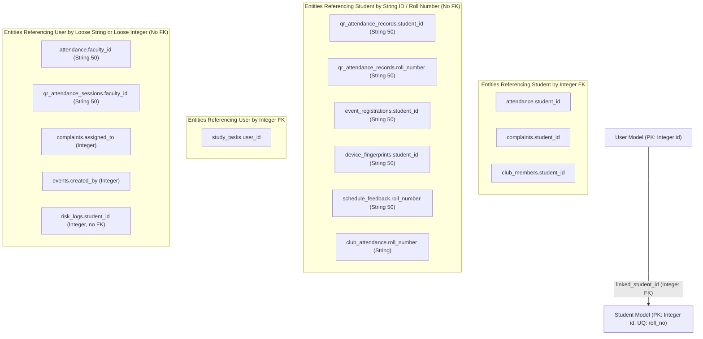
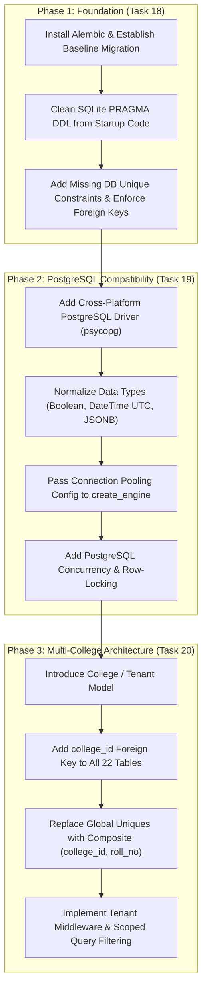

# TASK 17: DATABASE SECURITY, DATA INTEGRITY & MULTI-COLLEGE ARCHITECTURE AUDIT REPORT

**Audit Date**: November 1, 2026  
**Auditor**: Antigravity Database Architecture & Security Specialist  
**Repository**: `C:\Users\ruetk\OneDrive\Desktop\Campus-Automation-System\MARVEL-main`  
**Branch**: `main`  
**Commit**: `fab3926a1d3297b4a61cfc1ac8d64130fb9ff6f0`  
**Audit Scope**: Read-Only Architecture, Data Integrity, Concurrency, Security, Compatibility & Multi-Tenancy Review  

---

## 1. Executive Summary

A comprehensive architectural and security audit of the Campus Automation System (MARVEL) database tier was conducted. The application currently targets **SQLite** (`campus_automation.db` in development/production and in-memory `sqlite://` for testing) via **SQLAlchemy 2.0+** ORM.

### Verdict on Multi-College Platform Readiness
**VERDICT: NOT READY FOR MULTI-COLLEGE DEPLOYMENT.**  
The current database architecture is strictly single-tenant. There is **zero tenant isolation**:
- No `College` or `Institution` model exists.
- No `college_id` column exists on any table.
- **Fatal Constraint Collision**: `Student.roll_no` carries a global database `UNIQUE` constraint (`unique=True`). If two independent colleges share this database, they cannot both enroll a student with roll number `21BCS101` or `2024CS001`.
- `Club.name` carries a global database `UNIQUE` constraint (`unique=True`), preventing two colleges from both operating a "Coding Club" or "Robotics Club".
- Every query executed by administrative and faculty roles accesses institutional records without institutional namespace filtering. If multiple colleges shared the database today, any faculty member or staff user could inspect student rosters, academic risk logs, and attendance across all colleges.

### Verdict on PostgreSQL Compatibility
**VERDICT: PARTIALLY COMPATIBLE (NOT PRODUCTION-READY FOR POSTGRESQL).**  
While the application utilizes SQLAlchemy ORM, production startup and migrations rely on procedural `PRAGMA table_info(...)` queries inside `backend/seed_data.py::ensure_schema()`, which are SQLite-specific and fail immediately under PostgreSQL. Additionally, `requirements.txt` explicitly disables the PostgreSQL database driver (`psycopg2-binary`) on Windows systems (`platform_system != "Windows"`).

### Summary of Audit Findings
- **Total ORM Models Inspected**: 22 distinct SQLAlchemy models across 11 model files.
- **Total Database-Level Foreign Keys**: 13 enforced foreign keys (with 18 missing foreign keys across core entities).
- **Total Database-Level Relationships**: 9 bidirectional ORM relationships.
- **Findings Breakdown**:
  - **Critical**: 4
  - **High**: 4
  - **Medium**: 5
  - **Low / Informational**: 3
  - **Total Identified Findings**: 16

---

## 2. Existing Database Architecture & Connection Flow

### Database Technology Stack
- **Database Engine**: SQLite 3.x (file-based: `campus_automation.db`, test: `sqlite://`)
- **ORM**: SQLAlchemy 2.0.35+
- **Driver**: Python built-in `sqlite3` DBAPI module
- **Session Management**: Thread-local `SessionLocal = sessionmaker(autocommit=False, autoflush=False, bind=engine)`
- **Configuration**: Pydantic BaseSettings in `backend/core/config.py`

### Connection Flow
```
[HTTP Request]
       │
       ▼
[FastAPI Dependency: get_db()] (backend/database.py)
       │
       ├─► db = SessionLocal() ──► Engine (create_engine)
       │                              │
       │                              ▼
       │                    @event.listens_for(Engine, "connect")
       │                    executes: PRAGMA foreign_keys=ON (sqlite3 only)
       │
       ├─► yield db ──► Route Handler Execution (e.g. backend/routes/*.py)
       │
       ├─► On Exception: db.rollback() -> re-raises
       │
       └─► Finally: db.close()
```

### Connection & Session Lifecycle Analysis
1. **Engine Initialization** ([`backend/database.py`](file:///C:/Users/ruetk/OneDrive/Desktop/Campus-Automation-System/MARVEL-main/backend/database.py#L29-L33)):
   ```python
   connect_args = {}
   if "sqlite" in DATABASE_URL:
       connect_args = {"check_same_thread": False}

   engine = create_engine(
       DATABASE_URL,
       connect_args=connect_args,
       echo=settings.DB_ECHO and settings.is_development
   )
   ```
2. **SQLite Foreign Key Pragmas** ([`backend/database.py`](file:///C:/Users/ruetk/OneDrive/Desktop/Campus-Automation-System/MARVEL-main/backend/database.py#L22-L27)):
   SQLite does not enforce foreign keys by default. The application correctly attaches an engine connection listener:
   ```python
   @event.listens_for(Engine, "connect")
   def set_sqlite_pragma(dbapi_connection, connection_record):
       if isinstance(dbapi_connection, sqlite3.Connection):
           cursor = dbapi_connection.cursor()
           cursor.execute("PRAGMA foreign_keys=ON")
           cursor.close()
   ```
3. **Session Pooling Limitation**:
   `backend/core/config.py` defines `DB_POOL_SIZE = 5` and `DB_MAX_OVERFLOW = 10`, but these settings are **never passed to `create_engine()`**. When running SQLite with `connect_args={"check_same_thread": False}`, SQLAlchemy defaults to `NullPool` or `QueuePool` with standard defaults rather than the configured application parameters.
4. **Schema Initialization & Seeding Flow**:
   - In [`backend/main.py`](file:///C:/Users/ruetk/OneDrive/Desktop/Campus-Automation-System/MARVEL-main/backend/main.py#L43): `student.Base.metadata.create_all(bind=engine)` executes during module loading.
   - During `startup_event()` ([`backend/main.py`](file:///C:/Users/ruetk/OneDrive/Desktop/Campus-Automation-System/MARVEL-main/backend/main.py#L97-L109)): `backend.seed_data::ensure_schema()` runs procedural migrations and adds missing columns/indexes.

---

## 3. Complete Database Model Inventory

The application defines **22 SQLAlchemy ORM models** inheriting from `declarative_base()`.

| # | Model Name | Table Name | Primary Key | Foreign Keys (DB Level) | Relationships | Unique Constraints & Indexes | Sensitive Fields | Ownership Entity | Integrity & Schema Concerns |
|---|---|---|---|---|---|---|---|---|---|
| 1 | `User` | `users` | `id` (Integer) | `linked_student_id` -> `students.id` | `student` -> `Student` (backref `user_account`) | `username` (UQ, IDX), `email` (UQ, IDX), `id` (IDX) | `hashed_password`, `email`, `full_name`, `avatar`, `last_login` | Authentication Account | `linked_student_id` lacks unique constraint (allows duplicate student binding); `role` is unvalidated `String(20)`. |
| 2 | `Student` | `students` | `id` (Integer) | None | Backref `user_account` | `roll_no` (UQ), `id` (IDX) | `name`, `roll_no`, `department`, `semester`, `section` | Academic Student Record | `roll_no` global uniqueness breaks multi-tenancy; no `college_id`; un-normalized department/section strings. |
| 3 | `Attendance` | `attendance` | `id` (Integer) | `student_id` -> `students.id` | None | `id` (IDX), `subject_code` (IDX), `faculty_id` (IDX) | Student attendance history | `Student` (`student_id`) | **No unique constraint on (student_id, date, subject_code)**; `faculty_id` is plain `String(50)` with no FK to `users.id`. |
| 4 | `Complaint` | `complaints` | `id` (Integer) | `student_id` -> `students.id` | `history` -> `ComplaintHistory` (cascade all, delete-orphan) | `id` (IDX) | Complaint grievances, student PII | `Student` (`student_id`) | `assigned_to` (`Integer`) has no FK to `users.id`; status/category/priority are unvalidated strings. |
| 5 | `ComplaintHistory` | `complaint_history` | `id` (Integer) | `complaint_id` -> `complaints.id` (ON DELETE CASCADE) | `complaint` -> `Complaint` | `id` (IDX), `complaint_id` (IDX) | Investigation remarks | `Complaint` (`complaint_id`) | `changed_by_user_id` has no FK to `users.id`; no relationship to `User`. |
| 6 | `Schedule` | `schedules` | `id` (Integer) | None | None | `id` (IDX) | Institutional schedule data | Institutional | No FK to department or college; `is_active` stored as `Integer` (0/1); no unique constraint on time/venue. |
| 7 | `ScheduleFeedback` | `schedule_feedback` | `id` (Integer) | None | None | `id` (IDX) | Student grievance comments | Student (`roll_number`) | **Missing FK to `students` table**; `name` and `roll_number` are loose unvalidated strings; disconnected from auth. |
| 8 | `Announcement` | `announcements` | `id` (Integer) | None | None | `id` (IDX) | Campus notices | Faculty Author | `author` is loose string `String(100)` with no FK to `users.id`; `is_active` stored as `Integer`. |
| 9 | `Event` | `events` | `id` (Integer) | None | `registrations`, `leaderboard`, `announcements` | `id` (IDX), `name` (IDX), `category` (IDX) | Financial entry fee, prizes | Organizer / Institutional | `created_by` has no FK to `users.id`; unconstrained participant counter prone to race conditions. |
| 10 | `EventRegistration` | `event_registrations` | `id` (Integer) | `event_id` -> `events.id` (ON DELETE CASCADE) | `event` -> `Event` | `uq_event_student_reg` (`event_id`, `student_id`), `id` (IDX), `student_id` (IDX) | Phone number, emergency contact, team data | `Student` (`student_id`) | **`student_id` is `String(50)` with NO foreign key to `students.id` (`Integer`)**; `approved_by` has no FK. |
| 11 | `EventLeaderboard` | `event_leaderboard` | `id` (Integer) | `event_id` -> `events.id` (ON DELETE CASCADE) | `event` -> `Event` | `id` (IDX) | Participant scores, ranks, awards | Participant (`participant_id`) | `participant_id` has no FK; no unique constraint on `(event_id, participant_id)`. |
| 12 | `EventAnnouncement` | `event_announcements` | `id` (Integer) | `event_id` -> `events.id` (ON DELETE CASCADE) | `event` -> `Event` | `id` (IDX) | Event updates | Event Organizer | `created_by` has no FK to `users.id`. |
| 13 | `Club` | `clubs` | `id` (Integer) | None | `activities`, `members` | `name` (UQ), `id` (IDX) | Financial fees, contact details | Club Leadership / Advisor | **`name` is globally unique (breaks multi-tenancy)**; `created_by` has no FK to `users.id`. |
| 14 | `ClubActivity` | `club_activities` | `id` (Integer) | `club_id` -> `clubs.id` | `club` -> `Club` | `id` (IDX) | Club events and budgets | `Club` (`club_id`) | Missing database-level ON DELETE CASCADE; participant counts prone to race drift. |
| 15 | `ClubMember` | `club_members` | `id` (Integer) | `club_id` -> `clubs.id`, `student_id` -> `students.id` | `club` -> `Club` | `uq_club_student_member` (`club_id`, `student_id`), `id` (IDX) | Club membership roster | `Student` (`student_id`) | Missing relationship to `Student`; relies on procedural duplicate purge on startup. |
| 16 | `ClubAttendance` | `club_attendance` | `id` (Integer) | `club_id` -> `clubs.id` | None (relationship commented out) | `id` (IDX) | Attendance records | `Club` (`club_id`) | **Missing FK to `students` table** (`student_name` and `roll_number` are loose strings); no unique constraint on date. |
| 17 | `QRAttendanceSession` | `qr_attendance_sessions` | `id` (Integer) | None | `attendance_records` (cascade all, delete-orphan) | `session_id` (UQ, IDX), `id` (IDX), `faculty_id` (IDX) | Encrypted QR data, SHA-256 hash, GPS coordinates | Faculty Host | `faculty_id` is loose string `String(50)` with no FK to `users.id`; GPS coordinates stored in plain text. |
| 18 | `QRAttendanceRecord` | `qr_attendance_records` | `id` (Integer) | `session_id` -> `qr_attendance_sessions.id` (ON DELETE CASCADE) | `session` -> `QRAttendanceSession` | `uq_session_roll` (`session_id`, `roll_number`), `id` (IDX), `student_id` (IDX), `roll_number` (IDX) | Geolocation GPS coordinates, device IDs, IP address, user agent | `Student` (`student_id`) | **`student_id` is `String(50)` with NO foreign key to `students.id` (`Integer`)**; sensitive GPS and IP stored unencrypted. |
| 19 | `QRAttendanceLog` | `qr_attendance_logs` | `id` (Integer) | None | None | `id` (IDX), `session_id` (IDX), `student_id` (IDX) | Failure reasons, GPS coordinates, IP address | Audit Log | **Missing FKs to both `qr_attendance_sessions` and `students`**; `session_id` and `student_id` are unverified. |
| 20 | `DeviceFingerprint` | `device_fingerprints` | `id` (Integer) | None | None | `device_id` (UQ, IDX), `id` (IDX), `student_id` (IDX) | Device model, OS, browser, resolution | Hardware Device | **Missing FK to `students` table**; `student_id` is plain string with no relational integrity. |
| 21 | `RiskLog` | `risk_logs` | `id` (Integer) | None | None | `id` (IDX) | Academic, behavioral, and health risk logs | Student (`student_id`) | **Missing FK to `students.id`** (`student_id` is loose nullable Integer); `resolved` stored as Integer. |
| 22 | `StudyTask` | `study_tasks` | `id` (Integer) | `user_id` -> `users.id` (ON DELETE CASCADE) | `user` -> `User` (backref `study_tasks`) | `id` (IDX), `user_id` (IDX) | Student study schedule and habits | `User` (`user_id`) | Inconsistent ownership model (links to `User.id` instead of `Student.id`). |

---

## 4. Foreign Key and Data Integrity Audit

### Enforced Database Foreign Keys (13 Total)
1. `users.linked_student_id` $\to$ `students.id`
2. `attendance.student_id` $\to$ `students.id`
3. `complaints.student_id` $\to$ `students.id`
4. `complaint_history.complaint_id` $\to$ `complaints.id` (`ON DELETE CASCADE`)
5. `club_activities.club_id` $\to$ `clubs.id`
6. `club_members.club_id` $\to$ `clubs.id`
7. `club_members.student_id` $\to$ `students.id`
8. `club_attendance.club_id` $\to$ `clubs.id`
9. `event_registrations.event_id` $\to$ `events.id` (`ON DELETE CASCADE`)
10. `event_leaderboard.event_id` $\to$ `events.id` (`ON DELETE CASCADE`)
11. `event_announcements.event_id` $\to$ `events.id` (`ON DELETE CASCADE`)
12. `qr_attendance_records.session_id` $\to$ `qr_attendance_sessions.id` (`ON DELETE CASCADE`)
13. `study_tasks.user_id` $\to$ `users.id` (`ON DELETE CASCADE`)

### Missing Foreign Keys & Relational Gaps (18 Total)
The application relies extensively on application-level integrity rather than database foreign keys:
1. **`qr_attendance_records.student_id`**: Stored as `String(50)`. Has NO foreign key to `students.id`.
2. **`qr_attendance_records.roll_number`**: Stored as `String(50)`. Has NO foreign key to `students.roll_no`.
3. **`qr_attendance_logs.session_id`**: Stored as `Integer`. Has NO foreign key to `qr_attendance_sessions.id`.
4. **`qr_attendance_logs.student_id`**: Stored as `String(50)`. Has NO foreign key to `students.id`.
5. **`device_fingerprints.student_id`**: Stored as `String(50)`. Has NO foreign key to `students.id`.
6. **`qr_attendance_sessions.faculty_id`**: Stored as `String(50)`. Has NO foreign key to `users.id`.
7. **`attendance.faculty_id`**: Stored as `String(50)`. Has NO foreign key to `users.id`.
8. **`complaints.assigned_to`**: Stored as `Integer`. Has NO foreign key to `users.id`.
9. **`complaint_history.changed_by_user_id`**: Stored as `Integer`. Has NO foreign key to `users.id`.
10. **`event_registrations.student_id`**: Stored as `String(50)`. Has NO foreign key to `students.id`.
11. **`event_registrations.approved_by`**: Stored as `Integer`. Has NO foreign key to `users.id`.
12. **`events.created_by`**: Stored as `Integer`. Has NO foreign key to `users.id`.
13. **`event_announcements.created_by`**: Stored as `Integer`. Has NO foreign key to `users.id`.
14. **`clubs.created_by`**: Stored as `Integer`. Has NO foreign key to `users.id`.
15. **`club_attendance.student_name` & `roll_number`**: Stored as loose strings. Has NO foreign key to `students` table.
16. **`risk_logs.student_id`**: Stored as nullable `Integer`. Has NO foreign key to `students.id`.
17. **`schedule_feedback.name` & `roll_number`**: Stored as loose strings. Has NO foreign key to `students` table.
18. **`announcements.author`**: Stored as `String(100)`. Has NO foreign key to `users.id`.

### Impact of Missing Foreign Keys: Orphan Records
Because these tables lack database foreign keys and cascades:
- If a student is deleted (`DELETE FROM students WHERE id = X`), their records in `qr_attendance_records`, `event_registrations`, `risk_logs`, `club_attendance`, and `schedule_feedback` **remain orphaned in the database permanently**.
- If a user/staff account is deleted, complaints assigned to them and audit records in `complaint_history` reference non-existent users.

---

## 5. Inconsistent Entity Identifier Patterns

The schema suffers from widespread inconsistency in how student and user identities are referenced:



### Identifier Discrepancy Matrix
1. **Academic vs. Auth Entity Collision**:
   - `StudyTask` links to `users.id`.
   - `Attendance` links to `students.id`.
   - `QRAttendanceRecord` accepts either `student.id` or `student.roll_no` stored as a string in `student_id`.
2. **Type Discrepancy**:
   - `students.id` is `Integer`.
   - `qr_attendance_records.student_id` is `String(50)`.
   - `event_registrations.student_id` is `String(50)`.
   Joining these tables requires explicit type casting in PostgreSQL (`students.id::text = event_registrations.student_id`), preventing efficient B-tree index lookups without expression indexes.

---

## 6. Multi-College / Tenant Isolation Readiness

### Detailed Tenant Isolation Investigation

#### 1. Does a College or Institution model exist?
**NO.** There is no `College`, `Campus`, `University`, or `Tenant` model anywhere in the repository.

#### 2. Is there a `college_id` or equivalent tenant identifier?
**NO.** Not a single table in the schema includes a `college_id`, `institution_id`, or `tenant_id` column.

#### 3. Are students associated with a specific college?
**NO.** `Student` defines only `name`, `roll_no`, `department`, `semester`, and `section`.

#### 4. Are faculty associated with a specific college?
**NO.** `User` defines only `role` (`student`, `faculty`, `staff`, `admin`).

#### 5. Are departments and sections college-specific?
**NO.** Department and section values are plain un-normalized strings (`"Computer Science Engineering"`, `"A"`). Two colleges offering "Computer Science Engineering" share the exact same string value.

#### 6. Are schedules isolated by institution?
**NO.** `Schedule.audience` is an un-normalized string. Any query for active schedules returns all schedules across the entire database.

#### 7. Are attendance records isolated by institution?
**NO.** Attendance records link to `student_id` without institutional scoping.

#### 8. Are clubs, events, complaints, and academic risk records isolated?
**NO.**
- `Club.name` has a global `unique=True` constraint.
- `Event` has no tenant scope.
- `Complaint` has no tenant scope.
- `RiskLog` has no tenant scope.

#### 9. Can an authenticated user access records belonging to another college?
**YES.**
- Faculty users querying `GET /students/` or `GET /dashboard/risks/students` receive all students matching department criteria across the entire database.
- A student from College A can query schedules, public events, clubs, announcements, and faculty lists from College B.

#### 10. Are database queries consistently scoped by ownership?
Only at the individual student self-ownership level (`student_id == current_user.linked_student_id`). Faculty, staff, and admin queries have no tenant boundaries.

#### 11. Do foreign keys enforce relationships within the same institution?
**NO.** Foreign keys cannot enforce tenant boundaries because tenant columns do not exist.

#### 12. Could two colleges have overlapping student roll numbers safely?
**NO (FATAL CONFLICT).**
In [`backend/models/student.py`](file:///C:/Users/ruetk/OneDrive/Desktop/Campus-Automation-System/MARVEL-main/backend/models/student.py#L10):
```python
roll_no = Column(String, unique=True, nullable=False)
```
Because `roll_no` has a global `unique=True` constraint, if College 1 registers student `21BCS101`, College 2 **cannot register any student with roll number `21BCS101`**. Attempting to do so triggers `sqlite3.IntegrityError: UNIQUE constraint failed: students.roll_no`.

### Tenant Isolation Matrix

| Module | Tenant Identifier | Query-Level Isolation | Database-Level Isolation | Multi-College Risk Level | Failure Mode if Multi-College Enabled Today |
|---|---|---|---|---|---|
| **Students** | None | None | None | **CRITICAL** | Global `roll_no` uniqueness collision; cross-college student listing by faculty. |
| **Attendance** | None | None | None | **CRITICAL** | Cross-college attendance tracking; faculty can record attendance for students of other colleges. |
| **QR Attendance** | None | None | None | **CRITICAL** | QR sessions visible to all faculty; cross-college proxy scanning possible if GPS boundaries overlap. |
| **Complaints** | None | None | None | **HIGH** | Staff see complaints across all institutions; sensitive disciplinary leaks. |
| **Schedules** | None | None | None | **HIGH** | Exam and holiday schedules conflated across different university calendars. |
| **Clubs** | None | None | None | **CRITICAL** | Global `name` uniqueness collision; students joining clubs from other institutions. |
| **Events** | None | None | None | **HIGH** | Cross-institutional registrations; budget and fee accounting mingled. |
| **Academic Risk** | None | None | None | **HIGH** | Student risk profiles exposed across institutions. |
| **Study Tasks** | None | User-owned | User FK only | **MEDIUM** | Private to `user_id`, but user accounts are un-scoped by institution. |
| **Analytics** | None | None | None | **HIGH** | Institutional metrics, heatmaps, and drop-out trends aggregated across all colleges. |
| **AI / RAG** | None | None | None | **HIGH** | RAG knowledge base answers queries using institutional data from all colleges. |

---

## 7. Transaction and Concurrency Safety

### 1. High-Risk TOCTOU Race Condition on Event Registrations
In [`backend/routes/events.py`](file:///C:/Users/ruetk/OneDrive/Desktop/Campus-Automation-System/MARVEL-main/backend/routes/events.py#L336-L404):
```python
# Check if event is full
if event.is_full():
    raise HTTPException(status_code=400, detail="Event has reached maximum capacity")
...
new_registration = EventRegistration(**reg_dict)
db.add(new_registration)
event.current_participants += 1
db.commit()
```
- **Vulnerability**: Time-of-check to time-of-use (TOCTOU) race condition.
- **Root Cause**: The application checks `event.is_full()` in application memory without row-level locking (`with_for_update()`) or an atomic database check constraint (`CHECK (current_participants <= max_participants)`).
- **Impact**: Two or more concurrent registration requests for the last remaining seat will both evaluate `is_full() == False`, increment `current_participants`, and commit. The event becomes **over-subscribed**, violating capacity limits.

### 2. Denormalized Counter Drift in Club Membership
In [`backend/routes/clubs.py`](file:///C:/Users/ruetk/OneDrive/Desktop/Campus-Automation-System/MARVEL-main/backend/routes/clubs.py#L448-L454):
```python
club.member_count = (
    db.query(ClubMember)
    .filter(ClubMember.club_id == club_id, ClubMember.is_active == True)
    .count()
    + 1
)
db.commit()
```
- Denormalized counters (`Club.member_count`, `Event.current_participants`) are calculated and written back via non-atomic application logic.
- Concurrent joins, leaves, or cancellations cause the stored counter to drift out of sync with actual rows in `club_members`.

### 3. Missing Database-Level Unique Constraint in General Attendance
In [`backend/routes/attendance.py`](file:///C:/Users/ruetk/OneDrive/Desktop/Campus-Automation-System/MARVEL-main/backend/routes/attendance.py#L43-L68):
- The duplicate check queries:
  ```python
  existing = db.query(Attendance).filter(...).first()
  if existing: raise HTTPException(...)
  db.add(new_attendance)
  db.commit()
  ```
- Because the `attendance` table **lacks a database UNIQUE constraint on `(student_id, date, subject_code)`**, simultaneous requests can both pass the `existing` check and insert duplicate attendance records for the same student on the same day.
- Contrast with `qr_attendance_records`, which properly enforces `UniqueConstraint("session_id", "roll_number")` and handles `IntegrityError`.

### 4. Inconsistent Route-Level Transaction Rollback
- In `backend/routes/clubs.py`, `backend/routes/events.py`, and `backend/routes/qr_attendance.py`, `db.commit()` is wrapped in `try...except IntegrityError: db.rollback()`.
- However, in `attendance.py`, `auth.py`, `complaint.py`, `risk.py`, `schedule.py`, `students.py`, and `study_task.py`, `db.commit()` is called **without** a route-level `try...except` or explicit `db.rollback()`.
- While `get_db()` rolls back when an unhandled exception exits the generator, any partial state flushed prior to the error leaves the session un-clean until request termination, returning a generic 500 error instead of a structured client error.

### 5. SQLite File Locking Under Concurrency
- SQLite uses database-level locking for writes. Only one write transaction can execute at a time.
- Under high concurrency (e.g. 500 students scanning QR codes simultaneously at the start of a lecture period), SQLite encounters `sqlite3.OperationalError: database is locked`.

---

## 8. SQLite and PostgreSQL Compatibility Assessment

| Compatibility Dimension | Current SQLite Implementation | PostgreSQL Compatibility Status | Required Remediation for PostgreSQL |
|---|---|---|---|
| **Database Driver** | Python built-in `sqlite3` | **Incompatible on Windows** (`requirements.txt` excludes `psycopg2-binary` on Windows). | Add `psycopg[binary]>=3.1` or `asyncpg` without platform restriction. |
| **Connection Pooling** | `connect_args={"check_same_thread": False}` | **Incomplete**. Configured `DB_POOL_SIZE` and `DB_MAX_OVERFLOW` are ignored. | Pass pooling arguments (`pool_size`, `max_overflow`, `pool_pre_ping=True`) to `create_engine`. |
| **Schema Initialization** | `PRAGMA table_info(...)` in `seed_data.py::ensure_schema()` | **Broken**. `PRAGMA table_info` raises syntax error in PostgreSQL. | Replace PRAGMA queries with Alembic migrations or SQLAlchemy `inspect(engine)`. |
| **Enums** | SQLite stores strings or CHECK constraints. | **Schema Conflict Risk**. `SQLEnum(EventCategory)` attempts to create native PostgreSQL `ENUM` types. | Use `create_type=False` or manage enum types via Alembic migrations. |
| **Boolean Types** | Mixed: `Boolean` in some models, `Integer` (0/1) in `schedules`, `announcements`, `risk_logs`. | **Type Mismatch**. PostgreSQL enforces strict boolean types. | Standardize all boolean columns to `Boolean(create_constraint=True)`. |
| **Datetime Handling** | SQLite stores timestamps as text; `func.now()` or `datetime.utcnow`. | **Timezone Drift**. Mixed `DateTime` and `DateTime(timezone=True)`. | Standardize all timestamp columns on `DateTime(timezone=True)` with UTC. |
| **JSON Storage** | Stored as plain `Text` and serialized with `json.dumps()`. | **Functional Limitation**. Lacks PostgreSQL JSONB indexing and query capabilities. | Migrate JSON text columns to SQLAlchemy `JSON` / `JSONB`. |
| **Primary Keys / Sequences** | `Column(Integer, primary_key=True)` (SQLite `rowid`). | **Compatible**. SQLAlchemy maps this to `SERIAL` / `IDENTITY`. | Ensure sequence ownership is preserved during table creation. |
| **Foreign Key Enforcement** | Requires `PRAGMA foreign_keys=ON` on connection. | **Fully Supported**. PostgreSQL enforces foreign keys natively. | Remove SQLite PRAGMA listener for non-SQLite connections. |

---

## 9. Database Security and Privacy Findings

### 1. Password Hashing Security
- **Verified Implementation**: Passwords are hashed using **Argon2id** (`pwd_context = CryptContext(schemes=["argon2"], deprecated="auto", argon2__memory_cost=65536)`) in [`backend/core/auth.py`](file:///C:/Users/ruetk/OneDrive/Desktop/Campus-Automation-System/MARVEL-main/backend/core/auth.py#L22).
- Hashes are stored in `users.hashed_password` (`String(255)`). Plaintext passwords are never stored.

### 2. Plaintext Geolocation and Device PII Storage
- `QRAttendanceRecord` and `DeviceFingerprint` store:
  - Exact student GPS coordinates (`student_latitude`, `student_longitude`)
  - Client IP addresses (`ip_address`)
  - Browser user agents (`user_agent`)
  - Unique hardware identifiers (`device_id`)
- **Finding**: All tracking telemetry is stored unencrypted in plain text. There is no automated data minimization or retention expiration policy (e.g. purging location telemetry after 90 days).

### 3. SQL Injection Analysis
- **Finding**: **No SQL injection vulnerabilities identified.**
- All 178 API endpoints use SQLAlchemy ORM parameterization (`db.query(...).filter(...)`).
- Raw SQL queries via `text(...)` are confined to:
  - `SELECT 1` in `health.py` (constant literal)
  - Hardcoded DDL/DML statements in `seed_data.py` (no user input interpolation)

### 4. Tracked Legacy SQLite Databases in Git
- **Finding**: Two legacy SQLite database files are committed directly in Git tracking history:
  - `SP0511---MAJOR-PROJECT--master/campusautomation_QR_attendence/database.db`
  - `SP0511---MAJOR-PROJECT--master/test.db`
- While modern active databases are excluded by `.gitignore` (`*.db`, `*.sqlite`), committing database binaries bloats repository history and risks leaking test or development records.

---

## 10. Migration and Backup Readiness

| Capability | Current State | Assessment | Production Risk |
|---|---|---|---|
| **Migration Framework** | None (No Alembic, no `alembic.ini`, no migration scripts) | **Absent** | **CRITICAL**. Schema modifications cannot be automated or versioned. |
| **Schema Evolution** | Ad-hoc procedural `ALTER TABLE` in `seed_data.py::ensure_schema()` | **Fragile** | **HIGH**. Fails on PostgreSQL; unable to drop columns, alter data types, or rollback. |
| **Database Versioning** | No `alembic_version` or schema version table | **Absent** | **HIGH**. Application has no mechanism to determine database schema version. |
| **Automated Backups** | No backup scripts, cron jobs, or database snapshot utilities | **Absent** | **CRITICAL**. Data loss is catastrophic if disk or file corruption occurs. |
| **Backup Restoration** | No documented or automated recovery procedure | **Absent** | **HIGH**. Recovery time objective (RTO) is undefined. |
| **Schema Downgrade** | Zero downgrade scripts | **Absent** | **MEDIUM**. Failed deployments cannot be safely rolled back at the database level. |

---

## 11. Database Test Coverage Review

### Inspection of Existing Test Infrastructure (`tests/`)
1. **In-Memory SQLite Test Fixture** ([`tests/conftest.py`](file:///C:/Users/ruetk/OneDrive/Desktop/Campus-Automation-System/MARVEL-main/tests/conftest.py#L14-L46)):
   - Tests execute against an ephemeral in-memory SQLite database (`"sqlite://"`, `StaticPool`).
   - Tables are created via `Base.metadata.create_all(bind=test_engine)`.
   - `ensure_schema()` is **not** executed in `conftest.py`.
2. **Coverage Classification**:
   - **Direct Database Tests**: 0 tests specifically assert database schema constraints, foreign key cascades, or trigger behaviors.
   - **Application-Level Tests**: 188 backend tests verify API endpoints, IDOR boundaries, role access, and QR verification logic.
   - **Concurrent Write Tests**: 0 tests execute parallel database transactions.
   - **PostgreSQL Compatibility Tests**: 0 tests execute against a PostgreSQL database.
   - **Rollback Tests**: Only `test_qr_security.py` verifies rollback on duplicate scan constraints.

---

## 12. Categorized Findings & Vulnerability Matrix

```
┌────────────────────────────────────────────────────────────────────────┐
│                        FINDINGS BY SEVERITY                            │
├───────────────────┬────────────────────────────────────────────────────┤
│  CRITICAL (4)     │ 1. Zero Tenant Isolation / Global Unique Collision │
│                   │ 2. Complete Absence of Database Migration Tool     │
│                   │ 3. Event Capacity TOCTOU Concurrency Race          │
│                   │ 4. PostgreSQL Incompatibility (PRAGMA DDL & Driver)│
├───────────────────┼────────────────────────────────────────────────────┤
│  HIGH (4)         │ 5. Missing Foreign Keys (18 Relations Across Core) │
│                   │ 6. Missing Unique Constraints (Attendance/Clubs)   │
│                   │ 7. Unencrypted Sensitive Geolocation Telemetry     │
│                   │ 8. Total Absence of Automated Backup/Recovery      │
├───────────────────┼────────────────────────────────────────────────────┤
│  MEDIUM (5)       │ 9. Denormalized Counter Concurrency Drift          │
│                   │ 10. Inconsistent Route-Level Transaction Rollback  │
│                   │ 11. Configured Connection Pool Settings Ignored    │
│                   │ 12. Inconsistent Boolean/Integer Column Types      │
│                   │ 13. Tracked Legacy SQLite Files in Git History     │
├───────────────────┼────────────────────────────────────────────────────┤
│  LOW / INFO (3)   │ 14. Missing B-Tree Indexes on Filtered Foreign Keys│
│                   │ 15. Unbounded Varchar Lengths Across SQLite Models │
│                   │ 16. In-Memory SQLite Masking Production Dialects   │
└───────────────────┴────────────────────────────────────────────────────┘
```

### Detailed Finding Descriptions

#### Finding 1 (CRITICAL): Zero Tenant Isolation & Global Unique Key Collision
- **File**: [`backend/models/student.py`](file:///C:/Users/ruetk/OneDrive/Desktop/Campus-Automation-System/MARVEL-main/backend/models/student.py#L10), [`backend/models/club.py`](file:///C:/Users/ruetk/OneDrive/Desktop/Campus-Automation-System/MARVEL-main/backend/models/club.py#L11)
- **Observed Behavior**: `Student.roll_no` and `Club.name` define `unique=True` globally. No `college_id` exists.
- **Why It Matters**: Prevents multiple colleges from using the platform. Two colleges cannot enroll students with the same roll number.
- **Remediation**: Introduce `College` model; add `college_id` foreign keys; replace global unique constraints with composite unique constraints `UniqueConstraint("college_id", "roll_no")` and `UniqueConstraint("college_id", "name")`.

#### Finding 2 (CRITICAL): Absence of Database Migration Framework
- **File**: [`backend/seed_data.py`](file:///C:/Users/ruetk/OneDrive/Desktop/Campus-Automation-System/MARVEL-main/backend/seed_data.py#L36-L132)
- **Observed Behavior**: Schema evolution is performed procedurally through custom `PRAGMA table_info` checks and raw `ALTER TABLE` statements on application startup.
- **Why It Matters**: Untracked, non-reproducible, lacks rollback capability, and crashes on PostgreSQL.
- **Remediation**: Initialize Alembic (`alembic init alembic`); generate baseline revision from SQLAlchemy models; remove procedural DDL from `seed_data.py`.

#### Finding 3 (CRITICAL): Event Capacity TOCTOU Race Condition
- **File**: [`backend/routes/events.py`](file:///C:/Users/ruetk/OneDrive/Desktop/Campus-Automation-System/MARVEL-main/backend/routes/events.py#L336-L404)
- **Observed Behavior**: `is_full()` check and `event.current_participants += 1` are executed without row-level locking or database constraints.
- **Why It Matters**: Concurrent registrations over-subscribe events beyond maximum capacity.
- **Remediation**: Use `db.query(Event).with_for_update().filter(...)` in PostgreSQL, or execute an atomic conditional update `UPDATE events SET current_participants = current_participants + 1 WHERE id = :id AND current_participants < max_participants`.

#### Finding 4 (CRITICAL): PostgreSQL Incompatibility via SQLite PRAGMAs & Missing Drivers
- **File**: [`backend/seed_data.py`](file:///C:/Users/ruetk/OneDrive/Desktop/Campus-Automation-System/MARVEL-main/backend/seed_data.py#L42), [`requirements.txt`](file:///C:/Users/ruetk/OneDrive/Desktop/Campus-Automation-System/MARVEL-main/requirements.txt#L9)
- **Observed Behavior**: `PRAGMA table_info` fails on PostgreSQL; `psycopg2-binary` is excluded on Windows.
- **Why It Matters**: Application fails to start or run migrations when connected to PostgreSQL.
- **Remediation**: Eliminate SQLite PRAGMAs from startup code; update dependencies to include cross-platform PostgreSQL drivers (`psycopg[binary]`).

#### Finding 5 (HIGH): 18 Missing Database Foreign Keys Across Core Entities
- **File**: [`backend/models/qr_attendance.py`](file:///C:/Users/ruetk/OneDrive/Desktop/Campus-Automation-System/MARVEL-main/backend/models/qr_attendance.py), [`backend/models/events.py`](file:///C:/Users/ruetk/OneDrive/Desktop/Campus-Automation-System/MARVEL-main/backend/models/events.py), [`backend/models/risk.py`](file:///C:/Users/ruetk/OneDrive/Desktop/Campus-Automation-System/MARVEL-main/backend/models/risk.py)
- **Observed Behavior**: `qr_attendance_records.student_id` is a `String(50)` with no FK; `event_registrations.student_id` is a `String(50)` with no FK; `risk_logs.student_id` is an unconstrained integer.
- **Why It Matters**: Orphan records accumulate indefinitely when parent records are deleted; joins require type casting.
- **Remediation**: Normalize all student references to `Integer ForeignKey("students.id", ondelete="CASCADE")`.

#### Finding 6 (HIGH): Missing Database Unique Constraints on Attendance and Clubs
- **File**: [`backend/models/attendance.py`](file:///C:/Users/ruetk/OneDrive/Desktop/Campus-Automation-System/MARVEL-main/backend/models/attendance.py), [`backend/models/club.py`](file:///C:/Users/ruetk/OneDrive/Desktop/Campus-Automation-System/MARVEL-main/backend/models/club.py#L94)
- **Observed Behavior**: `attendance` lacks unique constraints on `(student_id, date, subject_code)`; `club_attendance` lacks unique constraints on `(club_id, roll_number, attendance_date)`.
- **Why It Matters**: Concurrent attendance submissions insert duplicate records.
- **Remediation**: Add explicit composite `UniqueConstraint` on both tables.

#### Finding 7 (HIGH): Unencrypted Sensitive Telemetry at Rest
- **File**: [`backend/models/qr_attendance.py`](file:///C:/Users/ruetk/OneDrive/Desktop/Campus-Automation-System/MARVEL-main/backend/models/qr_attendance.py#L155-L168)
- **Observed Behavior**: High-precision GPS latitude/longitude, client IP addresses, and device fingerprints are stored in plain text.
- **Why It Matters**: Data privacy liability (FERPA, GDPR) in case of database leakage.
- **Remediation**: Truncate GPS coordinates to classroom precision; anonymize IP addresses after validation; introduce automated data retention policies.

#### Finding 8 (HIGH): Absence of Automated Database Backup and Recovery
- **File**: Repository infrastructure
- **Observed Behavior**: No backup scripts, dump commands, or recovery runbooks exist.
- **Why It Matters**: High risk of permanent data loss in case of hardware failure or SQLite corruption.
- **Remediation**: Implement automated backup scripts (`sqlite3 .dump` or `pg_dump`) with retention policies and test restoration procedures.

---

## 13. Recommended Implementation Roadmap (Task 18+)



### Phase 1: Database Integrity & Migration Readiness (Recommended Task 18)
1. **Adopt Alembic**:
   - Add `alembic>=1.13.0` to `requirements.txt`.
   - Run `alembic init alembic` and configure `env.py` to bind to `Base.metadata`.
   - Remove procedural `PRAGMA table_info` and `ALTER TABLE` blocks from [`backend/seed_data.py`](file:///C:/Users/ruetk/OneDrive/Desktop/Campus-Automation-System/MARVEL-main/backend/seed_data.py).
2. **Add Missing Foreign Keys & Unique Constraints**:
   - Add `UniqueConstraint("student_id", "date", "subject_code", name="uq_student_attendance_date")` on `attendance`.
   - Convert `qr_attendance_records.student_id` and `event_registrations.student_id` to `Integer ForeignKey("students.id", ondelete="CASCADE")`.
   - Add `ForeignKey("users.id")` to `complaints.assigned_to`, `events.created_by`, `clubs.created_by`, and `attendance.faculty_id`.
3. **Fix Race Conditions**:
   - Implement atomic updates or row locking for event registrations and club member counters.

### Phase 2: PostgreSQL Production Readiness (Recommended Task 19)
1. Update `requirements.txt` to include `psycopg[binary]>=3.1.18` across all platforms.
2. Wire `settings.DB_POOL_SIZE` and `settings.DB_MAX_OVERFLOW` into `create_engine()` in [`backend/database.py`](file:///C:/Users/ruetk/OneDrive/Desktop/Campus-Automation-System/MARVEL-main/backend/database.py).
3. Standardize `is_active` and `resolved` integer columns to native `Boolean`.
4. Implement automated backup scripts (`scripts/backup_db.py`) and test restore procedures.

### Phase 3: Multi-College / Tenant Architecture (Recommended Task 20)
1. Create `College` model:
   ```python
   class College(Base):
       __tablename__ = "colleges"
       id = Column(Integer, primary_key=True, index=True)
       code = Column(String(20), unique=True, nullable=False) # e.g. "STANFORD", "MIT"
       name = Column(String(200), nullable=False)
       domain = Column(String(100), unique=True, nullable=True)
       is_active = Column(Boolean, default=True)
       created_at = Column(DateTime, default=datetime.utcnow)
   ```
2. Add `college_id = Column(Integer, ForeignKey("colleges.id", ondelete="CASCADE"), nullable=False, index=True)` across all 22 domain tables.
3. Migrate `Student.roll_no` constraint from global `unique=True` to composite `UniqueConstraint("college_id", "roll_no", name="uq_college_roll_no")`.
4. Migrate `Club.name` constraint from global `unique=True` to composite `UniqueConstraint("college_id", "name", name="uq_college_club_name")`.
5. Implement FastAPI multi-tenant dependency / middleware to automatically inject and filter `college_id` on all authenticated and administrative queries.
