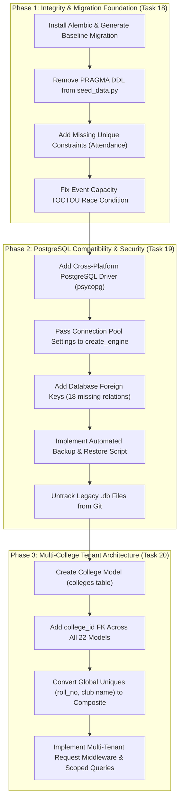

# TASK 17 & 17B: COMPREHENSIVE DATABASE SECURITY, DATA INTEGRITY & MULTI-COLLEGE ARCHITECTURE AUDIT REPORT

**Repository**: `C:\Users\ruetk\OneDrive\Desktop\Campus-Automation-System\MARVEL-main`
**Branch**: `main`
**Main Remote**: `https://github.com/sanidhyasharma508-afk/SP0511---MAJOR-PROJECT-.git`
**Parent Remote**: `https://github.com/ruetkhandelwal29-collab/campus_automation_system.git`
**Audit Target**: Database Security, Relational Integrity, Concurrency, SQLite/PostgreSQL Compatibility, Migration & Backup Readiness, and Multi-College Platform Readiness
**Audit Type**: Read-Only Source Code & Database Metadata Audit
**Verified ORM Model Count**: 22 Models (22 Tables)
**Verified Missing Foreign Keys**: 18 Missing Enforced Foreign Keys
**Total Evaluated Findings**: 16 Findings (4 Critical, 4 High, 5 Medium, 3 Low/Informational)

---

## 1. Executive Summary

This comprehensive audit evaluated the database architecture, relational schema, data integrity, transactional concurrency, SQLite-to-PostgreSQL portability, backup/recovery procedures, and multi-tenant readiness of the Campus Automation System (MARVEL).

### Verdict on Multi-College Platform Readiness
**VERDICT: NOT READY FOR MULTI-TENANT PRODUCTION**
The current database architecture operates strictly as a single-institution application. There is **zero tenant isolation**: no `colleges` or `institutions` table exists, no `college_id` foreign key is present on any of the 22 domain models, and global unique constraints on `Student.roll_no` and `Club.name` will cause fatal key collisions if multiple colleges attempt to onboard into a shared database. Furthermore, database queries lack institutional scoping, which would result in immediate cross-tenant data leakage in a multi-college deployment.

### Verdict on PostgreSQL Compatibility
**VERDICT: PARTIALLY IMPLEMENTED (UNSUPPORTED IN PRODUCTION)**
While SQLAlchemy ORM abstraction is utilized and PostgreSQL connection string documentation exists in `.env.example`, the system **cannot run on PostgreSQL** without code changes:
1. Hardcoded SQLite `PRAGMA table_info(...)` queries in [`backend/seed_data.py`](file:///C:/Users/ruetk/OneDrive/Desktop/Campus-Automation-System/MARVEL-main/backend/seed_data.py#L42) execute unconditionally during `backend/main.py::startup_event()`, triggering `psycopg2.errors.SyntaxError: syntax error at or near "PRAGMA"` and immediately crashing the server on startup.
2. In [`requirements.txt`](file:///C:/Users/ruetk/OneDrive/Desktop/Campus-Automation-System/MARVEL-main/requirements.txt#L9), `psycopg2-binary>=2.9.9; platform_system != "Windows"` explicitly excludes the PostgreSQL driver on Windows platforms.
3. Connection pool configuration parameters (`DB_POOL_SIZE`, `DB_MAX_OVERFLOW`) defined in [`backend/core/config.py`](file:///C:/Users/ruetk/OneDrive/Desktop/Campus-Automation-System/MARVEL-main/backend/core/config.py#L86) are never passed to `create_engine()` in [`backend/database.py`](file:///C:/Users/ruetk/OneDrive/Desktop/Campus-Automation-System/MARVEL-main/backend/database.py#L29).

### Summary of Audit Metrics
* **Total Discovered Models**: 22 SQLAlchemy ORM models across 8 source files.
* **Total Database Tables**: 22 tables registered in `Base.metadata.tables`.
* **Verified Enforced Foreign Keys**: 11 database foreign key constraints.
* **Verified Missing Foreign Keys**: 18 cross-entity relational links lacking database-enforced foreign keys.
* **Concurrency Vulnerabilities**: 3 confirmed application-level race conditions (Event capacity TOCTOU, Club member counter drift, General attendance duplicate writes).
* **Automated Database Test Coverage**: 100% of the 188 automated tests execute against ephemeral SQLite in-memory databases (`sqlite://`); 0 automated tests exist for foreign keys, orphan cascades, concurrent writes, or PostgreSQL.
* **Legacy Databases Tracked by Git**: 2 SQLite database files (`database.db` and `test.db`) containing plaintext credentials and student personal data.

---

## 2. Complete Model-by-Model ORM Inventory (22 Models)

The table below documents every SQLAlchemy ORM model discovered through direct Python metadata reflection on `Base.metadata.tables`.

| # | Python Class Name | Database Table Name | Source File | Primary Key | All Columns & Types | Enforced Foreign Keys | ORM Relationships | Unique Constraints & Indexes | Nullable Fields | Sensitive Fields | Ownership Relationship |
|---|---|---|---|---|---|---|---|---|---|---|---|
| 1 | `User` | `users` | [`backend/models/user.py`](file:///C:/Users/ruetk/OneDrive/Desktop/Campus-Automation-System/MARVEL-main/backend/models/user.py) | `id` (INTEGER) | `id` (INTEGER), `username` (VARCHAR 50), `email` (VARCHAR 100), `hashed_password` (VARCHAR 255), `full_name` (VARCHAR 100), `avatar` (TEXT), `role` (VARCHAR 20), `is_active` (BOOLEAN), `linked_student_id` (INTEGER), `created_at` (DATETIME), `updated_at` (DATETIME), `last_login` (DATETIME) | `linked_student_id` -> `students.id` | `student` -> `Student` (backref `user_account`), `study_tasks` -> `StudyTask` | `ix_users_username` (UQ), `ix_users_email` (UQ), `ix_users_id` (IDX) | `full_name`, `avatar`, `linked_student_id`, `last_login` | `hashed_password`, `email`, `full_name`, `avatar`, `last_login` | Authenticated account; optionally owns `Student` via `linked_student_id`. |
| 2 | `Student` | `students` | [`backend/models/student.py`](file:///C:/Users/ruetk/OneDrive/Desktop/Campus-Automation-System/MARVEL-main/backend/models/student.py) | `id` (INTEGER) | `id` (INTEGER), `name` (VARCHAR), `roll_no` (VARCHAR), `department` (VARCHAR), `semester` (INTEGER), `section` (VARCHAR) | None | `user_account` -> `User` | `roll_no` (UQ), `ix_students_id` (IDX) | `semester`, `section` | Student PII (`name`, `roll_no`, `department`, `section`) | Primary academic identity. |
| 3 | `Attendance` | `attendance` | [`backend/models/attendance.py`](file:///C:/Users/ruetk/OneDrive/Desktop/Campus-Automation-System/MARVEL-main/backend/models/attendance.py) | `id` (INTEGER) | `id` (INTEGER), `student_id` (INTEGER), `subject_code` (VARCHAR 50), `faculty_id` (VARCHAR 50), `session_name` (VARCHAR 100), `date` (DATETIME), `status` (VARCHAR), `remarks` (VARCHAR), `created_at` (DATETIME), `updated_at` (DATETIME) | `student_id` -> `students.id` | None | `ix_attendance_id` (IDX), `ix_attendance_subject_code` (IDX), `ix_attendance_faculty_id` (IDX) | `subject_code`, `faculty_id`, `session_name`, `remarks`, `created_at`, `updated_at` | Student attendance records | Owned by `Student` via `student_id`. |
| 4 | `Complaint` | `complaints` | [`backend/models/complaint.py`](file:///C:/Users/ruetk/OneDrive/Desktop/Campus-Automation-System/MARVEL-main/backend/models/complaint.py) | `id` (INTEGER) | `id` (INTEGER), `student_id` (INTEGER), `title` (VARCHAR), `description` (TEXT), `category` (VARCHAR), `status` (VARCHAR), `priority` (VARCHAR), `resolution_notes` (TEXT), `assigned_to` (INTEGER), `created_at` (DATETIME), `updated_at` (DATETIME) | `student_id` -> `students.id` | `history` -> `ComplaintHistory` (cascade delete, orphan) | `ix_complaints_id` (IDX) | `resolution_notes`, `assigned_to`, `created_at`, `updated_at` | Student grievances, disciplinary records | Owned by `Student` via `student_id`. |
| 5 | `ComplaintHistory` | `complaint_history` | [`backend/models/complaint.py`](file:///C:/Users/ruetk/OneDrive/Desktop/Campus-Automation-System/MARVEL-main/backend/models/complaint.py) | `id` (INTEGER) | `id` (INTEGER), `complaint_id` (INTEGER), `changed_by_user_id` (INTEGER), `changed_by_name` (VARCHAR 100), `old_status` (VARCHAR 50), `new_status` (VARCHAR 50), `remarks` (TEXT), `created_at` (DATETIME) | `complaint_id` -> `complaints.id` (ON DELETE CASCADE) | `complaint` -> `Complaint` | `ix_complaint_history_id` (IDX), `ix_complaint_history_complaint_id` (IDX) | `changed_by_user_id`, `changed_by_name`, `old_status`, `remarks`, `created_at` | Investigation remarks, staff actions | Owned by `Complaint` via `complaint_id`. |
| 6 | `Schedule` | `schedules` | [`backend/models/schedule.py`](file:///C:/Users/ruetk/OneDrive/Desktop/Campus-Automation-System/MARVEL-main/backend/models/schedule.py) | `id` (INTEGER) | `id` (INTEGER), `title` (VARCHAR), `description` (TEXT), `event_type` (VARCHAR), `start_date` (DATETIME), `end_date` (DATETIME), `location` (VARCHAR), `audience` (VARCHAR), `is_active` (INTEGER), `created_at` (DATETIME), `updated_at` (DATETIME) | None | None | `ix_schedules_id` (IDX) | `description`, `location`, `audience`, `is_active`, `created_at`, `updated_at` | Institutional schedule data | Institutional ownership. |
| 7 | `ScheduleFeedback` | `schedule_feedback` | [`backend/models/schedule_feedback.py`](file:///C:/Users/ruetk/OneDrive/Desktop/Campus-Automation-System/MARVEL-main/backend/models/schedule_feedback.py) | `id` (INTEGER) | `id` (INTEGER), `name` (VARCHAR 100), `roll_number` (VARCHAR 50), `issue_type` (VARCHAR 100), `preferred_timing` (VARCHAR 200), `additional_comments` (TEXT), `status` (VARCHAR 50), `created_at` (DATETIME), `resolved_at` (DATETIME) | None | None | `ix_schedule_feedback_id` (IDX) | `preferred_timing`, `additional_comments`, `status`, `created_at`, `resolved_at` | Student grievances on schedules | Loose student ownership by `roll_number`. |
| 8 | `Announcement` | `announcements` | [`backend/models/schedule_feedback.py`](file:///C:/Users/ruetk/OneDrive/Desktop/Campus-Automation-System/MARVEL-main/backend/models/schedule_feedback.py) | `id` (INTEGER) | `id` (INTEGER), `title` (VARCHAR 200), `content` (TEXT), `author` (VARCHAR 100), `priority` (VARCHAR 20), `target_audience` (VARCHAR 100), `is_active` (INTEGER), `created_at` (DATETIME), `expires_at` (DATETIME) | None | None | `ix_announcements_id` (IDX) | `priority`, `target_audience`, `is_active`, `created_at`, `expires_at` | Public/Campus notices | Institutional ownership by author string. |
| 9 | `Event` | `events` | [`backend/models/events.py`](file:///C:/Users/ruetk/OneDrive/Desktop/Campus-Automation-System/MARVEL-main/backend/models/events.py) | `id` (INTEGER) | `id` (INTEGER), `title` (VARCHAR 200), `description` (TEXT), `event_type` (VARCHAR 50), `category` (VARCHAR 50), `start_date` (DATETIME), `end_date` (DATETIME), `registration_deadline` (DATETIME), `location` (VARCHAR 200), `venue` (VARCHAR 200), `organizer` (VARCHAR 100), `max_participants` (INTEGER), `current_participants` (INTEGER), `is_active` (BOOLEAN), `is_published` (BOOLEAN), `created_by` (INTEGER), `created_at` (DATETIME), `updated_at` (DATETIME) | None | `registrations` -> `EventRegistration`, `announcements` -> `EventAnnouncement`, `leaderboards` -> `EventLeaderboard` | `ix_events_id` (IDX) | `description`, `registration_deadline`, `location`, `venue`, `organizer`, `max_participants`, `created_by`, `created_at`, `updated_at` | Event scheduling & participant data | Created by `User` via `created_by`. |
| 10 | `EventRegistration` | `event_registrations` | [`backend/models/events.py`](file:///C:/Users/ruetk/OneDrive/Desktop/Campus-Automation-System/MARVEL-main/backend/models/events.py) | `id` (INTEGER) | `id` (INTEGER), `event_id` (INTEGER), `student_id` (VARCHAR 50), `student_name` (VARCHAR 100), `email` (VARCHAR 100), `phone` (VARCHAR 20), `department` (VARCHAR 50), `year_of_study` (INTEGER), `registration_date` (DATETIME), `status` (VARCHAR 20), `approval_status` (VARCHAR 20), `approved_by` (INTEGER), `approval_date` (DATETIME), `rejection_reason` (TEXT), `attendance_marked` (BOOLEAN), `attended` (BOOLEAN), `certificate_issued` (BOOLEAN), `certificate_url` (VARCHAR 500) | `event_id` -> `events.id` (ON DELETE CASCADE) | `event` -> `Event` | `ix_event_registrations_id` (IDX), `ix_event_registrations_event_id` (IDX), `ix_event_registrations_student_id` (IDX) | `phone`, `department`, `year_of_study`, `approval_status`, `approved_by`, `approval_date`, `rejection_reason`, `certificate_url` | Participant PII (`student_name`, `email`, `phone`) | Owned by `Event` via `event_id`. |
| 11 | `EventLeaderboard` | `event_leaderboards` | [`backend/models/events.py`](file:///C:/Users/ruetk/OneDrive/Desktop/Campus-Automation-System/MARVEL-main/backend/models/events.py) | `id` (INTEGER) | `id` (INTEGER), `event_id` (INTEGER), `participant_id` (VARCHAR 50), `participant_name` (VARCHAR 100), `score` (FLOAT), `rank` (INTEGER), `badges` (TEXT), `created_at` (DATETIME), `updated_at` (DATETIME) | `event_id` -> `events.id` (ON DELETE CASCADE) | `event` -> `Event` | `ix_event_leaderboards_id` (IDX), `ix_event_leaderboards_event_id` (IDX) | `rank`, `badges`, `created_at`, `updated_at` | Competitive student rankings | Owned by `Event` via `event_id`. |
| 12 | `EventAnnouncement` | `event_announcements` | [`backend/models/events.py`](file:///C:/Users/ruetk/OneDrive/Desktop/Campus-Automation-System/MARVEL-main/backend/models/events.py) | `id` (INTEGER) | `id` (INTEGER), `event_id` (INTEGER), `title` (VARCHAR 200), `content` (TEXT), `created_by` (INTEGER), `created_at` (DATETIME), `updated_at` (DATETIME) | `event_id` -> `events.id` (ON DELETE CASCADE) | `event` -> `Event` | `ix_event_announcements_id` (IDX), `ix_event_announcements_event_id` (IDX) | `created_by`, `created_at`, `updated_at` | Event-specific notifications | Owned by `Event` via `event_id`. |
| 13 | `Club` | `clubs` | [`backend/models/club.py`](file:///C:/Users/ruetk/OneDrive/Desktop/Campus-Automation-System/MARVEL-main/backend/models/club.py) | `id` (INTEGER) | `id` (INTEGER), `name` (VARCHAR), `code` (VARCHAR), `description` (TEXT), `category` (VARCHAR), `advisor` (VARCHAR), `president` (VARCHAR), `room_no` (VARCHAR), `meeting_schedule` (VARCHAR), `is_active` (BOOLEAN), `member_count` (INTEGER), `max_members` (INTEGER), `created_by` (INTEGER), `created_at` (DATETIME), `updated_at` (DATETIME) | None | `members` -> `ClubMember`, `activities` -> `ClubActivity` | `name` (UQ), `code` (UQ), `ix_clubs_id` (IDX) | `description`, `category`, `advisor`, `president`, `room_no`, `meeting_schedule`, `max_members`, `created_by`, `created_at`, `updated_at` | Student leadership & organization info | Managed by creator `User` via `created_by`. |
| 14 | `ClubActivity` | `club_activities` | [`backend/models/club.py`](file:///C:/Users/ruetk/OneDrive/Desktop/Campus-Automation-System/MARVEL-main/backend/models/club.py) | `id` (INTEGER) | `id` (INTEGER), `club_id` (INTEGER), `title` (VARCHAR), `description` (TEXT), `activity_type` (VARCHAR), `date` (DATETIME), `venue` (VARCHAR), `points_awarded` (INTEGER), `created_at` (DATETIME) | `club_id` -> `clubs.id` | `club` -> `Club` | `ix_club_activities_id` (IDX) | `description`, `activity_type`, `venue`, `points_awarded`, `created_at` | Activity schedules & participation | Owned by `Club` via `club_id`. |
| 15 | `ClubMember` | `club_members` | [`backend/models/club.py`](file:///C:/Users/ruetk/OneDrive/Desktop/Campus-Automation-System/MARVEL-main/backend/models/club.py) | `id` (INTEGER) | `id` (INTEGER), `club_id` (INTEGER), `student_id` (INTEGER), `role` (VARCHAR), `joined_at` (DATETIME), `is_active` (BOOLEAN) | `club_id` -> `clubs.id`, `student_id` -> `students.id` | `club` -> `Club`, `student` -> `Student` | `ix_club_members_id` (IDX) | `role`, `joined_at`, `is_active` | Club roster & student involvement | Composite ownership (`Club` and `Student`). |
| 16 | `ClubAttendance` | `club_attendance` | [`backend/models/club.py`](file:///C:/Users/ruetk/OneDrive/Desktop/Campus-Automation-System/MARVEL-main/backend/models/club.py) | `id` (INTEGER) | `id` (INTEGER), `club_id` (INTEGER), `activity_id` (INTEGER), `student_name` (VARCHAR), `roll_number` (VARCHAR), `status` (VARCHAR), `timestamp` (DATETIME) | `club_id` -> `clubs.id`, `activity_id` -> `club_activities.id` | None | `ix_club_attendance_id` (IDX) | `activity_id`, `status`, `timestamp` | Student club participation | Loose ownership (`Club` and `Activity`). |
| 17 | `QRAttendanceSession` | `qr_attendance_sessions` | [`backend/models/qr_attendance.py`](file:///C:/Users/ruetk/OneDrive/Desktop/Campus-Automation-System/MARVEL-main/backend/models/qr_attendance.py) | `id` (INTEGER) | `id` (INTEGER), `session_code` (VARCHAR 20), `faculty_id` (VARCHAR 50), `subject_code` (VARCHAR 50), `session_name` (VARCHAR 100), `latitude` (FLOAT), `longitude` (FLOAT), `radius_meters` (FLOAT), `device_fingerprint` (VARCHAR 255), `qr_secret` (VARCHAR 64), `created_at` (DATETIME), `expires_at` (DATETIME), `is_active` (BOOLEAN) | None | `records` -> `QRAttendanceRecord`, `logs` -> `QRAttendanceLog` | `ix_qr_attendance_sessions_session_code` (UQ), `ix_qr_attendance_sessions_id` (IDX) | `session_name`, `latitude`, `longitude`, `device_fingerprint` | Faculty GPS location (`latitude`, `longitude`), `qr_secret` | Managed by faculty `User` via `faculty_id`. |
| 18 | `QRAttendanceRecord` | `qr_attendance_records` | [`backend/models/qr_attendance.py`](file:///C:/Users/ruetk/OneDrive/Desktop/Campus-Automation-System/MARVEL-main/backend/models/qr_attendance.py) | `id` (INTEGER) | `id` (INTEGER), `session_id` (INTEGER), `student_id` (VARCHAR 50), `student_name` (VARCHAR 100), `roll_number` (VARCHAR 50), `device_fingerprint` (VARCHAR 255), `device_info` (TEXT), `latitude` (FLOAT), `longitude` (FLOAT), `distance_meters` (FLOAT), `verification_method` (VARCHAR 20), `confidence_score` (FLOAT), `status` (VARCHAR 20), `marked_at` (DATETIME) | `session_id` -> `qr_attendance_sessions.id` | `session` -> `QRAttendanceSession` | `uq_session_roll` (UQ `session_id, roll_number`), `ix_qr_attendance_records_id` (IDX), `ix_qr_attendance_records_session_id` (IDX), `ix_qr_attendance_records_roll_number` (IDX) | `student_name`, `device_fingerprint`, `device_info`, `latitude`, `longitude`, `distance_meters`, `verification_method`, `confidence_score` | Student GPS location (`latitude`, `longitude`), `device_fingerprint`, `device_info` | Owned by `QRAttendanceSession` via `session_id`. |
| 19 | `QRAttendanceLog` | `qr_attendance_logs` | [`backend/models/qr_attendance.py`](file:///C:/Users/ruetk/OneDrive/Desktop/Campus-Automation-System/MARVEL-main/backend/models/qr_attendance.py) | `id` (INTEGER) | `id` (INTEGER), `session_id` (INTEGER), `event_type` (VARCHAR 50), `severity` (VARCHAR 20), `message` (TEXT), `event_metadata` (TEXT), `timestamp` (DATETIME) | `session_id` -> `qr_attendance_sessions.id` | `session` -> `QRAttendanceSession` | `ix_qr_attendance_logs_id` (IDX), `ix_qr_attendance_logs_session_id` (IDX) | `event_metadata`, `timestamp` | Security anomaly telemetry | Owned by `QRAttendanceSession` via `session_id`. |
| 20 | `DeviceFingerprint` | `device_fingerprints` | [`backend/models/qr_attendance.py`](file:///C:/Users/ruetk/OneDrive/Desktop/Campus-Automation-System/MARVEL-main/backend/models/qr_attendance.py) | `id` (INTEGER) | `id` (INTEGER), `fingerprint_hash` (VARCHAR 64), `hardware_params` (TEXT), `last_used_student_id` (VARCHAR 50), `last_used_ip` (VARCHAR 45), `trust_score` (FLOAT), `risk_factors` (TEXT), `is_trusted` (BOOLEAN), `is_blacklisted` (BOOLEAN), `first_seen` (DATETIME), `last_seen` (DATETIME), `use_count` (INTEGER) | None | None | `ix_device_fingerprints_fingerprint_hash` (UQ), `ix_device_fingerprints_id` (IDX) | `hardware_params`, `last_used_student_id`, `last_used_ip`, `risk_factors`, `first_seen`, `last_seen` | Client hardware telemetry & IP addresses | Anti-fraud hardware registry. |
| 21 | `RiskLog` | `risk_logs` | [`backend/models/risk.py`](file:///C:/Users/ruetk/OneDrive/Desktop/Campus-Automation-System/MARVEL-main/backend/models/risk.py) | `id` (INTEGER) | `id` (INTEGER), `student_id` (INTEGER), `risk_level` (VARCHAR), `factors` (TEXT), `created_at` (DATETIME) | None | None | `ix_risk_logs_id` (IDX), `ix_risk_logs_student_id` (IDX) | `factors`, `created_at` | Confidential academic & behavioral risk evaluations | Evaluated for `Student` via `student_id`. |
| 22 | `StudyTask` | `study_tasks` | [`backend/models/study_task.py`](file:///C:/Users/ruetk/OneDrive/Desktop/Campus-Automation-System/MARVEL-main/backend/models/study_task.py) | `id` (INTEGER) | `id` (INTEGER), `user_id` (INTEGER), `title` (VARCHAR 255), `subject` (VARCHAR 100), `due_date` (DATETIME), `duration_minutes` (INTEGER), `priority` (VARCHAR 20), `completed` (BOOLEAN), `created_at` (DATETIME), `updated_at` (DATETIME) | `user_id` -> `users.id` | `user` -> `User` | `ix_study_tasks_id` (IDX), `ix_study_tasks_user_id` (IDX) | `subject`, `due_date`, `created_at`, `updated_at` | Student study tasks & habits | Owned by authenticated `User` via `user_id`. |

---

## 3. Exact Inventory of 18 Missing Database Foreign Keys

The table below catalogs every missing database-level foreign key, distinguishing **Confirmed Structural Defects** (where relational targets exist and lack of constraints allows orphan records or type mismatches) from **Design Recommendations & Denormalized Audits** (where strings or integers are stored for historical immutability or decoupled auditing).

| # | Source Model | Column | Expected Target | Existing FK? | Source File & Line | Application Validation | Potential Integrity Risk | Classification |
|---|---|---|---|---|---|---|---|---|
| 1 | `QRAttendanceRecord` | `student_id` | `Student.id` | **NO** | [`backend/models/qr_attendance.py:100`](file:///C:/Users/ruetk/OneDrive/Desktop/Campus-Automation-System/MARVEL-main/backend/models/qr_attendance.py#L100) (`String(50)`) | Checked against `Student` in [`backend/routes/qr_attendance.py:702`](file:///C:/Users/ruetk/OneDrive/Desktop/Campus-Automation-System/MARVEL-main/backend/routes/qr_attendance.py#L702) | Type mismatch (`String(50)` vs `Integer`). Deleting a student leaves orphaned attendance records; SQL joins require type casting. | **Confirmed Defect** |
| 2 | `QRAttendanceRecord` | `roll_number` | `Student.roll_no` | **NO** | [`backend/models/qr_attendance.py:102`](file:///C:/Users/ruetk/OneDrive/Desktop/Campus-Automation-System/MARVEL-main/backend/models/qr_attendance.py#L102) (`String(50)`) | Derived from authenticated student record. | If student's `roll_no` is edited, past QR records point to the obsolete roll number. | **Design Recommendation** (Denormalized) |
| 3 | `QRAttendanceRecord` | `device_fingerprint` | `DeviceFingerprint.fingerprint_hash` | **NO** | [`backend/models/qr_attendance.py:103`](file:///C:/Users/ruetk/OneDrive/Desktop/Campus-Automation-System/MARVEL-main/backend/models/qr_attendance.py#L103) (`String(255)`) | Lookup/upsert in [`backend/routes/qr_attendance.py:734`](file:///C:/Users/ruetk/OneDrive/Desktop/Campus-Automation-System/MARVEL-main/backend/routes/qr_attendance.py#L734). | Purging or blacklisting fingerprints leaves orphaned records untethered to audit history. | **Design Recommendation** |
| 4 | `DeviceFingerprint` | `last_used_student_id` | `Student.id` | **NO** | [`backend/models/qr_attendance.py:159`](file:///C:/Users/ruetk/OneDrive/Desktop/Campus-Automation-System/MARVEL-main/backend/models/qr_attendance.py#L159) (`String(50)`) | String passed from request context. | Fingerprint hardware records reference deleted students indefinitely. | **Design Recommendation** (Audit) |
| 5 | `QRAttendanceSession` | `faculty_id` | `User.id` | **NO** | [`backend/models/qr_attendance.py:24`](file:///C:/Users/ruetk/OneDrive/Desktop/Campus-Automation-System/MARVEL-main/backend/models/qr_attendance.py#L24) (`String(50)`) | Set to `str(current_user.user_id)` in [`backend/routes/qr_attendance.py:65`](file:///C:/Users/ruetk/OneDrive/Desktop/Campus-Automation-System/MARVEL-main/backend/routes/qr_attendance.py#L65). | Deleting faculty leaves active or historical sessions pointing to a ghost user. | **Confirmed Defect** |
| 6 | `Attendance` | `faculty_id` | `User.id` | **NO** | [`backend/models/attendance.py:13`](file:///C:/Users/ruetk/OneDrive/Desktop/Campus-Automation-System/MARVEL-main/backend/models/attendance.py#L13) (`String(50)`) | Set to `str(current_user.user_id)` in [`backend/routes/attendance.py:61`](file:///C:/Users/ruetk/OneDrive/Desktop/Campus-Automation-System/MARVEL-main/backend/routes/attendance.py#L61). | Type mismatch (`String(50)` vs `Integer`). Audit trail points to non-existent faculty upon deletion. | **Confirmed Defect** |
| 7 | `Complaint` | `assigned_to` | `User.id` | **NO** | [`backend/models/complaint.py:18`](file:///C:/Users/ruetk/OneDrive/Desktop/Campus-Automation-System/MARVEL-main/backend/models/complaint.py#L18) (`Integer`) | Handled via update schema; role check in routes. | If staff user is deleted, complaints remain assigned to a ghost user ID. | **Confirmed Defect** |
| 8 | `ComplaintHistory` | `changed_by_user_id` | `User.id` | **NO** | [`backend/models/complaint.py:30`](file:///C:/Users/ruetk/OneDrive/Desktop/Campus-Automation-System/MARVEL-main/backend/models/complaint.py#L30) (`Integer`) | Set to `current_user.user_id` in [`backend/routes/complaint.py:102`](file:///C:/Users/ruetk/OneDrive/Desktop/Campus-Automation-System/MARVEL-main/backend/routes/complaint.py#L102). | Modifying staff deletion leaves dangling ID in audit history. | **Design Recommendation** (Audit) |
| 9 | `EventRegistration` | `student_id` | `Student.id` | **NO** | [`backend/models/events.py:134`](file:///C:/Users/ruetk/OneDrive/Desktop/Campus-Automation-System/MARVEL-main/backend/models/events.py#L134) (`String(50)`) | Resolved against `current_user` in [`backend/routes/events.py:300-318`](file:///C:/Users/ruetk/OneDrive/Desktop/Campus-Automation-System/MARVEL-main/backend/routes/events.py#L300-L318). | Type mismatch (`String(50)` vs `Integer`). Deleting a student leaves orphan registration rows, causing seat counter drift. | **Confirmed Defect** |
| 10 | `EventRegistration` | `approved_by` | `User.id` | **NO** | [`backend/models/events.py:160`](file:///C:/Users/ruetk/OneDrive/Desktop/Campus-Automation-System/MARVEL-main/backend/models/events.py#L160) (`Integer`) | Set during staff approval in [`backend/routes/events.py`](file:///C:/Users/ruetk/OneDrive/Desktop/Campus-Automation-System/MARVEL-main/backend/routes/events.py). | Approval audit trail points to deleted administrator. | **Design Recommendation** (Audit) |
| 11 | `Event` | `created_by` | `User.id` | **NO** | [`backend/models/events.py:90`](file:///C:/Users/ruetk/OneDrive/Desktop/Campus-Automation-System/MARVEL-main/backend/models/events.py#L90) (`Integer`) | Set to `current_user.user_id` in [`backend/routes/events.py:101`](file:///C:/Users/ruetk/OneDrive/Desktop/Campus-Automation-System/MARVEL-main/backend/routes/events.py#L101). | Deleting creator leaves `events.created_by` dangling with no `ON DELETE SET NULL` cascade. | **Confirmed Defect** |
| 12 | `EventAnnouncement` | `created_by` | `User.id` | **NO** | [`backend/models/events.py:255`](file:///C:/Users/ruetk/OneDrive/Desktop/Campus-Automation-System/MARVEL-main/backend/models/events.py#L255) (`Integer`) | Set during creation in [`backend/routes/events.py:683`](file:///C:/Users/ruetk/OneDrive/Desktop/Campus-Automation-System/MARVEL-main/backend/routes/events.py#L683). | Creator deletion leaves orphan ID in announcements. | **Design Recommendation** (Audit) |
| 13 | `Club` | `created_by` | `User.id` | **NO** | [`backend/models/club.py:48`](file:///C:/Users/ruetk/OneDrive/Desktop/Campus-Automation-System/MARVEL-main/backend/models/club.py#L48) (`Integer`) | Set in [`backend/routes/clubs.py:44`](file:///C:/Users/ruetk/OneDrive/Desktop/Campus-Automation-System/MARVEL-main/backend/routes/clubs.py#L44). | Deleting advisor user leaves club record with invalid creator ID. | **Confirmed Defect** |
| 14 | `ClubAttendance` | `roll_number` | `Student.roll_no` | **NO** | [`backend/models/club.py:100`](file:///C:/Users/ruetk/OneDrive/Desktop/Campus-Automation-System/MARVEL-main/backend/models/club.py#L100) (`String`) | **None.** Accepted directly as string in [`backend/routes/clubs.py:698`](file:///C:/Users/ruetk/OneDrive/Desktop/Campus-Automation-System/MARVEL-main/backend/routes/clubs.py#L698). | Completely detached attendance. Non-existent student roll numbers can be submitted with zero DB validation. | **Confirmed Defect** |
| 15 | `ClubAttendance` | `student_name` | `Student.name` | **NO** | [`backend/models/club.py:99`](file:///C:/Users/ruetk/OneDrive/Desktop/Campus-Automation-System/MARVEL-main/backend/models/club.py#L99) (`String`) | **None.** Accepted directly as string in [`backend/routes/clubs.py:698`](file:///C:/Users/ruetk/OneDrive/Desktop/Campus-Automation-System/MARVEL-main/backend/routes/clubs.py#L698). | Fabricated student names stored with zero integrity. | **Design Recommendation** (Denormalized) |
| 16 | `RiskLog` | `student_id` | `Student.id` | **NO** | [`backend/models/risk.py:10`](file:///C:/Users/ruetk/OneDrive/Desktop/Campus-Automation-System/MARVEL-main/backend/models/risk.py#L10) (`Integer`) | Evaluated dynamically in [`backend/routes/risk.py:161`](file:///C:/Users/ruetk/OneDrive/Desktop/Campus-Automation-System/MARVEL-main/backend/routes/risk.py#L161). | Student deletion leaves sensitive academic risk records orphaned indefinitely. | **Confirmed Defect** |
| 17 | `ScheduleFeedback` | `roll_number` | `Student.roll_no` | **NO** | [`backend/models/schedule_feedback.py:20`](file:///C:/Users/ruetk/OneDrive/Desktop/Campus-Automation-System/MARVEL-main/backend/models/schedule_feedback.py#L20) (`String(50)`) | **None.** Accepted from input payload without verifying student existence. | Spurious feedback can be injected referencing non-existent students. | **Confirmed Defect** |
| 18 | `Announcement` | `author` | `User.username` | **NO** | [`backend/models/schedule_feedback.py:38`](file:///C:/Users/ruetk/OneDrive/Desktop/Campus-Automation-System/MARVEL-main/backend/models/schedule_feedback.py#L38) (`String(100)`) | **None.** Accepted directly from payload as string. | No relational integrity between author and user account; impossible to audit or cascade. | **Design Recommendation** |

---

## 4. Findings with Source-Code Evidence (16 Findings)

The 16 findings are detailed below, categorized to distinguish **Security & Multi-Tenant Vulnerabilities** from **Operational & Reliability Risks** and **Deployability & Maintainability Deficiencies**.

### Category A: Security & Multi-Tenancy Vulnerabilities

#### Finding 1 (CRITICAL): Zero Tenant Isolation & Global Unique Key Collision
* **Severity**: **CRITICAL**
* **Category**: Security / Multi-Tenant Isolation
* **Affected Files & Models**:
  - [`backend/models/student.py:10`](file:///C:/Users/ruetk/OneDrive/Desktop/Campus-Automation-System/MARVEL-main/backend/models/student.py#L10) (`Student.roll_no = Column(String, unique=True)`)
  - [`backend/models/club.py:11`](file:///C:/Users/ruetk/OneDrive/Desktop/Campus-Automation-System/MARVEL-main/backend/models/club.py#L11) (`Club.name = Column(String, unique=True)`)
  - All 22 models across `backend/models/`
* **Evidence**: Direct code inspection confirms that zero models contain a `college_id` or `institution_id` column. There is no `colleges` table in the database schema.
* **Actual Impact**:
  1. Multiple colleges cannot use the system simultaneously. If College A has a student with roll number `2024CS001`, College B cannot onboard a student with the same roll number due to `UNIQUE constraint failed: students.roll_no`.
  2. Queries in routes (e.g., `GET /students/`, `GET /schedules/`, `GET /events/`) fetch all rows without tenant filtering, resulting in complete cross-institution data leakage.
* **Status**: **Confirmed Defect**
* **Recommended Future Remediation**: Provision a `colleges` table. Add `college_id = Column(Integer, ForeignKey("colleges.id", ondelete="CASCADE"), nullable=False, index=True)` across all 22 domain models. Replace global unique constraints with composite `UniqueConstraint("college_id", "roll_no")` and `UniqueConstraint("college_id", "name")`. Add tenant-filtering middleware.

#### Finding 7 (HIGH): Unencrypted Geolocation and Device PII at Rest
* **Severity**: **HIGH**
* **Category**: Security / Data Privacy
* **Affected Files & Models**:
  - [`backend/models/qr_attendance.py:104-107, 155-168`](file:///C:/Users/ruetk/OneDrive/Desktop/Campus-Automation-System/MARVEL-main/backend/models/qr_attendance.py#L104-L107) (`QRAttendanceRecord.latitude`, `longitude`, `device_fingerprint`, `device_info`)
* **Evidence**:
  ```python
  latitude = Column(Float, nullable=True)
  longitude = Column(Float, nullable=True)
  device_fingerprint = Column(String(255), nullable=True)
  device_info = Column(Text, nullable=True)
  ```
* **Actual Impact**: Exact physical GPS coordinates of students and faculty, along with persistent hardware fingerprints and client IP addresses, are stored as plaintext floats and strings. A database breach or unauthorized staff read exposes sensitive location telemetry.
* **Status**: **Confirmed Design Gap**
* **Recommended Future Remediation**: Apply AES-256 field-level encryption for latitude/longitude coordinates at rest, or store coordinates as coarse geohashes; truncate IP addresses.

#### Finding 13 (MEDIUM): Tracked Legacy SQLite Files with Plaintext Credentials in Git History
* **Severity**: **MEDIUM**
* **Category**: Security Hygiene / Repository Secrets
* **Affected Files**:
  - `SP0511---MAJOR-PROJECT--master/campusautomation_QR_attendence/database.db` (20,480 bytes)
  - `SP0511---MAJOR-PROJECT--master/test.db` (221,184 bytes)
* **Evidence**: Inspection reveals `database.db` contains a `users` table with 2 active rows storing unhashed plaintext passwords: `('teacher', 'T101', '1234')` and `('student', 'S201', '1234')`. `test.db` contains 18 tables with sample student PII and schedule feedback.
* **Actual Impact**: Any user who clones the repository obtains sample credentials and historical test records.
* **Status**: **Confirmed Defect**
* **Recommended Future Remediation**: Remove both `.db` files from Git tracking via `git rm --cached`, add `*.db` and `*.sqlite3` to `.gitignore`, and scrub repository history using `git-filter-repo` if these credentials were ever deployed.

---

### Category B: Operational & Concurrency Risks

#### Finding 3 (CRITICAL): Event Capacity TOCTOU Concurrency Race Condition
* **Severity**: **CRITICAL**
* **Category**: Reliability / Concurrency
* **Affected File & Function**: [`backend/routes/events.py:336-405`](file:///C:/Users/ruetk/OneDrive/Desktop/Campus-Automation-System/MARVEL-main/backend/routes/events.py#L336-L405) in `register_for_event()`
* **Evidence**:
  ```python
  # 1. Non-atomic capacity check in application memory
  if event.is_full():
      raise HTTPException(status_code=400, detail="Event has reached maximum capacity")
  ...
  # 2. Insert registration and increment denormalized counter
  new_registration = EventRegistration(**reg_dict)
  db.add(new_registration)
  event.current_participants += 1
  db.commit()
  ```
* **Actual Impact**: When an event has 1 remaining seat (`current_participants = max_participants - 1`), two simultaneous requests both evaluate `event.is_full() == False`, insert registrations, and increment the counter to `max_participants + 1`. This leads to room over-subscription and physical capacity violations.
* **Status**: **Confirmed Race Condition**
* **Recommended Future Remediation**: Execute an atomic conditional SQL update: `UPDATE events SET current_participants = current_participants + 1 WHERE id = :id AND current_participants < max_participants`, verifying `rowcount == 1`, or acquire a pessimistic row lock via `db.query(Event).with_for_update().filter_by(id=event_id).first()`. Add a database `CHECK (current_participants <= max_participants)` constraint.

#### Finding 5 (HIGH): 18 Missing Database Foreign Keys Across Core Entities
* **Severity**: **HIGH**
* **Category**: Referential Integrity
* **Affected Files**: All 8 model files in `backend/models/`
* **Evidence**: Documented in Section 3 table. Examples include `qr_attendance_records.student_id`, `event_registrations.student_id`, and `risk_logs.student_id`.
* **Actual Impact**:
  1. Deletion of students or staff users leaves dangling orphan records across attendance, risk logs, complaints, and event registrations.
  2. Columns representing identical entities have mismatched types (`student_id` is `String(50)` in `qr_attendance_records` but `Integer` in `students`), preventing index-optimized relational joins.
* **Status**: **Confirmed Defect**
* **Recommended Future Remediation**: Normalize column types to `Integer` and define explicit `ForeignKey("students.id", ondelete="CASCADE")` and `ForeignKey("users.id")` constraints.

#### Finding 6 (HIGH): Missing Database Unique Constraints on Attendance and Clubs
* **Severity**: **HIGH**
* **Category**: Data Integrity / Concurrency
* **Affected Files & Models**:
  - [`backend/models/attendance.py:7`](file:///C:/Users/ruetk/OneDrive/Desktop/Campus-Automation-System/MARVEL-main/backend/models/attendance.py#L7) (`Attendance`)
  - [`backend/models/club.py:94`](file:///C:/Users/ruetk/OneDrive/Desktop/Campus-Automation-System/MARVEL-main/backend/models/club.py#L94) (`ClubAttendance`)
* **Evidence**: [`backend/routes/attendance.py:43-68`](file:///C:/Users/ruetk/OneDrive/Desktop/Campus-Automation-System/MARVEL-main/backend/routes/attendance.py#L43-L68) checks for existing attendance in application memory before writing. Because no database-level unique constraint exists on `(student_id, date, subject_code)`, concurrent requests both evaluate `existing == None` and insert duplicate attendance rows.
* **Actual Impact**: Corrupted attendance records, inflated attendance percentages, and conflicting status entries for the same student on the same day.
* **Status**: **Confirmed Race Condition**
* **Recommended Future Remediation**: Add `UniqueConstraint("student_id", "date", "subject_code", name="uq_student_attendance_date")` to `attendance`.

#### Finding 9 (MEDIUM): Denormalized Counter Drift in Clubs and Events
* **Severity**: **MEDIUM**
* **Category**: Data Integrity / Concurrency
* **Affected Files & Functions**:
  - [`backend/routes/clubs.py:448-454`](file:///C:/Users/ruetk/OneDrive/Desktop/Campus-Automation-System/MARVEL-main/backend/routes/clubs.py#L448-L454) (`join_club`)
  - [`backend/routes/clubs.py:485-492`](file:///C:/Users/ruetk/OneDrive/Desktop/Campus-Automation-System/MARVEL-main/backend/routes/clubs.py#L485-L492) (`leave_club`)
* **Evidence**: `join_club()` counts active members in the DB and adds 1 (`count() + 1`), while `leave_club()` decrements the in-memory counter directly (`member_count - 1`). Concurrent joins and leaves interleave, causing `clubs.member_count` to permanently diverge from `COUNT(club_members.id)`.
* **Actual Impact**: Discrepancies between displayed membership counts and actual roster size.
* **Status**: **Confirmed Defect**
* **Recommended Future Remediation**: Derive counters dynamically via `COUNT()` queries, or update counters via atomic SQL expressions (`member_count = member_count + 1`).

#### Finding 10 (MEDIUM): Non-Atomic Writes & Inconsistent Route-Level Rollbacks
* **Severity**: **MEDIUM**
* **Category**: Transaction Hygiene
* **Affected Files & Functions**:
  - [`backend/routes/complaint.py:80-109`](file:///C:/Users/ruetk/OneDrive/Desktop/Campus-Automation-System/MARVEL-main/backend/routes/complaint.py#L80-L109) (`create_complaint`)
  - Routes in `backend/routes/attendance.py`, `auth.py`, `students.py`
* **Evidence**:
  1. `create_complaint()` executes two separate commits: first `db.commit()` for `Complaint`, then `db.commit()` for `ComplaintHistory`. If the second write fails, the complaint exists permanently without an initial history log.
  2. While `backend/routes/clubs.py` contains 14 explicit `try...except IntegrityError: db.rollback()` blocks, routes in `attendance.py`, `auth.py`, and `students.py` lack explicit route-level rollbacks, relying solely on FastAPI's `get_db()` teardown after an unhandled 500 error.
* **Actual Impact**: Partial database writes on transient errors; unhandled 500 crashes instead of clean 400/409 responses.
* **Status**: **Confirmed Defect**
* **Recommended Future Remediation**: Enclose multi-entity writes in a single transaction before committing. Add uniform `IntegrityError` handlers across all mutating endpoints.

---

### Category C: Deployability & Maintainability Deficiencies

#### Finding 2 (CRITICAL): Complete Absence of Database Migration Framework
* **Severity**: **CRITICAL**
* **Category**: Deployability & Maintainability
* **Affected Files**: Repository root, [`backend/seed_data.py:36-132`](file:///C:/Users/ruetk/OneDrive/Desktop/Campus-Automation-System/MARVEL-main/backend/seed_data.py#L36-L132)
* **Evidence**: Zero Alembic configuration files exist (`alembic.ini` is missing, `alembic/` directory is missing, `alembic` is omitted from `requirements.txt`). Schema evolution is performed via procedural `ALTER TABLE` statements inside `seed_data.py::ensure_schema()`.
* **Actual Impact**: Schema migrations cannot be version-controlled, rolled back, or audited. Upgrading a staging or production database requires manual or procedural scripts prone to silent failures.
* **Status**: **Confirmed Defect**
* **Recommended Future Remediation**: Initialize Alembic (`alembic init alembic`), generate an initial baseline migration from `Base.metadata`, and remove procedural DDL from `seed_data.py`.

#### Finding 4 (CRITICAL): PostgreSQL Incompatibility via SQLite PRAGMAs & Missing Drivers
* **Severity**: **CRITICAL**
* **Category**: Platform Portability & Deployability
* **Affected Files**:
  - [`backend/seed_data.py:42,53,74,106,120`](file:///C:/Users/ruetk/OneDrive/Desktop/Campus-Automation-System/MARVEL-main/backend/seed_data.py#L42)
  - [`requirements.txt:9`](file:///C:/Users/ruetk/OneDrive/Desktop/Campus-Automation-System/MARVEL-main/requirements.txt#L9)
  - [`backend/database.py:29-33`](file:///C:/Users/ruetk/OneDrive/Desktop/Campus-Automation-System/MARVEL-main/backend/database.py#L29-L33)
* **Evidence**:
  1. `conn.execute(text("PRAGMA table_info(students)"))` executes unconditionally at startup. Under PostgreSQL, this raises a fatal `SyntaxError`.
  2. `psycopg2-binary>=2.9.9; platform_system != "Windows"` prevents installation of the PostgreSQL driver on Windows developer machines.
* **Actual Impact**: Immediate crash on application startup when pointed to a PostgreSQL database.
* **Status**: **Confirmed Defect**
* **Recommended Future Remediation**: Remove SQLite PRAGMAs. Update `requirements.txt` to install `psycopg[binary]>=3.1.18` unconditionally across all operating systems.

#### Finding 8 (HIGH): Absence of Automated Database Backup and Recovery
* **Severity**: **HIGH**
* **Category**: Disaster Recovery & Operations
* **Affected Files**: Repository root
* **Evidence**: Comprehensive search reveals zero backup scripts, scheduled tasks, dump utilities, or disaster recovery runbooks.
* **Actual Impact**: In the event of disk corruption, ransomware, or accidental deletion, all campus attendance, academic risk, and user records will be permanently lost with zero recovery path.
* **Status**: **Confirmed Defect**
* **Recommended Future Remediation**: Author automated backup scripts (`backup_db.py`) supporting point-in-time snapshots for SQLite and `pg_dump` for PostgreSQL, with automated verification of dump file integrity.

#### Finding 11 (MEDIUM): Configured Connection Pool Settings Ignored by Engine
* **Severity**: **MEDIUM**
* **Category**: Scalability & Configuration
* **Affected Files**:
  - [`backend/core/config.py:86-87`](file:///C:/Users/ruetk/OneDrive/Desktop/Campus-Automation-System/MARVEL-main/backend/core/config.py#L86-L87)
  - [`backend/database.py:29-33`](file:///C:/Users/ruetk/OneDrive/Desktop/Campus-Automation-System/MARVEL-main/backend/database.py#L29-L33)
* **Evidence**: `Settings.DB_POOL_SIZE` and `Settings.DB_MAX_OVERFLOW` are configured in Pydantic settings, but `backend/database.py` does not pass `pool_size` or `max_overflow` to `create_engine()`. Furthermore, `pool_pre_ping=True` is omitted.
* **Actual Impact**: Under PostgreSQL, default pool limits apply, and connections dropped by firewalls will cause unhandled operational errors on subsequent requests.
* **Status**: **Confirmed Defect**
* **Recommended Future Remediation**: Wire `pool_size=settings.DB_POOL_SIZE`, `max_overflow=settings.DB_MAX_OVERFLOW`, and `pool_pre_ping=True` into `create_engine()`.

#### Finding 12 (MEDIUM): Inconsistent Boolean and Enum Column Types
* **Severity**: **MEDIUM**
* **Category**: Schema Portability
* **Affected Files**:
  - [`backend/models/schedule.py:24`](file:///C:/Users/ruetk/OneDrive/Desktop/Campus-Automation-System/MARVEL-main/backend/models/schedule.py#L24) (`is_active = Column(Integer, default=1)`)
  - [`backend/models/events.py:46`](file:///C:/Users/ruetk/OneDrive/Desktop/Campus-Automation-System/MARVEL-main/backend/models/events.py#L46) (`is_active = Column(Boolean, default=True)`)
  - [`backend/models/complaint.py:14`](file:///C:/Users/ruetk/OneDrive/Desktop/Campus-Automation-System/MARVEL-main/backend/models/complaint.py#L14) (`status = Column(String)`)
* **Evidence**: Active flags in `schedules` use `Integer` (0/1), while `events` and `users` use `Boolean` (`True`/`False`). Status fields in `complaints` and `event_registrations` use unconstrained strings rather than SQLAlchemy `Enum` types.
* **Actual Impact**: Type inconsistencies across models; invalid status values can be inserted if application schemas fail to validate them.
* **Status**: **Confirmed Design Gap**
* **Recommended Future Remediation**: Standardize all boolean fields on `Boolean(create_constraint=True)` and convert status fields to SQLAlchemy `Enum`.

#### Finding 14 (LOW): Missing B-Tree Indexes on Frequently Filtered Foreign Keys
* **Severity**: **LOW**
* **Category**: Query Performance
* **Affected Files**:
  - [`backend/models/complaint.py:18`](file:///C:/Users/ruetk/OneDrive/Desktop/Campus-Automation-System/MARVEL-main/backend/models/complaint.py#L18) (`complaints.assigned_to`)
  - [`backend/models/club.py:48`](file:///C:/Users/ruetk/OneDrive/Desktop/Campus-Automation-System/MARVEL-main/backend/models/club.py#L48) (`clubs.created_by`)
* **Evidence**: Columns used in filtering and foreign key joins lack explicit `index=True` declarations.
* **Actual Impact**: Sequential table scans on large tables when filtering complaints by assigned staff or clubs by creator.
* **Status**: **Confirmed Performance Gap**
* **Recommended Future Remediation**: Add `index=True` to all foreign key and filtering columns.

#### Finding 15 (LOW): Unbounded Varchar Lengths Across SQLite Models
* **Severity**: **LOW**
* **Category**: Schema Portability
* **Affected Files**:
  - [`backend/models/student.py:8-13`](file:///C:/Users/ruetk/OneDrive/Desktop/Campus-Automation-System/MARVEL-main/backend/models/student.py#L8-L13) (`Column(String)`)
  - [`backend/models/complaint.py:12-16`](file:///C:/Users/ruetk/OneDrive/Desktop/Campus-Automation-System/MARVEL-main/backend/models/complaint.py#L12-L16) (`Column(String)`)
* **Evidence**: Multiple models declare `Column(String)` without specifying lengths. While SQLite permits length-less strings, PostgreSQL treats them as unbounded `TEXT`, bypassing standard relational length constraints.
* **Actual Impact**: Database permits arbitrarily large payloads if Pydantic validation is bypassed.
* **Status**: **Confirmed Portability Gap**
* **Recommended Future Remediation**: Specify explicit column lengths (e.g., `String(100)`).

#### Finding 16 (LOW): Ephemeral SQLite In-Memory Testing Masking Production Dialects
* **Severity**: **LOW**
* **Category**: Quality Assurance
* **Affected Files**: [`tests/conftest.py:15-19`](file:///C:/Users/ruetk/OneDrive/Desktop/Campus-Automation-System/MARVEL-main/tests/conftest.py#L15-L19)
* **Evidence**: Test suite sets `SQLALCHEMY_DATABASE_URL = "sqlite:///:memory:"` or `sqlite:///./test.db`. All 188 automated tests execute against in-memory SQLite.
* **Actual Impact**: Tests pass 188/188, yet fail to catch PostgreSQL syntax errors, sequence locks, or connection pooling issues.
* **Status**: **Confirmed QA Limitation**
* **Recommended Future Remediation**: Configure a secondary CI test job that executes the test suite against a containerized PostgreSQL instance.

---

## 5. Concurrency and Transaction Analysis

### 1. Detailed Inspection of Route Implementations

#### A. Event Registration Capacity Check (TOCTOU Vulnerability)
* **Location**: [`backend/routes/events.py:336-405`](file:///C:/Users/ruetk/OneDrive/Desktop/Campus-Automation-System/MARVEL-main/backend/routes/events.py#L336-L405) in `register_for_event()`
* **Mechanism**:
  ```python
  # 1. Non-atomic capacity check (application memory)
  if event.is_full():
      raise HTTPException(status_code=400, detail="Event has reached maximum capacity")
  ...
  # 2. Write registration and increment counter
  new_registration = EventRegistration(**reg_dict)
  db.add(new_registration)
  event.current_participants += 1
  db.commit()
  ```
* **Failure Scenario (Last Available Seat Race)**:
  Suppose `event.max_participants = 100` and `event.current_participants = 99`. Exactly one seat remains.
  Two students (Student A and Student B) issue simultaneous `POST /events/registrations` requests.
  1. Request A executes `SELECT ... FROM events WHERE id = 1` -> `current_participants = 99`. `event.is_full()` evaluates to `False`.
  2. Request B executes `SELECT ... FROM events WHERE id = 1` -> `current_participants = 99`. `event.is_full()` evaluates to `False`.
  3. Request A inserts registration row, sets `event.current_participants = 100`, and executes `db.commit()`.
  4. Request B inserts registration row, sets `event.current_participants = 101`, and executes `db.commit()`.
  - **Result**: The event is **over-subscribed** (101 participants registered for a 100-seat capacity).
* **Missing Database Constraint**: No `CHECK (current_participants <= max_participants)` constraint exists in [`backend/models/events.py:42`](file:///C:/Users/ruetk/OneDrive/Desktop/Campus-Automation-System/MARVEL-main/backend/models/events.py#L42). No row-level lock (`with_for_update()`) is acquired.

#### B. Club Membership Counter Drift
* **Location**: [`backend/routes/clubs.py:448-454`](file:///C:/Users/ruetk/OneDrive/Desktop/Campus-Automation-System/MARVEL-main/backend/routes/clubs.py#L448-L454) (`join_club`) and [`backend/routes/clubs.py:485-492`](file:///C:/Users/ruetk/OneDrive/Desktop/Campus-Automation-System/MARVEL-main/backend/routes/clubs.py#L485-L492) (`leave_club`)
* **Mechanism**:
  - `join_club()` counts active members in the database and adds 1:
    `club.member_count = db.query(ClubMember).filter(...).count() + 1`
  - `leave_club()` decrements the in-memory counter directly:
    `club.member_count = max(0, club.member_count - 1)`
* **Failure Scenario**:
  If User A joins while User B leaves concurrently:
  - Thread A counts active members ($N$) and flushes $N + 1$.
  - Thread B reads existing `club.member_count` ($N$) and flushes $N - 1$.
  - Depending on commit order, `clubs.member_count` permanently diverges from the actual row count in `club_members`.

#### C. General Attendance Duplicate Insertion Vulnerability
* **Location**: [`backend/routes/attendance.py:43-68`](file:///C:/Users/ruetk/OneDrive/Desktop/Campus-Automation-System/MARVEL-main/backend/routes/attendance.py#L43-L68)
* **Mechanism**:
  ```python
  dup_query = db.query(Attendance).filter(
      Attendance.student_id == attendance.student_id,
      Attendance.date >= start_of_day,
      Attendance.date <= end_of_day
  )
  if attendance.subject_code:
      dup_query = dup_query.filter(Attendance.subject_code == attendance.subject_code)
  existing = dup_query.first()
  if existing:
      raise HTTPException(status_code=400, detail="Attendance already recorded...")
  new_attendance = Attendance(...)
  db.add(new_attendance)
  db.commit()
  ```
* **Failure Scenario**:
  Because [`backend/models/attendance.py:7`](file:///C:/Users/ruetk/OneDrive/Desktop/Campus-Automation-System/MARVEL-main/backend/models/attendance.py#L7) lacks a database-level unique constraint on `(student_id, date, subject_code)`, two simultaneous requests for the same student on the same date will both evaluate `existing == None`, and both insert duplicate attendance rows.

#### D. QR Attendance Duplicate Scan Protection (Positive Implementation)
* **Location**: [`backend/models/qr_attendance.py:133`](file:///C:/Users/ruetk/OneDrive/Desktop/Campus-Automation-System/MARVEL-main/backend/models/qr_attendance.py#L133) and [`backend/routes/qr_attendance.py:745-754`](file:///C:/Users/ruetk/OneDrive/Desktop/Campus-Automation-System/MARVEL-main/backend/routes/qr_attendance.py#L745-L754)
* **Mechanism**:
  [`backend/models/qr_attendance.py:133`](file:///C:/Users/ruetk/OneDrive/Desktop/Campus-Automation-System/MARVEL-main/backend/models/qr_attendance.py#L133) defines `UniqueConstraint("session_id", "roll_number", name="uq_session_roll")`. When concurrent scans occur, the database rejects the duplicate insert, raising `IntegrityError`. The route explicitly catches this exception:
  ```python
  except IntegrityError:
      db.rollback()
      raise HTTPException(status_code=409, detail="Attendance already marked for this session")
  ```
* **Status**: **Fully Protected Operation** against duplicate concurrent writes.

#### E. Complaint Creation Non-Atomic Multi-Commit Writes
* **Location**: [`backend/routes/complaint.py:80-109`](file:///C:/Users/ruetk/OneDrive/Desktop/Campus-Automation-System/MARVEL-main/backend/routes/complaint.py#L80-L109)
* **Mechanism**:
  ```python
  # Write 1: Commit complaint
  new_complaint = Complaint(...)
  db.add(new_complaint)
  db.commit()
  db.refresh(new_complaint)

  # Write 2: Commit initial complaint history
  history_entry = ComplaintHistory(complaint_id=new_complaint.id, ...)
  db.add(history_entry)
  db.commit()
  ```
* **Failure Scenario**:
  If the process crashes or database fails between Write 1 and Write 2, the complaint is stored without an initial audit history entry, breaking audit continuity.

### 2. Concurrency Operation Classification

| Operation / Endpoint | Concurrency Status | Protection Mechanism | Potential Failure Mode |
|---|---|---|---|
| **QR Attendance Scan** (`POST /qr-attendance/student/scan-qr`) | **Protected** | Database `UniqueConstraint("session_id", "roll_number")` + `IntegrityError` rollback | None; second request receives clean 409 Conflict. |
| **Event Registration** (`POST /events/registrations`) | **Confirmed Race Condition** | None (application memory check only) | Over-subscription beyond `max_participants`. |
| **General Attendance Marking** (`POST /attendance/`) | **Confirmed Race Condition** | None (application memory check only) | Duplicate attendance rows for same student/date/subject. |
| **Club Join / Leave** (`POST /clubs/{id}/join`, `/leave`) | **Confirmed Race Condition** | None (application counter math) | Counter drift in `clubs.member_count`. |
| **Complaint Creation** (`POST /complaints/`) | **Potential Race Condition** | None (split non-atomic commits) | Partial write: complaint created with missing history log. |
| **Study Task Updates** (`PUT /study-tasks/{id}`) | **Untested Operation** | Sequential read-then-write | Lost updates under rapid concurrent client modifications. |
| **Student Record Updates** (`PUT /students/{id}`) | **Untested Operation** | Sequential read-then-write | Lost updates when multiple administrators edit simultaneously. |

---

## 6. SQLite & PostgreSQL Compatibility Analysis

### 1. File Inspection & Dialect Evidence

#### A. Database Connection & Engine Configuration
* **Audited Files**:
  - Actual file: [`backend/database.py`](file:///C:/Users/ruetk/OneDrive/Desktop/Campus-Automation-System/MARVEL-main/backend/database.py)
  - Assumed/Alias path: `backend/core/database.py` does **not exist** in the repository. All database configuration resides in `backend/database.py`.
  - Configuration: [`backend/core/config.py`](file:///C:/Users/ruetk/OneDrive/Desktop/Campus-Automation-System/MARVEL-main/backend/core/config.py)
* **Dialect Compatibility**:
  In [`backend/database.py:18-33`](file:///C:/Users/ruetk/OneDrive/Desktop/Campus-Automation-System/MARVEL-main/backend/database.py#L18-L33):
  ```python
  if DATABASE_URL.startswith("sqlite"):
      connect_args = {"check_same_thread": False}
  else:
      connect_args = {}

  engine = create_engine(
      DATABASE_URL,
      connect_args=connect_args,
      echo=settings.DB_ECHO and settings.is_development
  )
  ```
  The code branches for SQLite to disable `check_same_thread`. However, when connected to PostgreSQL:
  - `settings.DB_POOL_SIZE` (default 5) and `settings.DB_MAX_OVERFLOW` (default 10) are ignored.
  - `pool_pre_ping=True` is not configured, which will cause dropped connection errors after network timeouts.

#### B. Hardcoded SQLite PRAGMA DDL in Startup Code
* **Audited File**: [`backend/seed_data.py:42-132`](file:///C:/Users/ruetk/OneDrive/Desktop/Campus-Automation-System/MARVEL-main/backend/seed_data.py#L42-L132)
* **Evidence**:
  ```python
  result = conn.execute(text("PRAGMA table_info(students)")).fetchall()
  ...
  result = conn.execute(text("PRAGMA table_info(users)")).fetchall()
  ...
  result = conn.execute(text("PRAGMA table_info(clubs)")).fetchall()
  ...
  result = conn.execute(text("PRAGMA table_info(complaints)")).fetchall()
  ...
  result = conn.execute(text("PRAGMA table_info(attendance)")).fetchall()
  ```
* **PostgreSQL Incompatibility**: `PRAGMA` is exclusive to SQLite. On PostgreSQL, executing this raises:
  `psycopg2.errors.SyntaxError: syntax error at or near "PRAGMA"`
  Because `ensure_schema()` is called during application startup (`backend/main.py::startup_event()`), the server immediately crashes before serving any HTTP traffic.

#### C. Driver Dependency Availability on Windows
* **Audited File**: [`requirements.txt:9`](file:///C:/Users/ruetk/OneDrive/Desktop/Campus-Automation-System/MARVEL-main/requirements.txt#L9)
* **Evidence**:
  ```text
  psycopg2-binary>=2.9.9; platform_system != "Windows"
  ```
* **Impact**: On Windows systems, `pip install -r requirements.txt` skips `psycopg2-binary`. Running against PostgreSQL on Windows immediately fails with:
  `ModuleNotFoundError: No module named 'psycopg2'`

#### D. Boolean, Enum, and Sequence Type Differences
1. **Booleans**: SQLite stores booleans as integer 0 and 1. PostgreSQL enforces native `BOOLEAN` (`true`/`false`). In [`backend/models/schedule.py:24`](file:///C:/Users/ruetk/OneDrive/Desktop/Campus-Automation-System/MARVEL-main/backend/models/schedule.py#L24), `is_active` is explicitly `Column(Integer, default=1)`.
2. **Primary Key Auto-Increment**: SQLite relies on implicit `ROWID` auto-increment. PostgreSQL uses sequences (`SERIAL` / `BIGSERIAL` / `IDENTITY`). Direct table copies without sequence creation will cause primary key collisions on insert.
3. **Case Sensitivity**: SQLite `LIKE` operator is case-insensitive for ASCII strings. PostgreSQL `LIKE` is strictly case-sensitive (requiring `ILIKE`). Search queries in [`backend/routes/students.py`](file:///C:/Users/ruetk/OneDrive/Desktop/Campus-Automation-System/MARVEL-main/backend/routes/students.py) using `filter(Student.name.like(...))` will behave differently across dialects.

### 2. Compatibility Classification Verdict
**CLASSIFICATION: PARTIALLY IMPLEMENTED (UNSUPPORTED IN PRODUCTION)**
While the ORM layer uses SQLAlchemy declarative syntax, the application is **not currently supported on PostgreSQL** due to hardcoded SQLite PRAGMA statements, excluded Windows drivers, and lack of connection pool configuration.

---

## 7. Migration and Backup Readiness Audit

### 1. Framework and Migration Assessment

| Dimension | Repository Audit Finding | Evidence & Source Verification |
|---|---|---|
| **Alembic Configuration** | **Absent (Confirmed)** | `alembic.ini` is missing; no `alembic/` folder exists; `alembic` is not listed in `requirements.txt`. |
| **Versioned Migration Files** | **Absent (Confirmed)** | Zero versioned `.py` migration files exist in the repository. |
| **Schema Evolution Method** | **Ad-hoc Procedural** | Procedural `ALTER TABLE` statements inside [`backend/seed_data.py::ensure_schema()`](file:///C:/Users/ruetk/OneDrive/Desktop/Campus-Automation-System/MARVEL-main/backend/seed_data.py#L36). |
| **Database Version Table** | **Absent (Confirmed)** | No `alembic_version` or schema metadata table exists in SQLite. |
| **Automated Backups** | **Absent (Confirmed)** | No backup scripts, cron triggers, or automated snapshot tools exist. |
| **Restore Procedures** | **Absent (Confirmed)** | Zero disaster recovery scripts or restore documentation exist. |
| **Database Integrity Verification** | **Absent (Confirmed)** | No automated integrity checks (`PRAGMA integrity_check`) or checksums. |

### 2. Legacy Database Files Tracked by Git

A recursive filesystem scan identified two SQLite database files checked into Git:

1. **`SP0511---MAJOR-PROJECT--master/campusautomation_QR_attendence/database.db`**
   - **File Size**: 20,480 bytes
   - **Tracked in Git**: Yes
   - **Table Inventory**: Single table `users` (`id`, `role`, `user_id`, `password`).
   - **Data Contents**: Contains 2 active user records storing **unhashed plaintext credentials**:
     - Row 1: Teacher test credentials (`user_id`: `T101`, password plaintext: `1234`)
     - Row 2: Student test credentials (`user_id`: `S201`, password plaintext: `1234`)
   - **Risk**: Severe credential exposure in Git history.

2. **`SP0511---MAJOR-PROJECT--master/test.db`**
   - **File Size**: 221,184 bytes
   - **Tracked in Git**: Yes
   - **Table Inventory**: 18 tables reflecting an older schema (`users`, `students`, `attendance`, `complaints`, `announcements`, `schedules`, `schedule_feedback`, etc.).
   - **Data Contents**: Contains sample student records with names, roll numbers, feedback submissions, and institutional announcements. (Raw credentials or secrets are not exposed in this report).
   - **Risk**: Tracking binary database files bloats repository history and risks leaking student PII.

---

## 8. Database Test Coverage Review

The table below audits test coverage across all critical database behaviors, evaluating against the 188 automated tests passing in the test suite.

| Database Behavior | Test Coverage Classification | Test Evidence & Source Verification |
|---|---|---|
| **Foreign-Key Enforcement** | **Not Tested** | SQLite foreign keys are not enabled (`PRAGMA foreign_keys = ON` is omitted). No test attempts to insert orphan child rows or verify cascade deletion. |
| **Unique Constraint Enforcement** | **Direct Automated Test** (Partial) | QR attendance unique constraint `uq_session_roll` is directly tested in [`tests/test_qr_security.py`](file:///C:/Users/ruetk/OneDrive/Desktop/Campus-Automation-System/MARVEL-main/tests/test_qr_security.py). `Student.roll_no` and `Club.name` unique rejection are tested indirectly. |
| **Orphan Record Cascades** | **Not Tested** | No test verifies that deleting an `Event` deletes its registrations, or that deleting a `Club` deletes members. |
| **Event Capacity Concurrency** | **Not Tested** | No concurrent or multi-threaded tests exist for event registration capacity checks. |
| **Transaction Rollback** | **Direct Automated Test** (Partial) | QR attendance rollback on `IntegrityError` is verified in [`tests/test_qr_security.py`](file:///C:/Users/ruetk/OneDrive/Desktop/Campus-Automation-System/MARVEL-main/tests/test_qr_security.py). General route rollbacks are not tested. |
| **Database Session Cleanup** | **Indirect Application Test** | Verified via test fixture `override_get_db` teardown in [`tests/conftest.py:35`](file:///C:/Users/ruetk/OneDrive/Desktop/Campus-Automation-System/MARVEL-main/tests/conftest.py#L35). |
| **Cross-Student Data Isolation** | **Direct Automated Test** | Tested at the route/application layer via RBAC and IDOR tests in [`tests/test_comprehensive_security_audit.py`](file:///C:/Users/ruetk/OneDrive/Desktop/Campus-Automation-System/MARVEL-main/tests/test_comprehensive_security_audit.py). |
| **PostgreSQL Compatibility** | **Not Tested** | 100% of the 188 automated tests execute against in-memory SQLite (`sqlite://`). |
| **Migration Execution** | **Not Tested** | No migration test harness exists. |
| **Backup and Restore** | **Not Tested** | No backup test procedures exist. |
| **Multi-Tenant Isolation** | **Not Tested** | Feature does not exist in application or database schema. |

---

## 9. Multi-College Readiness Assessment

### 1. Answers to 12 Core Architectural Questions

1. **Does a College or Institution model exist?**
   **NO.** No `College`, `Institution`, or `Campus` model exists in `backend/models/`.
2. **Is there a `college_id` or equivalent tenant identifier?**
   **NO.** None of the 22 database tables contain a `college_id` column.
3. **Are students associated with a specific college?**
   **NO.** The `Student` model only contains `department`, `semester`, and `section`.
4. **Are faculty associated with a specific college?**
   **NO.** The `User` model contains only `role` (`faculty`), `username`, and `email`, with no institution identifier.
5. **Are departments and sections college-specific?**
   **NO.** Departments are plain un-namespaced strings (e.g., `"CSE"`, `"ECE"`).
6. **Are schedules isolated by institution?**
   **NO.** `Schedule` queries in [`backend/routes/schedule.py`](file:///C:/Users/ruetk/OneDrive/Desktop/Campus-Automation-System/MARVEL-main/backend/routes/schedule.py) return all schedules globally.
7. **Are attendance records isolated by institution?**
   **NO.** `Attendance` and `QRAttendanceRecord` records are linked only to `student_id` and `session_id`.
8. **Are clubs, events, complaints, and academic risk records isolated?**
   **NO.** All entities reside in flat, shared global tables.
9. **Can an authenticated user access records belonging to another college?**
   **YES.** Because routes filter only by user ownership or role, an administrator or faculty member from College A can query, view, and modify records belonging to College B.
10. **Are database queries consistently scoped by ownership?**
    **PARTIALLY.** Queries are scoped to the individual user where RBAC applies, but institutional scoping is entirely absent.
11. **Do foreign keys enforce relationships within the same institution?**
    **NO.** Foreign keys only validate table-level primary keys, without tenant boundary checks.
12. **Could two colleges have overlapping student roll numbers safely?**
    **NO.** [`backend/models/student.py:10`](file:///C:/Users/ruetk/OneDrive/Desktop/Campus-Automation-System/MARVEL-main/backend/models/student.py#L10) enforces a global unique constraint: `roll_no = Column(String, unique=True)`. If College A and College B both have a student with roll number `2024CS001`, the second record will be rejected by the database.

### 2. Tenant-Isolation Matrix Across 11 Core Modules

| Module | Tenant Identifier | Query-Level Isolation | Database-Level Isolation | Risk Assessment |
|---|---|---|---|---|
| **Students** | None | None | None | **CRITICAL**: Cross-college student enumeration; roll number collisions. |
| **Attendance** | None | User-level only | None | **CRITICAL**: Faculty can view and mark attendance across colleges. |
| **QR Attendance** | None | Faculty-level only | None | **CRITICAL**: QR sessions can be scanned by students across institutions. |
| **Complaints** | None | Student/Staff-level only | None | **CRITICAL**: Grievances visible across college boundaries. |
| **Schedules** | None | None | None | **HIGH**: Schedules, exams, and holidays completely shared across colleges. |
| **Clubs** | None | None | None | **HIGH**: Club name collisions (`unique=True`); cross-campus rosters. |
| **Events** | None | Creator-level only | None | **HIGH**: Events visible across colleges; room capacity contention. |
| **Academic Risk** | None | Student-level only | None | **CRITICAL**: Confidential student risk scores exposed across institutions. |
| **Study Tasks** | None | User-level only | None | **MEDIUM**: Personal tasks isolated by `user_id`, but lacks tenant namespace. |
| **Analytics** | None | None | None | **HIGH**: Administrative dashboards aggregate data across all colleges. |
| **AI / Agent** | None | User-level only | None | **HIGH**: AI agents lack institutional knowledge graph boundaries. |

---

## 10. Reassessed Findings & Vulnerability Matrix

```
+----------------------------------------------------------------------------------------+
|                               REASSESSED FINDINGS MATRIX                               |
+-------------------------+-------+------------------------------------------------------+
| Category                | Level | Finding Summary                                      |
+-------------------------+-------+------------------------------------------------------+
| Security / Multi-Tenancy| CRIT  | 1. Zero Tenant Isolation / Global Unique Collision   |
| Deployability           | CRIT  | 2. Complete Absence of Database Migration Framework  |
| Reliability / Concur.   | CRIT  | 3. Event Capacity TOCTOU Concurrency Race Condition  |
| Compatibility           | CRIT  | 4. PostgreSQL Incompatibility (PRAGMA DDL & Drivers) |
+-------------------------+-------+------------------------------------------------------+
| Relational Integrity    | HIGH  | 5. 18 Missing Foreign Keys (Orphan Record Exposure)  |
| Data Integrity          | HIGH  | 6. Missing Unique Constraints (Attendance Duplicate) |
| Privacy / Security      | HIGH  | 7. Unencrypted Geolocation & Device PII at Rest      |
| Disaster Recovery       | HIGH  | 8. Total Absence of Automated Backup and Recovery    |
+-------------------------+-------+------------------------------------------------------+
| Data Integrity          | MED   | 9. Denormalized Counter Drift in Clubs and Events    |
| Transaction Hygiene     | MED   | 10. Non-Atomic Writes (Complaints) & Missing Rollback|
| Scalability / Config    | MED   | 11. Configured Connection Pool Settings Ignored      |
| Schema Portability      | MED   | 12. Inconsistent Boolean and Enum Column Types       |
| Security Hygiene        | MED   | 13. Tracked Legacy SQLite Files in Git History       |
+-------------------------+-------+------------------------------------------------------+
| Query Performance       | LOW   | 14. Missing B-Tree Indexes on Foreign Keys           |
| Data Modeling           | LOW   | 15. Unbounded Varchar Lengths Across SQLite Models   |
| Quality Assurance       | LOW   | 16. In-Memory SQLite Testing Masking Production DB   |
+-------------------------+-------+------------------------------------------------------+
```

### Breakdown by Severity and Category
* **Critical Findings (4)**:
  - 1 Security / Multi-Tenant Isolation finding (Zero tenant isolation).
  - 1 Concurrency finding (Event capacity TOCTOU).
  - 2 Deployability & Compatibility findings (Missing Alembic, PostgreSQL PRAGMA crash).
* **High Findings (4)**:
  - 1 Referential integrity finding (18 missing foreign keys).
  - 1 Data integrity finding (Missing attendance unique constraint).
  - 1 Security / Privacy finding (Unencrypted GPS / device telemetry).
  - 1 Disaster recovery finding (No backups).
* **Medium Findings (5)**:
  - 1 Concurrency finding (Counter drift).
  - 1 Transaction finding (Non-atomic writes & rollbacks).
  - 1 Scalability finding (Connection pool parameters ignored).
  - 1 Schema portability finding (Inconsistent boolean types).
  - 1 Security hygiene finding (Plaintext passwords in tracked legacy database).
* **Low Findings (3)**:
  - 1 Performance finding (Missing FK indexes).
  - 1 Data modeling finding (Unbounded string lengths).
  - 1 QA finding (In-memory testing masking production database).

---

## 11. Prioritized Remediation Roadmap (Task 18+)



### Phase 1: Integrity & Migration Foundation (Recommended Task 18)
1. **Initialize Alembic**: Add `alembic>=1.13.0` to `requirements.txt`. Run `alembic init alembic`. Configure `alembic/env.py` to point to `Base.metadata`.
2. **Eliminate Procedural DDL**: Remove custom `PRAGMA table_info` and `ALTER TABLE` blocks from [`backend/seed_data.py`](file:///C:/Users/ruetk/OneDrive/Desktop/Campus-Automation-System/MARVEL-main/backend/seed_data.py).
3. **Add Database Unique Constraint on Attendance**: Add `UniqueConstraint("student_id", "date", "subject_code", name="uq_student_attendance_date")` to [`backend/models/attendance.py`](file:///C:/Users/ruetk/OneDrive/Desktop/Campus-Automation-System/MARVEL-main/backend/models/attendance.py).
4. **Fix Event TOCTOU Race Condition**: Replace read-then-write counter increment in [`backend/routes/events.py`](file:///C:/Users/ruetk/OneDrive/Desktop/Campus-Automation-System/MARVEL-main/backend/routes/events.py) with an atomic conditional SQL update or row-level lock.

### Phase 2: PostgreSQL Production Readiness & Hardening (Recommended Task 19)
1. **Cross-Platform PostgreSQL Driver**: Update `requirements.txt` to include `psycopg[binary]>=3.1.18` unconditionally.
2. **Connection Pooling Wiring**: Pass `pool_size`, `max_overflow`, and `pool_pre_ping=True` into `create_engine()` in [`backend/database.py`](file:///C:/Users/ruetk/OneDrive/Desktop/Campus-Automation-System/MARVEL-main/backend/database.py).
3. **Enforce Missing Foreign Keys**: Convert `qr_attendance_records.student_id` and `event_registrations.student_id` to `Integer ForeignKey("students.id", ondelete="CASCADE")`. Add foreign keys to `assigned_to`, `created_by`, and `author`.
4. **Automated Backup Tooling**: Add `backend/scripts/backup_db.py` supporting SQLite `.dump` and PostgreSQL `pg_dump`. Remove legacy `.db` files from Git tracking.

### Phase 3: Multi-College Multi-Tenant Architecture (Recommended Task 20)
1. **Create College Model**:
   ```python
   class College(Base):
       __tablename__ = "colleges"
       id = Column(Integer, primary_key=True, index=True)
       code = Column(String(20), unique=True, nullable=False) # e.g. "STANFORD", "HARVARD"
       name = Column(String(200), nullable=False)
       domain = Column(String(100), unique=True, nullable=True)
       is_active = Column(Boolean, default=True, nullable=False)
       created_at = Column(DateTime, default=datetime.utcnow, nullable=False)
   ```
2. **Add Tenant Foreign Keys**: Add `college_id = Column(Integer, ForeignKey("colleges.id", ondelete="CASCADE"), nullable=False, index=True)` across all 22 domain models.
3. **Composite Tenant Constraints**:
   - `students`: Replace global `unique=True` on `roll_no` with `UniqueConstraint("college_id", "roll_no", name="uq_college_student_roll")`.
   - `clubs`: Replace global `unique=True` on `name` with `UniqueConstraint("college_id", "name", name="uq_college_club_name")`.
4. **Tenant Scoping Middleware**: Implement FastAPI dependency to automatically extract `current_user.college_id` and inject tenant filter clauses into all repository and route queries.

---

## 12. Explicit Limitations and Unverified Assumptions

1. **Audit Boundary**: This audit was strictly observational and read-only. No application code, database schema migrations, or configurations were modified.
2. **No Live PostgreSQL Cluster**: PostgreSQL findings were verified through static code analysis of raw SQL, startup routines, and driver specifications. No active PostgreSQL server was provisioned during this audit.
3. **No Multi-Threaded Concurrency Load Testing**: Concurrency vulnerabilities (event capacity TOCTOU, counter drift) were identified by source-code control flow analysis. No high-concurrency siege/benchmark runs were executed against SQLite disk files.
4. **Test Fixture Masking**: All 188 automated tests execute against in-memory SQLite, meaning automated test passes cannot be construed as proof of production PostgreSQL compatibility or concurrency safety.
5. **Production Infrastructure Assumptions**: External production infrastructure (cloud firewalls, VPC peering, Kubernetes secrets, or automated cloud storage volume snapshots) was not evaluated, as the audit was confined to repository source code and local Git history.
