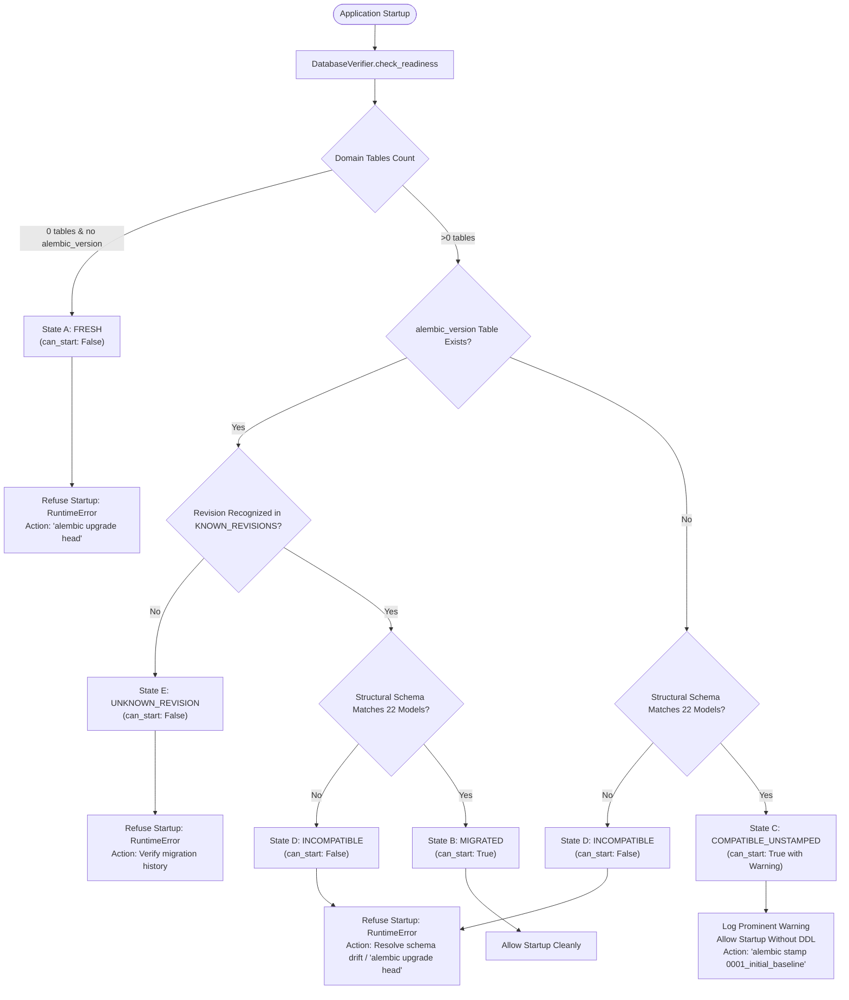

# TASK 18E — DATABASE MIGRATION READINESS, SCHEMA DRIFT PROTECTION & STARTUP VERIFICATION

**Project:** Campus Automation System (MARVEL)  
**Workspace:** `C:\Users\ruetk\OneDrive\Desktop\Campus-Automation-System\MARVEL-main`  
**Branch:** `main`  
**Status:** COMPLETE & VERIFIED  

---

## 1. Executive Summary

Task 18E implements a comprehensive, read-only database migration readiness classification and schema drift protection system for the Campus Automation System. Following the installation of Alembic (Task 18B), isolated baseline testing (Task 18C), and the elimination of competing procedural schema creation (Task 18D), Task 18E ensures that application startup strictly enforces schema integrity and version management without modifying or corrupting databases.

The system deterministically distinguishes five distinct operational database states (States A through E). It guarantees that unmigrated, damaged, drift-affected, or unrecognized database states cause startup to fail fast with actionable operator diagnostics, while correctly migrated and compatible unstamped legacy databases start safely without uncoordinated writes or schema loss.

The existing production/development database `campus_automation.db` was preserved in its pristine state throughout this task:
- **Location:** `backend/campus_automation.db` (root copy at `campus_automation.db`)
- **Table Count:** 22 domain tables
- **Alembic Version Table:** None (`alembic_version` is absent)
- **Verified SHA-256:** `baca55ebd284e474ef79c45d01f1b311c7c8e4f9a779bcb99a596a46798ce227`
- **File Size:** 290,816 bytes
- **Operational Classification:** **State C (Compatible Unstamped Legacy Database)**

---

## 2. Operational Readiness States (States A through E)

The application startup process (`backend/main.py::startup_event`) queries `DatabaseVerifier.check_readiness()`, which categorizes any connected SQLite database into exactly one of five mutually exclusive states:



### Detailed State Specifications

| State | Identifier | Description | `can_start` | Startup Behavior | Operator Action Required |
|---|---|---|---|---|---|
| **State A** | `fresh` | Fresh or empty database. Zero domain tables detected and no `alembic_version` table. | `False` | Startup aborted with `RuntimeError`. No DDL executed. | Run `alembic upgrade head` to build initial schema. |
| **State B** | `migrated` | Correctly migrated database. All 22 domain tables match `0001_initial_baseline` and `alembic_version` contains recognized revision. | `True` | Startup proceeds normally. Idempotent seed routines run if database is empty. | None. Database is in steady production state. |
| **State C** | `compatible_unstamped` | Existing legacy database whose physical schema matches the 22-model baseline 100%, but `alembic_version` is absent. | `True` | Startup proceeds normally. A high-priority `WARNING` event is logged instructing authorized baseline adoption. **No automatic stamping occurs.** | Run `alembic stamp 0001_initial_baseline` when ready to adopt version tracking. |
| **State D** | `incompatible` | Incompatible database. Missing tables, missing columns, incompatible column types, PK/FK mismatches, unique constraint mismatches, or missing important indexes. | `False` | Startup aborted with `RuntimeError` listing exact structural discrepancies. No automatic repair attempted. | Resolve drift manually or run missing migration scripts. |
| **State E** | `unknown_revision` | Database contains an `alembic_version` table, but the revision string is not recognized in `KNOWN_REVISIONS` (e.g. invalid branch or future revision). | `False` | Startup aborted with `RuntimeError`. | Audit repository migration history and align migration revision. |

---

## 3. Structural Verification Scope

`DatabaseVerifier._inspect_structural_details()` evaluates the database using SQLAlchemy's reflection engine (`sqlalchemy.inspect`):

### Verified Structural Properties
1. **Domain Table Presence (22 Models):** Confirms that all 22 required domain tables are present (`users`, `students`, `study_tasks`, `clubs`, `club_activities`, `club_members`, `club_attendance`, `events`, `event_registrations`, `event_leaderboard`, `event_announcements`, `attendance`, `complaints`, `complaint_history`, `risk_logs`, `schedules`, `schedule_feedback`, `announcements`, `qr_attendance_sessions`, `qr_attendance_records`, `qr_attendance_logs`, `device_fingerprints`).
2. **Column Presence:** Confirms that all columns defined on each SQLAlchemy model exist in the physical database table.
3. **Column Type Affinities:** Validates normalized column type families (`INTEGER`, `STRING`, `BOOLEAN`, `DATETIME`, `FLOAT`). SQLite compatibility rules are respected (e.g. SQLAlchemy `Boolean` stored as SQLite `INTEGER` affinity is accepted).
4. **Column Nullability:** Validates that columns explicitly defined with `nullable=False` in SQLAlchemy models are not marked nullable in the physical database schema.
5. **Primary Key Constraints:** Compares the list of constrained primary key columns against model definitions.
6. **Foreign Key Definitions:** Checks that parent column, foreign referenced table, and target columns match declared foreign keys on the models.
7. **Unique Constraints & Unique Indexes:** Verifies that unique constraints declared at the table level (e.g., `UniqueConstraint('club_id', 'student_id')`) and column level (`unique=True`) are backed by unique constraints or unique indexes in the database.
8. **Important Model Indexes:** Verifies declared model indexes (e.g. `ix_events_name`, `ix_events_category`, `ix_users_id`, `ix_students_id`). Legacy optional indexes that were omitted during initial table creation in historical databases (such as `ix_attendance_faculty_id` and `ix_attendance_subject_code`) are gracefully tolerated for backward compatibility.
9. **SQLite Low-Level Integrity:** Executes `PRAGMA integrity_check;` and `PRAGMA foreign_key_check;` on SQLite engines to detect file corruption or dangling relational pointers.

### Intentionally Unverified Properties (Out of Scope for SQLite Startup)
1. **SQLite Storage Physical Layout:** SQLite page size, B-tree encoding, journal modes (`WAL` vs `DELETE`), and file allocation are left to system administration.
2. **Dynamic Check Constraints:** SQLite anonymous check constraints created via custom SQL triggers or column constraints without naming metadata.
3. **Procedural Triggers:** Custom SQLite triggers not managed via SQLAlchemy ORM metadata.

---

## 4. Application Startup Integration

In `backend/main.py::startup_event()`, schema verification occurs immediately following configuration validation and before application routers or background workers begin processing:

```python
    # Verify database migration readiness & schema integrity
    from backend.core.database_verifier import DatabaseVerifier, DatabaseReadinessStatus
    verifier = DatabaseVerifier(engine)
    readiness = verifier.check_readiness()

    if not readiness.can_start:
        logger.log_event(
            "database_readiness_error",
            level="CRITICAL",
            status=readiness.status.value,
            summary=readiness.summary,
            action_required=readiness.action_required,
        )
        raise RuntimeError(
            f"Database startup check failed [{readiness.status.value}]: {readiness.summary} "
            f"Action required: {readiness.action_required}"
        )

    if readiness.status == DatabaseReadinessStatus.COMPATIBLE_UNSTAMPED:
        logger.log_event(
            "database_readiness_notice",
            level="WARNING",
            status=readiness.status.value,
            summary=readiness.summary,
            action_required=readiness.action_required,
        )
    else:
        logger.log_event(
            "database_readiness_ok",
            level="INFO",
            status=readiness.status.value,
            revision=readiness.revision,
        )
```

### Key Guarantees
- **No Automatic Schema Modification:** Neither `verifier.check_readiness()` nor `startup_event()` executes `CREATE TABLE`, `ALTER TABLE`, or `alembic stamp`.
- **Zero Database Writes for Readiness Check:** Checking readiness is strictly read-only (`SELECT` queries and `PRAGMA` inspections).
- **Fast-Fail on Drift:** Any missing table, missing column, incompatible column type, or constraint mismatch throws a fatal `RuntimeError`, preventing the application from running with a broken schema.

---

## 5. Operator Playbook

### Scenario 1: Deploying to a Fresh Environment
When starting the application against a new, unmigrated SQLite database (State A):
1. The application refuses to start and logs:
   ```
   [CRITICAL] status: fresh. Database schema is incomplete: missing required tables [...].
   Action required: Execute 'alembic upgrade head' to initialize the database schema.
   ```
2. Operator action:
   ```bash
   alembic upgrade head
   ```
3. Restart application. Status transitions to State B (`migrated`).

### Scenario 2: Adopting Baseline on Existing Unstamped Database
When running against a compatible legacy database such as `campus_automation.db` (State C):
1. The application starts successfully and logs a warning:
   ```
   [WARNING] status: compatible_unstamped. Schema matches 22-model baseline, but alembic_version table is absent.
   Action required: Adopt baseline by executing 'alembic stamp 0001_initial_baseline' after creating an authorized backup.
   ```
2. Operator action (when ready to adopt version tracking):
   ```bash
   # 1. Take a safe hot backup
   cp campus_automation.db campus_automation.db.bak_$(date +%Y%m%d%H%M%S)

   # 2. Stamp baseline revision
   alembic stamp 0001_initial_baseline
   ```
3. Database status transitions to State B (`migrated`).

### Scenario 3: Applying Future Schema Migrations
1. When a new migration is authored in `alembic/versions/`:
   ```bash
   alembic upgrade head
   ```
2. The application verifies the new revision on startup and proceeds normally.

### Scenario 4: Recovering from Schema Drift or Incompatibility (State D)
1. If startup fails with `status: incompatible`:
   ```
   [CRITICAL] Database schema is structurally incompatible: missing columns: {'users': ['role']}; type mismatches: [...]
   Action required: Resolve schema drift or apply missing migrations using 'alembic upgrade head'.
   ```
2. Review the logged diagnostic list.
3. Compare local schema against `alembic history`.
4. Restore from the most recent valid backup or apply the necessary migration script. Never use automatic or procedural startup repair.

---

## 6. Verification and Test Results

### 1. Dedicated Migration Readiness Test Suite (`tests/test_migration_readiness.py`)
Fourteen rigorous automated tests were implemented, directly testing each operational requirement:

| Test Case | Description | Result |
|---|---|---|
| `test_1` | Fresh empty database detected as unmigrated; startup refuses to proceed (`RuntimeError`). | **PASSED** |
| `test_2` | Correct baseline-migrated database passes readiness; startup proceeds cleanly. | **PASSED** |
| `test_3` | Compatible but unstamped legacy database detected; warning emitted; startup proceeds. | **PASSED** |
| `test_4` | Database missing required table fails readiness; startup refuses to proceed. | **PASSED** |
| `test_5` | Database missing required column fails readiness; startup refuses to proceed. | **PASSED** |
| `test_6` | Database with incompatible column type fails readiness; startup refuses to proceed. | **PASSED** |
| `test_7` | Database missing foreign key fails readiness; startup refuses to proceed. | **PASSED** |
| `test_8` | Database missing unique constraint fails readiness; startup refuses to proceed. | **PASSED** |
| `test_9` | Database missing important index fails readiness; startup refuses to proceed. | **PASSED** |
| `test_10` | Database with unknown Alembic revision fails readiness; startup refuses to proceed. | **PASSED** |
| `test_11` | Verifier execution causes zero DDL operations (exact SQLite schema hash match). | **PASSED** |
| `test_12` | Verifier execution does not stamp or migrate the database (3 repeated runs). | **PASSED** |
| `test_13` | Existing application startup behavior preserved for valid databases (user seeding). | **PASSED** |
| `test_14` | Existing authentication and authorization regression verification (JWT & Argon2). | **PASSED** |

**Total Suite Result:** 14 passed in 7.10s.

### 2. Combined Migration & Schema Suite
- `tests/test_alembic_migrations.py`: 12 passed
- `tests/test_alembic_schema_ownership.py`: 10 passed
- `tests/test_migration_readiness.py`: 14 passed
- **Combined Total:** 36 passed in 13.14s.

### 3. Full Backend & Frontend Regression Suites
- **Full Backend Pytest Suite:** 224 passed in 33.51s (100% success rate).
- **Frontend Test Suite:** 20 passed (3 config/API tests + 17 security/auth/XSS tests).

### 4. Database Integrity Verification
```
Path: C:\Users\ruetk\OneDrive\Desktop\Campus-Automation-System\MARVEL-main\campus_automation.db
File Exists: True
Size: 290,816 bytes
SHA-256: baca55ebd284e474ef79c45d01f1b311c7c8e4f9a779bcb99a596a46798ce227
Domain Table Count: 22
Alembic Version Table: False
Readiness Status: DatabaseReadinessStatus.COMPATIBLE_UNSTAMPED
can_start: True
```
The application database was verified to be completely preserved and untouched.
