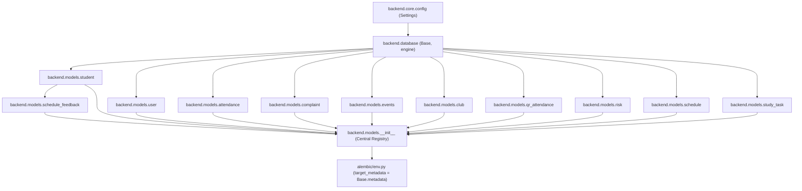
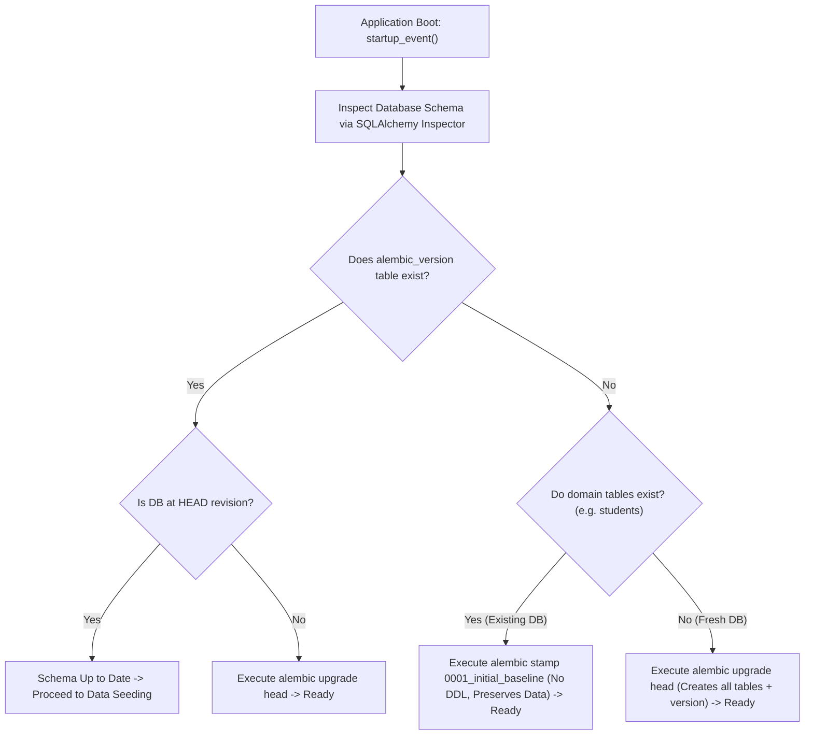
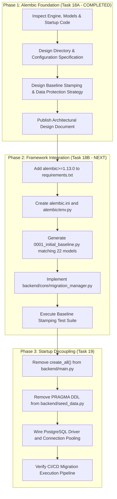

# TASK 18A — ALEMBIC MIGRATION ARCHITECTURE ASSESSMENT & DESIGN SPECIFICATION

**Project**: Campus Automation System (MARVEL)  
**Repository**: `C:\Users\ruetk\OneDrive\Desktop\Campus-Automation-System\MARVEL-main`  
**Branch**: `main`  
**Task Type**: Architecture Assessment & Design Specification (Read-Only / No DDL / No Schema Changes)  
**Scope**: Version-Controlled Database Migration Architecture for SQLite and PostgreSQL  
**Date**: November 3, 2026  

---

## 1. Executive Summary

This document establishes the architectural blueprint for integrating **Alembic** as the centralized, version-controlled database migration framework for the Campus Automation System (MARVEL).

Currently, the application manages database schemas through procedural SQLAlchemy calls:
1. Module-level execution of `Base.metadata.create_all(bind=engine)` inside [`backend/main.py:43`](file:///C:/Users/ruetk/OneDrive/Desktop/Campus-Automation-System/MARVEL-main/backend/main.py#L43).
2. Procedural `PRAGMA table_info(...)` queries and raw `ALTER TABLE` statements inside [`backend/seed_data.py::ensure_schema()`](file:///C:/Users/ruetk/OneDrive/Desktop/Campus-Automation-System/MARVEL-main/backend/seed_data.py#L36).

This architecture prevents production rollouts, crashes immediately under PostgreSQL, lacks schema version tracking, provides no rollback capability, and risks silent data corruption under schema modifications.

This assessment designs an enterprise-grade Alembic migration architecture that:
- Seamlessly integrates with the existing 22 SQLAlchemy ORM models.
- Safely baselines existing SQLite databases containing real student records without recreating or dropping tables.
- Supports zero-downtime, idempotent schema upgrades for fresh installations, existing development environments, and future PostgreSQL deployments.
- Enforces strict separation between **Schema Migration (DDL via Alembic)** and **Data Seeding (DML via `seed_data.py`)**.

---

## 2. Existing Database Architecture Inspection Findings

An exhaustive inspection of the active codebase was conducted. The verified architectural facts are documented below:

### 2.1 SQLAlchemy Engine and Version
- **SQLAlchemy Version**: **`2.0.46`** (verified via runtime inspection). The codebase uses modern SQLAlchemy 2.x declarative standards.
- **Engine Configuration**: Located in [`backend/database.py:29-33`](file:///C:/Users/ruetk/OneDrive/Desktop/Campus-Automation-System/MARVEL-main/backend/database.py#L29-L33).
  ```python
  DATABASE_URL = settings.get_database_url()
  connect_args = {}
  if "sqlite" in DATABASE_URL:
      connect_args = {"check_same_thread": False}

  engine = create_engine(
      DATABASE_URL,
      connect_args=connect_args,
      echo=settings.DB_ECHO and settings.is_development
  )
  ```
- **Connection Listener for Foreign Keys**:
  ```python
  @event.listens_for(Engine, "connect")
  def set_sqlite_pragma(dbapi_connection, connection_record):
      if isinstance(dbapi_connection, sqlite3.Connection):
          cursor = dbapi_connection.cursor()
          cursor.execute("PRAGMA foreign_keys=ON")
          cursor.close()
  ```
  *Finding*: Foreign key enforcement is actively enabled for all SQLite engine connections at runtime.

### 2.2 Database URL Resolution
- Configured in [`backend/core/config.py:192-200`](file:///C:/Users/ruetk/OneDrive/Desktop/Campus-Automation-System/MARVEL-main/backend/core/config.py#L192-L200):
  - Testing mode (`is_testing=True`) returns `"sqlite:///:memory:"`.
  - Relative SQLite URLs (`sqlite:///./campus_automation.db`) are dynamically resolved to absolute project root paths: `sqlite:///C:/.../MARVEL-main/campus_automation.db`.
  - External PostgreSQL connection strings (e.g., `postgresql://...`) are returned directly.

### 2.3 Session Management and Lifecycle
- **Session Factory**: `SessionLocal = sessionmaker(autocommit=False, autoflush=False, bind=engine)` in [`backend/database.py:35`](file:///C:/Users/ruetk/OneDrive/Desktop/Campus-Automation-System/MARVEL-main/backend/database.py#L35).
- **Dependency Injection**: `get_db()` in [`backend/database.py:41-50`](file:///C:/Users/ruetk/OneDrive/Desktop/Campus-Automation-System/MARVEL-main/backend/database.py#L41-L50) provides session scoping with automatic rollback on unhandled exceptions and guaranteed closure in the `finally` block.

### 2.4 Declarative Base and Model Registration
- **Declarative Base**: `Base = declarative_base()` instantiated in [`backend/database.py:37`](file:///C:/Users/ruetk/OneDrive/Desktop/Campus-Automation-System/MARVEL-main/backend/database.py#L37).
- **Model Inheritance**: All models inherit from `backend.database.Base` (note: [`backend/models/schedule_feedback.py:4`](file:///C:/Users/ruetk/OneDrive/Desktop/Campus-Automation-System/MARVEL-main/backend/models/schedule_feedback.py#L4) imports `Base` via `from backend.models.student import Base`, which is a direct reference to `backend.database.Base`).
- **Complete Central Model Registry**: [`backend/models/__init__.py`](file:///C:/Users/ruetk/OneDrive/Desktop/Campus-Automation-System/MARVEL-main/backend/models/__init__.py) imports and exposes all 22 ORM models in `__all__`.
- **Reflection Verification**: Executing `import backend.models` populates exactly **22 tables** inside `Base.metadata.tables`:
  1. `announcements`
  2. `attendance`
  3. `club_activities`
  4. `club_attendance`
  5. `club_members`
  6. `clubs`
  7. `complaint_history`
  8. `complaints`
  9. `device_fingerprints`
  10. `event_announcements`
  11. `event_leaderboard`
  12. `event_registrations`
  13. `events`
  14. `qr_attendance_logs`
  15. `qr_attendance_records`
  16. `qr_attendance_sessions`
  17. `risk_logs`
  18. `schedule_feedback`
  19. `schedules`
  20. `students`
  21. `study_tasks`
  22. `users`

### 2.5 Current Schema Initialization Conflicts
1. **Module Import-Time DDL**: [`backend/main.py:43`](file:///C:/Users/ruetk/OneDrive/Desktop/Campus-Automation-System/MARVEL-main/backend/main.py#L43) runs `student.Base.metadata.create_all(bind=engine)` during module initialization before FastAPI begins routing requests.
2. **Procedural SQLite PRAGMAs**: [`backend/seed_data.py::ensure_schema()`](file:///C:/Users/ruetk/OneDrive/Desktop/Campus-Automation-System/MARVEL-main/backend/seed_data.py#L36-L132) runs during the `@app.on_event("startup")` lifecycle hook. It executes raw SQLite queries:
   - `PRAGMA table_info(students)` -> adds `section`
   - `PRAGMA table_info(users)` -> adds `avatar`
   - `PRAGMA table_info(clubs)` -> adds `created_by`
   - `PRAGMA table_info(complaints)` -> adds `resolution_notes`, `assigned_to`
   - `PRAGMA table_info(attendance)` -> adds `subject_code`, `faculty_id`, `session_name`
   - Procedural index creations and duplicate row purges on `club_members` and `event_registrations`.
3. **PostgreSQL Incompatibility**: Under PostgreSQL, `PRAGMA table_info` raises `psycopg2.errors.SyntaxError: syntax error at or near "PRAGMA"`, crashing the backend on boot.

---

## 3. Proposed Alembic Architecture

### 3.1 Recommended Repository File Layout
The standard, idiomatic architecture for Alembic in FastAPI applications positions the configuration at the project root while maintaining migrations in a dedicated versioned directory:

```text
MARVEL-main/
├── alembic.ini                          # Root configuration read by Alembic CLI
├── alembic/                             # Migration environment package
│   ├── env.py                           # Runtime migration orchestration script
│   ├── script.py.mako                   # Jinja/Mako template for new revisions
│   ├── README                           # Alembic documentation
│   └── versions/                        # Immutable, sequential migration scripts
│       ├── 0001_initial_baseline.py     # Comprehensive 22-table baseline schema
│       └── ...                          # Future feature revisions
├── backend/
│   ├── database.py                      # Engine, SessionLocal, Base
│   ├── models/                          # 22 ORM domain models
│   │   └── __init__.py                  # Centralized model registry
│   └── seed_data.py                     # DML-only initial seeding
```

### 3.2 `alembic.ini` Configuration Specification
`alembic.ini` will be located in the repository root (`C:\Users\ruetk\OneDrive\Desktop\Campus-Automation-System\MARVEL-main\alembic.ini`):

```ini
[alembic]
# Path to migration environment
script_location = alembic

# Template used to generate migration files
file_template = %%(year)d_%%(month).2d_%%(day).2d_%%(rev)s_%%(slug)s

# Prepend current directory to sys.path so 'backend' is immediately importable
prepend_sys_path = .

# Timezone for revision timestamps
timezone = UTC

# Maximum length of characters for slug field
truncate_slug_length = 40

# Database URL is left blank here and dynamically resolved via backend.core.config
sqlalchemy.url = 

[post_write_hooks]

[loggers]
keys = root,sqlalchemy,alembic

[handlers]
keys = console

[formatters]
keys = generic

[logger_root]
level = WARN
handlers = console
qualname =

[logger_sqlalchemy]
level = WARN
handlers =
qualname = sqlalchemy.engine

[logger_alembic]
level = INFO
handlers =
qualname = alembic

[handler_console]
class = StreamHandler
args = (sys.stderr,)
level = NOTSET
formatter = generic

[formatter_generic]
format = %(levelname)-5.5s [%(name)s] %(message)s
datefmt = %H:%M:%S
```

### 3.3 `alembic/env.py` Architecture Specification
[`alembic/env.py`](file:///C:/Users/ruetk/OneDrive/Desktop/Campus-Automation-System/MARVEL-main/alembic/env.py) orchestrates metadata reflection, dialect handling, and transaction execution.

#### Core Architectural Requirements:
1. **Dynamic URL Loading**: Reads directly from `backend.core.config.settings.get_database_url()`. This ensures environment variables (`.env`, staging, production, or CI) dictate the target database automatically.
2. **Complete Model Reflection**: Imports `backend.models`, guaranteeing all 22 ORM classes register into `Base.metadata` prior to autogenerate comparison or migration execution.
3. **SQLite Batch Mode (`render_as_batch=True`)**: Mandatory for SQLite to support altering columns, dropping constraints, and rebuilding tables.
4. **Foreign Key Pragma Toggling**: Disables foreign key constraints during batch table rebuilds on SQLite, re-enabling them upon completion to avoid cascade errors.
5. **Comparison Configuration**: Enables `compare_type=True` and `compare_server_default=True` to catch type modifications.

#### Proposed `alembic/env.py` Implementation Blueprint:
```python
import os
import sys
from logging.config import fileConfig

from sqlalchemy import engine_from_config, pool
from alembic import context

# Ensure MARVEL-main root is on sys.path
sys.path.insert(0, os.path.abspath(os.path.join(os.path.dirname(__file__), "..")))

# Import centralized configuration and declarative metadata
from backend.core.config import settings
from backend.database import Base
import backend.models  # Guarantees all 22 models are imported and registered

config = context.config

# Interpret the config file for Python logging
if config.config_file_name is not None:
    fileConfig(config.config_file_name)

# Set target metadata for autogenerate support
target_metadata = Base.metadata

def get_url():
    # Dynamically fetch the database URL from application settings
    return settings.get_database_url()

def run_migrations_offline() -> None:
    # Run migrations in offline mode (generates SQL script without active DB connection)
    url = get_url()
    context.configure(
        url=url,
        target_metadata=target_metadata,
        literal_binds=True,
        dialect_opts={"paramstyle": "named"},
        render_as_batch=True,
        compare_type=True,
    )

    with context.begin_transaction():
        context.run_migrations()

def run_migrations_online() -> None:
    # Run migrations in online mode (direct connection to target database)
    configuration = config.get_section(config.config_ini_section, {})
    configuration["sqlalchemy.url"] = get_url()

    connectable = engine_from_config(
        configuration,
        prefix="sqlalchemy.",
        poolclass=pool.NullPool,
    )

    with connectable.connect() as connection:
        is_sqlite = connection.dialect.name == "sqlite"

        context.configure(
            connection=connection,
            target_metadata=target_metadata,
            render_as_batch=is_sqlite,
            compare_type=True,
            compare_server_default=True,
        )

        with context.begin_transaction():
            if is_sqlite:
                connection.exec_driver_sql("PRAGMA foreign_keys=OFF;")
            
            context.run_migrations()
            
            if is_sqlite:
                connection.exec_driver_sql("PRAGMA foreign_keys=ON;")

if context.is_offline_mode():
    run_migrations_offline()
else:
    run_migrations_online()
```

---

## 4. Model Registration Strategy & Circular Dependency Prevention

### 4.1 Dependency Graph Analysis
A primary failure mode in Alembic deployments is **circular import deadlocks** or **unregistered models** resulting from fractured declarative bases.

The dependency structure of MARVEL was mapped:


### 4.2 Architectural Guarantees:
1. **Unidirectional Import Flow**:
   - `backend.database` defines `Base = declarative_base()`. It imports **no models**.
   - Model files import `Base` from `backend.database`. They do not import from `alembic` or `backend.main`.
   - `backend.models.__init__` imports all 22 classes.
   - `alembic/env.py` imports `backend.models.__init__`.
2. **Zero Duplicate Base Instances**:
   - All 22 models bind strictly to `backend.database.Base`.
   - Notice: [`backend/models/schedule_feedback.py:4`](file:///C:/Users/ruetk/OneDrive/Desktop/Campus-Automation-System/MARVEL-main/backend/models/schedule_feedback.py#L4) currently imports `Base` from `backend.models.student`. While functional because `student.py` imports from `backend.database`, standardizing all models to import directly from `backend.database` is recommended during Task 18 implementation to eliminate confusion.
3. **Registration Verification**:
   - Simply executing `import backend.models` guarantees 100% of the 22 tables are loaded into `Base.metadata.tables` before Alembic executes diffing or autogeneration.

---

## 5. Existing Database Baseline Strategy

The central challenge of this migration is that existing installations already possess working SQLite databases (`campus_automation.db`) containing student enrollments, attendance records, clubs, and complaints.

A naive `alembic upgrade head` on an existing database will attempt to execute `CREATE TABLE students ...`, immediately crashing with:
`sqlite3.OperationalError: table students already exists`

### 5.1 Multi-Environment Compatibility Matrix

| Environment State | Initial Condition | Migration Action | Resulting State |
|---|---|---|---|
| **Scenario 1: Fresh Empty Database** | 0 tables exist; no `alembic_version`. | Execute `alembic upgrade head` | Runs `0001_initial_baseline.py` DDL; creates 22 tables; stamps `alembic_version`. |
| **Scenario 2: Existing Current DB** | 22 tables exist; no `alembic_version`; data present. | Execute `alembic stamp 0001_initial_baseline` | Creates `alembic_version` table; writes baseline revision; **executes 0 DDL statements**; preserves 100% of data. |
| **Scenario 3: Legacy DB with Schema Gaps** | Older schema (e.g. missing `section` or `avatar`). | Execute pre-baseline alignment script, then stamp, then upgrade. | Harmonizes schema to baseline; records version; all data retained. |
| **Scenario 4: Future Upgrades** | Database is at revision `N`. | Execute `alembic upgrade head` | Runs incremental migrations `N+1..HEAD` transactionally. |

### 5.2 Baseline Revision Design (`0001_initial_baseline.py`)
The initial revision must capture the complete 22-table schema exactly as defined by the SQLAlchemy models today:
- In `upgrade()`: Contains standard `op.create_table(...)` statements for all 22 tables, along with foreign keys, primary keys, and unique indexes.
- In `downgrade()`: Contains `op.drop_table(...)` statements in reverse dependency order.

### 5.3 Automated Zero-Touch Startup Detection
To prevent developers or deployment scripts from needing manual CLI interventions, the application startup routine will incorporate a **Safe Migration Manager**:



#### Programmatic Implementation Blueprint (`backend/core/migration_manager.py`):
```python
import logging
from sqlalchemy import inspect
from alembic.config import Config
from alembic import command
from backend.database import engine
from backend.core.config import settings

logger = logging.getLogger(__name__)

def apply_or_baseline_database():
    """
    Safely integrates Alembic migrations into application startup:
    - New empty database: runs upgrade head.
    - Existing unversioned database: stamps baseline without data loss.
    - Versioned database: runs upgrade head for pending revisions.
    """
    alembic_cfg = Config("alembic.ini")
    inspector = inspect(engine)
    existing_tables = inspector.get_table_names()

    has_alembic = "alembic_version" in existing_tables
    has_domain_data = "students" in existing_tables or "users" in existing_tables

    if not has_alembic:
        if has_domain_data:
            logger.info("Existing database detected without version table. Stamping baseline revision...")
            # Stamping creates alembic_version table and inserts baseline revision WITHOUT running DDL
            command.stamp(alembic_cfg, "0001_initial_baseline")
            logger.info("Database successfully baselined.")
        else:
            logger.info("Fresh database detected. Applying all migrations...")
            command.upgrade(alembic_cfg, "head")
            logger.info("Fresh database schema created via Alembic.")
    else:
        logger.info("Database version table detected. Checking for pending migrations...")
        command.upgrade(alembic_cfg, "head")
        logger.info("Database migrations verified and up to date.")
```

---

## 6. Migration Safety, Boundaries & Disaster Recovery

### 6.1 Transaction Boundaries & Dialect Limitations
- **PostgreSQL**: Supports fully transactional DDL (`BEGIN ... COMMIT`). If a migration fails at statement 4 of 5, PostgreSQL automatically rolls back statements 1–3, leaving the database completely uncorrupted.
- **SQLite**: Does **not** support transactional DDL for table rebuild operations. In SQLite batch mode, Alembic:
  1. Creates `_alembic_tmp_<table_name>`.
  2. Copies data from `<table_name>` to `_alembic_tmp_<table_name>`.
  3. Drops `<table_name>`.
  4. Renames `_alembic_tmp_<table_name>` to `<table_name>`.
  *Failure Mode*: If step 2 or 3 fails (e.g. disk full, lock timeout, constraint violation), SQLite cannot roll back the dropped table, resulting in data loss.

### 6.2 Pre-Migration Automated Snapshot Protocol
To mitigate SQLite's non-transactional DDL limitations, an **Automated Pre-Migration Snapshot** must precede any migration execution:

```python
import shutil
import datetime
from pathlib import Path

def backup_sqlite_database_before_migration(db_path: Path):
    # Creates a point-in-time byte copy before executing any DDL
    if not db_path.exists():
        return
    backup_dir = db_path.parent / "backups"
    backup_dir.mkdir(exist_ok=True)
    timestamp = datetime.datetime.utcnow().strftime("%Y%m%d_%H%M%S")
    backup_path = backup_dir / f"pre_migration_{timestamp}_{db_path.name}"
    shutil.copy2(db_path, backup_path)
    logger.info(f"Pre-migration backup created: {backup_path}")
```

### 6.3 Schema Downgrade Safety Policy
Not all schema migrations can be reversed. Alembic revision scripts must adhere to explicit downgrade classification:
1. **Reversible Downgrades (`SAFE`)**:
   - Dropping an added index or view.
   - Dropping a newly added nullable column that contains no critical production data.
2. **Irreversible / Destructive Downgrades (`HIGH RISK / UNSUPPORTED`)**:
   - Reversing a table drop (dropped data cannot be recreated).
   - Reversing a column type conversion that truncated data.
   - Reversing a table split or merge.
   *Policy*: Irreversible downgrades must explicitly raise `NotImplementedError("Downgrade unsupported: data loss risk. Restore from pre-migration backup.")` rather than executing destructive operations silently.

### 6.4 Concurrency & Multi-Instance Safety
In production deployments with multiple application workers (e.g., Uvicorn workers behind Gunicorn or multi-container clusters):
- **Problem**: Concurrent workers attempting to run migrations simultaneously will collide on table locks or create duplicate migration records.
- **Solution**:
  - In containerized production, migrations run as a dedicated pre-start step (e.g., Kubernetes init-container or entrypoint script) before starting web worker processes.
  - In local development, the startup migration check uses file-level locking if multiple workers are detected.

---

## 7. Resolution of Existing Startup Conflicts

### 7.1 Conflict Breakdown

```text
Current Flow (Conflict-Prone):
main.py [import-time] -> Base.metadata.create_all()
main.py [startup_event] -> ensure_schema() [PRAGMA queries + raw ALTER TABLE]
main.py [startup_event] -> seed_database() [DML data inserts]

Proposed Flow (Clean Separation):
main.py [startup_event] -> apply_or_baseline_database() [Alembic DDL Migration]
main.py [startup_event] -> seed_default_users() & seed_database() [DML Data Seeding Only]
```

### 7.2 Detailed Phased Deprecation Plan

#### Phase 1: Coexistence (Current Task 18 Assessment)
- Maintain existing codebase unchanged (read-only audit).
- Prepare Alembic architecture and baseline migration script.

#### Phase 2: Introduction & Baselining (Task 18 Implementation)
- Add `alembic>=1.13.0` to `requirements.txt`.
- Generate `0001_initial_baseline.py` matching existing 22 models.
- Implement `apply_or_baseline_database()` startup check.
- Keep `ensure_schema()` as a fallback no-op if columns already exist.

#### Phase 3: Cleanup & PostgreSQL Readiness (Task 19)
- Delete import-time `student.Base.metadata.create_all(bind=engine)` from [`backend/main.py:43`](file:///C:/Users/ruetk/OneDrive/Desktop/Campus-Automation-System/MARVEL-main/backend/main.py#L43).
- Remove procedural `PRAGMA table_info` and `ALTER TABLE` blocks from [`backend/seed_data.py::ensure_schema()`](file:///C:/Users/ruetk/OneDrive/Desktop/Campus-Automation-System/MARVEL-main/backend/seed_data.py#L36).
- Retain `seed_data.py` strictly for DML (populating development user accounts and sample clubs/events).

---

## 8. Comprehensive Testing Strategy

A 10-point test suite is specified below to validate the migration framework prior to production rollout.

| # | Test Scenario | Target Execution Method | Success Criteria | Status |
|---|---|---|---|---|
| 1 | **Clean Database Migration** | `alembic upgrade head` on a new, non-existent SQLite file. | Creates all 22 tables, all indexes, and `alembic_version` table; zero errors. | **PLANNED** |
| 2 | **Existing Database Baseline Stamping** | Run startup baseline check against existing `campus_automation.db`. | Detects tables; stamps `0001_initial_baseline`; executes 0 DDL statements; all existing records intact. | **PLANNED** |
| 3 | **Incremental Migration Upgrade** | Apply a test revision (e.g. add test column) via `alembic upgrade head`. | Updates schema; records new revision in `alembic_version`. | **PLANNED** |
| 4 | **Incremental Migration Downgrade** | Revert test revision via `alembic downgrade -1`. | Drops test column; reverts `alembic_version` to baseline; preserves existing data. | **PLANNED** |
| 5 | **Data Preservation Under Batch Alter** | Insert student records, run SQLite batch table modification. | All existing rows retained without nullification or truncation. | **PLANNED** |
| 6 | **Foreign Key Constraint Verification** | Re-enable foreign keys after migration; insert valid and invalid child records. | Valid foreign keys accepted; invalid child records rejected with `IntegrityError`. | **PLANNED** |
| 7 | **Pre-Migration Snapshot Creation** | Trigger migration manager on disk-backed SQLite database. | Timestamped backup file verified in `backups/` directory prior to DDL execution. | **PLANNED** |
| 8 | **Repeated Startup Idempotency** | Execute application startup sequence 5 consecutive times. | Detects current revision; executes 0 duplicate migrations; logs clean startup. | **PLANNED** |
| 9 | **SQLite Windows Portability** | Execute migration suite on Windows environment with file locking. | No `sqlite3.OperationalError: database is locked` errors during migration. | **PLANNED** |
| 10 | **PostgreSQL Dialect Compatibility** | Generate offline SQL script via `alembic upgrade head --sql`. | Generates valid PostgreSQL DDL with zero SQLite PRAGMA statements. | **PLANNED** |

*Verification Note*: All 10 tests above are formally planned for execution during Task 18 implementation. The current active test suite (188 tests passing in `tests/`) remains completely green and unmodified.

---

## 9. Risks and Unresolved Architectural Decisions

| # | Architectural Risk / Decision | Current Assessment & Trade-off | Recommended Resolution |
|---|---|---|---|
| 1 | **Root `alembic/` vs `backend/alembic/`** | Root `alembic/` is standard for CLI tooling. `backend/alembic/` keeps all code inside `backend/`. | Standardize on root `alembic/` with `alembic.ini` at project root for standard developer experience. |
| 2 | **SQLite `batch_alter_table` Locking** | On Windows, SQLite locks can time out if background threads hold open sessions during migration. | Ensure migration runs before worker threads or scheduler tasks start in `startup_event()`. |
| 3 | **Inconsistent Base Import in `schedule_feedback.py`** | Line 4 imports `Base` from `backend.models.student`. While functional, it is stylistically inconsistent. | Refactor line 4 to `from backend.database import Base` during Task 18. |
| 4 | **Downgrade Policy on Production Data** | Downgrading migrations that drop columns will destroy production data. | Implement explicit policy: downgrades that drop data are forbidden in production; require restore from snapshot. |

---

## 10. Ordered Implementation Roadmap



1. **Step 1 (Immediate Next Task)**: Add `alembic>=1.13.0` to `requirements.txt`.
2. **Step 2**: Generate root `alembic.ini` and `alembic/env.py` following the specifications in Section 3.
3. **Step 3**: Generate the baseline migration `0001_initial_baseline.py` capturing all 22 tables.
4. **Step 4**: Implement `apply_or_baseline_database()` in `backend/core/migration_manager.py`.
5. **Step 5**: Execute the 10-point test plan to verify safe baselining of existing databases and clean upgrades of empty databases.
6. **Step 6**: Remove procedural DDL from `backend/seed_data.py` and `backend/main.py` once Alembic is established.
