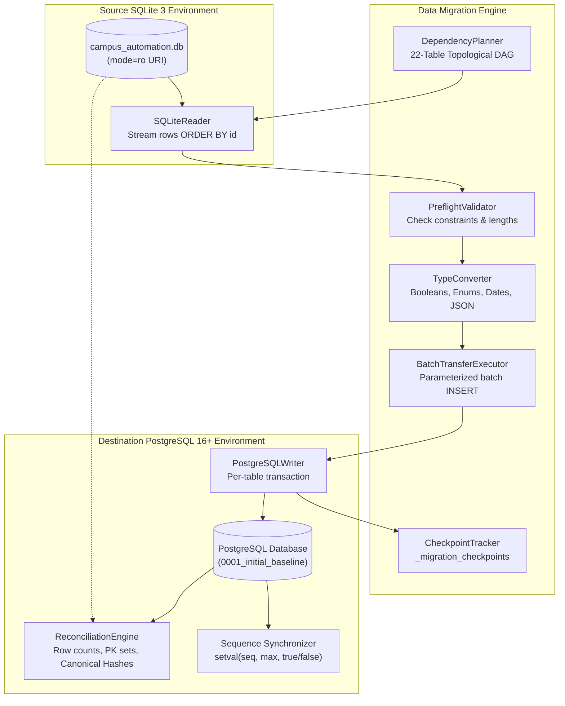

# Phase 19F.1 — Cross-Dialect Data Migration Architecture Audit

**Project:** Campus Automation System (MARVEL)  
**Workspace:** `C:\Users\ruetk\OneDrive\Desktop\Campus-Automation-System\MARVEL-main`  
**Branch:** `main`  
**Source Database:** SQLite 3 (`campus_automation.db`)  
**Target Database:** PostgreSQL 16+ (Staging / Production)  
**Mode:** READ-ONLY ARCHITECTURAL AUDIT & MIGRATION DESIGN (NO DATA MODIFIED)

---

## 1. Executive Summary

Phase 19F.1 provides a comprehensive, read-only architectural audit of the active application database (`campus_automation.db`) and establishes a deterministic, safe cross-dialect data migration architecture from SQLite 3 to PostgreSQL 16+.

### Key Audit Findings
1. **Source Database Immutability & Health:**
   - **File Path:** `MARVEL-main/campus_automation.db`
   - **File Size:** `290,816` bytes (exact match)
   - **SHA-256 Checksum:** `BACA55EBD284E474EF79C45D01F1B311C7C8E4F9A779BCB99A596A46798CE227` (exact match)
   - **`PRAGMA integrity_check`:** `ok`
   - **`PRAGMA foreign_key_check`:** `0` violations (pristine referential integrity)
   - **Total Domain Tables:** 22
   - **Total Records:** Exactly **60 rows** across all tables.
2. **Schema & Data Quality Assessment:**
   - **0** duplicate primary keys.
   - **0** duplicate unique constraint keys.
   - **0** orphaned foreign key references.
   - **0** string length violations against target PostgreSQL `VARCHAR(N)` definitions.
   - **0** nullability violations against target required columns.
   - **0** malformed JSON records across all JSON-like text columns.
   - **0** invalid enum values; raw SQLite enum strings (`'TECHNICAL'`, `'CULTURAL'`, `'SPORTS'`, `'REGISTRATION_OPEN'`) match the uppercase labels generated by Alembic baseline migration `0001_initial_baseline` for PostgreSQL native enums.
3. **Dependency Structure:**
   - The 22 domain tables form a strict **Directed Acyclic Graph (DAG)** with **0 circular dependencies** and **0 self-referential foreign keys**.
   - Tables sort into 3 distinct topological dependency levels (Level 0: 10 tables, Level 1: 10 tables, Level 2: 2 tables).
4. **PostgreSQL Sequence Synchronization Correction:**
   - Explicit primary key insertion does not advance PostgreSQL sequences.
   - A critical behavioral nuance of PostgreSQL `setval()` is resolved: calling `setval(seq, 0, true)` on empty tables causes an out-of-bounds error on sequences with `MINVALUE 1`. Empty tables require `setval(seq, 1, false)`, while populated tables require `setval(seq, max_id, true)`.

---

## 2. Complete Source Data Inventory (22 Tables, 60 Rows)

The source database contains 22 domain tables holding a total of 60 records. All tables utilize single-column integer primary keys (`id`).

| # | Table Name | Row Count | Primary Key Range | Foreign Key Dependencies | Unique Constraints / Indexes | Sequence Restart Val |
| :--- | :--- | :---: | :--- | :--- | :--- | :---: |
| 1 | `announcements` | 3 | `id` (1..3) | None | `ix_announcements_id` | 4 |
| 2 | `clubs` | 7 | `id` (1..7) | None | `name` (unique), `ix_clubs_id` | 8 |
| 3 | `device_fingerprints` | 0 | `id` (empty) | None | `device_id` (unique), `ix_device_fingerprints_id`, `student_id` | 1 |
| 4 | `events` | 4 | `id` (1..4) | None | `ix_events_category`, `ix_events_id`, `ix_events_name` | 5 |
| 5 | `qr_attendance_logs` | 0 | `id` (empty) | None | `ix_qr_attendance_logs_id`, `session_id`, `student_id` | 1 |
| 6 | `qr_attendance_sessions` | 1 | `id` (1) | None | `session_id` (unique), `faculty_id`, `id` | 2 |
| 7 | `risk_logs` | 2 | `id` (1..2) | None | `ix_risk_logs_id` | 3 |
| 8 | `schedule_feedback` | 0 | `id` (empty) | None | `ix_schedule_feedback_id` | 1 |
| 9 | `schedules` | 6 | `id` (1..6) | None | `ix_schedules_id` | 7 |
| 10 | `students` | 6 | `id` (1..6) | None | `roll_no` (unique), `ix_students_id` | 7 |
| 11 | `club_activities` | 1 | `id` (1) | `club_id` $\rightarrow$ `clubs.id` | `ix_club_activities_id` | 2 |
| 12 | `club_attendance` | 0 | `id` (empty) | `club_id` $\rightarrow$ `clubs.id` | `ix_club_attendance_id` | 1 |
| 13 | `event_registrations` | 0 | `id` (empty) | `event_id` $\rightarrow$ `events.id` | `(event_id, student_id)` (unique), `id`, `student_id` | 1 |
| 14 | `event_leaderboard` | 0 | `id` (empty) | `event_id` $\rightarrow$ `events.id` | `ix_event_leaderboard_id` | 1 |
| 15 | `event_announcements` | 0 | `id` (empty) | `event_id` $\rightarrow$ `events.id` | `ix_event_announcements_id` | 1 |
| 16 | `qr_attendance_records` | 1 | `id` (1) | `session_id` $\rightarrow$ `qr_attendance_sessions.id` | `(session_id, roll_number)` (unique), `(session_id, student_id)` (unique), `id`, `student_id`, `roll_number` | 2 |
| 17 | `club_members` | 1 | `id` (1) | `club_id` $\rightarrow$ `clubs.id`, `student_id` $\rightarrow$ `students.id` | `(club_id, student_id)` (unique), `ix_club_members_id` | 2 |
| 18 | `users` | 4 | `id` (1..4) | `linked_student_id` $\rightarrow$ `students.id` | `username` (unique), `email` (unique), `ix_users_id` | 5 |
| 19 | `complaints` | 2 | `id` (1..2) | `student_id` $\rightarrow$ `students.id` | `ix_complaints_id` | 3 |
| 20 | `attendance` | 22 | `id` (1..22) | `student_id` $\rightarrow$ `students.id` | `ix_attendance_id` | 23 |
| 21 | `study_tasks` | 0 | `id` (empty) | `user_id` $\rightarrow$ `users.id` | `ix_study_tasks_id`, `user_id` | 1 |
| 22 | `complaint_history` | 0 | `id` (empty) | `complaint_id` $\rightarrow$ `complaints.id` | `ix_complaint_history_id`, `complaint_id` | 1 |
| **TOTAL** | **22 Tables** | **60** | — | **13 Explicit Foreign Keys** | **33 Indexes / Constraints** | — |

---

## 3. Data-Quality Audit: Executed vs. Designed Checks

Every check below was **ACTUALLY EXECUTED** against the active `campus_automation.db` via read-only Python and SQLite inspection scripts (`scratch/audit_sqlite_data.py`, `scratch/detailed_audit.py`). No personal or sensitive record details are exposed.

| # | Quality Check Category | Tables & Columns Examined | Validation Method | Violations Found | Execution Status |
| :---: | :--- | :--- | :--- | :---: | :---: |
| **1** | **Duplicate Primary Keys** | All 22 domain tables on `id` column. | `SELECT id, COUNT(*) FROM "tbl" GROUP BY id HAVING COUNT(*) > 1;` | **0** | **ACTUALLY EXECUTED** |
| **2** | **Duplicate Unique Keys** | `users(username)`, `users(email)`, `students(roll_no)`, `clubs(name)`, `qr_attendance_sessions(session_id)`, `club_members(club_id, student_id)`, `qr_attendance_records(session_id, roll_number)`, `qr_attendance_records(session_id, student_id)`, `event_registrations(event_id, student_id)`, `device_fingerprints(device_id)`. | `SELECT cols, COUNT(*) FROM "tbl" WHERE col1 IS NOT NULL GROUP BY cols HAVING COUNT(*) > 1;` | **0** | **ACTUALLY EXECUTED** |
| **3** | **Orphaned Foreign Keys** | All 13 foreign keys across `attendance`, `club_activities`, `club_attendance`, `club_members`, `complaint_history`, `complaints`, `event_announcements`, `event_leaderboard`, `event_registrations`, `qr_attendance_records`, `study_tasks`, `users`. | `PRAGMA foreign_key_check;` plus cross-table join analysis (`LEFT JOIN ... WHERE parent.id IS NULL`). | **0** | **ACTUALLY EXECUTED** |
| **4** | **Invalid Enum Values** | `events.category`, `events.status`, `event_registrations.status`. | Checked `SELECT DISTINCT` against Python enum definitions (`EventCategory`, `EventStatus`, `RegistrationStatus`). Distinct values: `'TECHNICAL'`, `'CULTURAL'`, `'SPORTS'`, `'REGISTRATION_OPEN'`. | **0** | **ACTUALLY EXECUTED** |
| **5** | **Boolean Domain Violations** | 28 boolean-designated columns across `users`, `clubs`, `club_members`, `events`, `event_registrations`, `event_announcements`, `qr_attendance_sessions`, `qr_attendance_records`, `qr_attendance_logs`, `device_fingerprints`, `study_tasks`, `schedules`, `announcements`, `risk_logs`. | Checked `SELECT DISTINCT col, typeof(col)` to verify values are strictly `0` or `1`. Zero non-binary or out-of-range integer values. | **0** | **ACTUALLY EXECUTED** |
| **6** | **DateTime Consistency** | All datetime columns across all 22 tables (`created_at`, `updated_at`, `lecture_date`, `lecture_start_time`, `marked_at`, `start_date`, `end_date`, `date`, `registration_start_date`, etc.). | Regex format matching (`^\d{4}-\d{2}-\d{2}[ T]\d{2}:\d{2}:\d{2}(\.\d+)?$`) and `datetime.fromisoformat()` parsing. | **0** | **ACTUALLY EXECUTED** |
| **7** | **Malformed JSON Text** | `events.prizes`, `qr_attendance_sessions.qr_code_data`, `clubs.gallery_images`, `clubs.social_media_links`, `events.gallery_images`, `event_registrations.team_members`, `event_leaderboard.statistics`, `qr_attendance_records.validation_errors`. | Parsed non-empty values via `json.loads()`. `events.prizes` and `qr_attendance_sessions.qr_code_data` parsed as valid JSON dictionaries; all other JSON columns in existing data are NULL. | **0** | **ACTUALLY EXECUTED** |
| **8** | **String Length Violations** | All string columns across all 22 tables against SQLAlchemy model `String(length)` parameters. | Audited `len(val) <= max_length` for all rows. (Max username: 19 $\le 50$; max student name: 20 $\le 100$; max club name: 21 $\le 200$). | **0** | **ACTUALLY EXECUTED** |
| **9** | **Target NOT NULL Violations** | All columns declared `nullable=False` in target SQLAlchemy models. | Scanned rows for unexpected `NULL` values (`SELECT COUNT(*) FROM "tbl" WHERE col IS NULL;`). | **0** | **ACTUALLY EXECUTED** |
| **10** | **Numeric Precision & Range** | Float columns (`events.entry_fee`, `events.score`, `qr_attendance_sessions.center_latitude`, `center_longitude`, `geo_fence_radius_meters`, `qr_attendance_records.student_latitude`, `student_longitude`, `distance_from_center`, `location_accuracy`, `qr_attendance_logs.latitude`, `longitude`). | Validated float ranges (latitude $\in [-90, 90]$, longitude $\in [-180, 180]$, entry_fee $\ge 0$). Zero NaN or infinite values. | **0** | **ACTUALLY EXECUTED** |

---

## 4. Comprehensive Cross-Dialect Type Conversion Matrix

The following table documents the exact conversion rules between SQLite 3 storage representation and PostgreSQL 16+ target types across all 22 domain models:

| Column Category | SQLite 3 Storage Representation | PostgreSQL 16+ Target Type | Conversion & Validation Rules | Distinguishing Model Types from Proposed Changes |
| :--- | :--- | :--- | :--- | :--- |
| **Primary Keys (All 22 Tables)** | `INTEGER PRIMARY KEY` (Autoincrement rowid) | `INTEGER` / `BIGINT` with Identity / Serial Sequence | Insert explicit source ID values directly. Advance sequence post-load using corrected sequence synchronization logic. | Preserves existing model semantics; no schema changes proposed. |
| **Designated Booleans** | `INTEGER` (`0` or `1`) | `BOOLEAN` | Convert integer `1` $\rightarrow$ `True`, `0` $\rightarrow$ `False`, `NULL` $\rightarrow$ `NULL`. Reject values $\notin \{0, 1, \text{NULL}\}$. Affects: `users.is_active`, `clubs.is_active`, `clubs.accepting_members`, `club_members.is_active`, `events.requires_approval`, `events.team_event`, `qr_attendance_sessions.*`, `qr_attendance_records.*`, `device_fingerprints.*`, `study_tasks.is_completed`. | Preserves hardened Phase 19C model annotations (`Boolean`). |
| **Legacy Integer Flags** | `INTEGER` (`0` or `1`) | `INTEGER` | Preserve as raw integers (`0` or `1`). Affects: `schedules.is_active` (default 1), `announcements.is_active` (default 1), `risk_logs.resolved` (default 0). | Models explicitly declare `Integer`. Migration maintains integer semantics to avoid contract drift. |
| **Native Enums** | `TEXT` (`'TECHNICAL'`, `'SPORTS'`, `'REGISTRATION_OPEN'`, etc.) | PostgreSQL Native `ENUM` (`eventcategory`, `eventstatus`, `registrationstatus`) | SQLite stores strings in uppercase. Alembic baseline migration `0001_initial_baseline` creates PostgreSQL enum labels in uppercase. Map string values directly without case modification. Reject strings not in the declared enum domain. | Model uses `SQLEnum(EnumClass, name="...")`. Values match exact baseline labels. |
| **JSON-Like Text Columns** | `TEXT` (JSON serialized or NULL) | `TEXT` (or `JSONB` in future schema revisions) | Validate using `json.loads(val)` before insertion. Canonicalize for reconciliation via `json.dumps(obj, sort_keys=True, separators=(',', ':'))`. | Models currently declare `Text`. Stored as valid JSON text in PostgreSQL. |
| **DateTime (Naive UTC)** | `TEXT` (`'YYYY-MM-DD HH:MM:SS.ffffff'`) | `TIMESTAMP WITHOUT TIME ZONE` | Parse with `datetime.fromisoformat` or `datetime.strptime`. Preserve microsecond precision. Standard for `created_at`, `updated_at`, `lecture_start_time`, `marked_at`. | Preserves existing model default (`DateTime`). |
| **DateTime (Timezone-Aware)** | `TEXT` (`'YYYY-MM-DD HH:MM:SS.ffffff'`) | `TIMESTAMP WITH TIME ZONE` | Parse string and attach UTC timezone (`tzinfo=timezone.utc`). Target for `schedule_feedback` and `announcements` where model declares `DateTime(timezone=True)`. | Preserves existing model timezone declarations. |
| **Floating-Point Metrics** | `REAL` / `FLOAT` (IEEE 754 float) | `DOUBLE PRECISION` | Cast to standard Python `float`. Validate ranges (e.g. coordinates within geographic bounds). Round to 6 decimal places during canonical hashing. | Preserves existing `Float` column types. |
| **Foreign Keys (All 13 FKs)** | `INTEGER` | `INTEGER` referencing parent table `id` | Insert parent tables first via verified topological order (Levels 0 $\rightarrow$ 1 $\rightarrow$ 2). Ensure referenced parent IDs exist prior to batch write. | Preserves existing relational constraints. |
| **Nullable Text / Attributes** | `TEXT` / `VARCHAR` / `NULL` | `VARCHAR(N)` / `TEXT` / `NULL` | Maintain `None` as SQL `NULL`. Do not convert empty string to `NULL` or `NULL` to empty string. | Preserves existing column nullability. |

---

## 5. PostgreSQL Sequence Synchronization Design

### Analysis of PostgreSQL Sequence Semantics
In PostgreSQL, a sequence has an internal state consisting of `last_value` (bigint) and `is_called` (boolean):
- When `nextval(seq)` is called:
  - If `is_called = false`, it returns `last_value` and sets `is_called = true`.
  - If `is_called = true`, it increments `last_value = last_value + 1` and returns the new value.

### Resolution of Sequence Bounds Pitfall
A critical bug occurs if `setval(seq, 0, true)` is executed on an empty table:
- PostgreSQL sequences default to `MINVALUE 1`. Calling `setval(seq, 0, true)` raises:
  `ERROR: setval: value 0 is out of bounds for sequence "table_id_seq" (1..2147483647)`.
- If `setval(seq, 1, true)` is called on an empty table, the first application `INSERT` calls `nextval()`, which returns `2`, skipping ID `1`!
- If `setval(seq, 1, false)` is called on an empty table:
  `last_value = 1` and `is_called = false`. The first application `nextval()` returns `1`, perfectly preserving the sequence starting point.
- For a populated table with `MAX(id) >= 1`:
  Calling `setval(seq, MAX(id), true)` sets `last_value = MAX(id)` with `is_called = true`. The next `nextval()` returns `MAX(id) + 1`.

### Safe Production Sequence Synchronization Implementation

#### A. Safe PostgreSQL Stored Procedure (All Tables)
```sql
DO $$
DECLARE
    tbl_name text;
    seq_name text;
    max_val bigint;
BEGIN
    FOR tbl_name IN 
        SELECT table_name 
        FROM information_schema.tables 
        WHERE table_schema = 'public' AND table_type = 'BASE TABLE'
    LOOP
        -- 1. Identify sequence attached to primary key 'id'
        seq_name := pg_get_serial_sequence(quote_ident(tbl_name), 'id');
        
        -- 2. Skip tables without an auto-incrementing serial/identity sequence
        IF seq_name IS NOT NULL THEN
            EXECUTE format('SELECT MAX(id) FROM %I', tbl_name) INTO max_val;
            
            IF max_val IS NULL THEN
                -- Empty table: reset sequence to 1 with is_called = false
                -- so the first inserted record receives id = 1.
                PERFORM setval(seq_name, 1, false);
            ELSE
                -- Populated table: set sequence to max_val with is_called = true
                -- so the next inserted record receives id = max_val + 1.
                PERFORM setval(seq_name, max_val, true);
            END IF;
        END IF;
    END LOOP;
END $$;
```

#### B. Safe Python Migration Implementation (Single Table Method)
```python
def sync_table_sequence(connection, table_name: str, pk_column: str = "id") -> Optional[int]:
    """Safely synchronize a table's primary key sequence post-migration.
    
    Handles:
    - Tables without a serial/identity sequence (safely ignored, returns None).
    - Empty tables: setval(seq, 1, false) -> first nextval() returns 1.
    - Populated tables: setval(seq, max_id, true) -> next nextval() returns max_id + 1.
    """
    from sqlalchemy import text
    
    # 1. Check if column has an associated sequence
    query_seq = text("SELECT pg_get_serial_sequence(:tbl, :col)")
    seq_name = connection.execute(query_seq, {"tbl": table_name, "col": pk_column}).scalar()
    
    if not seq_name:
        return None  # No sequence attached to this table/column
        
    # 2. Query maximum migrated ID
    query_max = text(f'SELECT MAX("{pk_column}") FROM "{table_name}"')
    max_id = connection.execute(query_max).scalar()
    
    # 3. Synchronize with boundary-aware is_called parameter
    if max_id is None:
        # Empty table: sequence at 1, is_called=False
        connection.execute(text("SELECT setval(:seq, 1, false)"), {"seq": seq_name})
        return 1
    else:
        # Populated table: sequence at max_id, is_called=True
        connection.execute(text("SELECT setval(:seq, :max_val, true)"), {"seq": seq_name, "max_val": max_id})
        return max_id + 1
```

---

## 6. Migration Architecture Design



### Architectural Component Specifications
1. **Source SQLite Reader (`SQLiteReader`):**
   - Opened strictly using SQLite URI: `file:<path>?mode=ro`.
   - Queries rows in deterministic order: `SELECT * FROM "tbl" ORDER BY id ASC;`.
   - Reads data in configurable streaming chunks (e.g. 500 rows per chunk).
2. **Table Dependency Planner (`DependencyPlanner`):**
   - Enforces the 22-table topological order (Level 0 $\rightarrow$ Level 1 $\rightarrow$ Level 2).
   - Rejects unmapped tables and validates foreign-key dependencies.
3. **Type Conversion Layer (`TypeConverter`):**
   - Implements Section 4 conversion rules.
   - Enforces boolean translation, enum uppercase matching, JSON validation, and datetime parsing.
4. **Data Validation Layer (`PreflightValidator`):**
   - Inspects rows in-memory prior to write.
   - Verifies required columns, string length caps, and parent reference existence.
5. **Target PostgreSQL Writer (`PostgreSQLWriter`):**
   - Uses `psycopg3` parameterized batch inserts (`executemany` or PostgreSQL `COPY`).
   - Inserts explicit primary key values (`OVERRIDING SYSTEM VALUE` if identity columns).
   - Manages per-table transaction boundaries.
6. **Migration Checkpoint Tracker (`CheckpointTracker`):**
   - Records progress in a dedicated PostgreSQL metadata table:
     ```sql
     CREATE TABLE IF NOT EXISTS _migration_checkpoints (
         table_name VARCHAR(100) PRIMARY KEY,
         status VARCHAR(20) NOT NULL, -- PENDING, IN_PROGRESS, COMPLETED, FAILED
         rows_migrated INTEGER NOT NULL DEFAULT 0,
         started_at TIMESTAMP WITH TIME ZONE DEFAULT CURRENT_TIMESTAMP,
         completed_at TIMESTAMP WITH TIME ZONE,
         source_checksum VARCHAR(64),
         target_checksum VARCHAR(64),
         error_message TEXT
     );
     ```
7. **Reconciliation Engine (`ReconciliationEngine`):**
   - Executes three-tier independent verification (Counts, PK sets, Canonical Checksums).
8. **Migration Manifest Generator:**
   - Produces a signed, secret-free JSON manifest capturing migration metadata, timing, counts, and checksums.

### Transaction Boundaries & Recovery Strategy
- **Per-Table Transactions:** Each table is processed in its own explicit transaction (`BEGIN ... COMMIT`).
- **Interrupted Batch Recovery:** If a crash or network error interrupts a table, that table's transaction rolls back completely. The checkpoint table retains the status `FAILED` or `IN_PROGRESS`. Upon restart, the engine inspects checkpoints and resumes from the uncompleted table without re-migrating completed tables.
- **Duplicate Prevention:** Before writing a table, the writer verifies `SELECT COUNT(*) FROM "tbl"`. If the table is not empty, it aborts unless destructive overwrite is explicitly authorized.
- **Existing Destination Protection:** Rejects non-empty destination databases by default.
- **Handling of Empty Tables (11 Tables):** Empty tables are processed cleanly: sequence is initialized to `(1, false)`, checkpoint is marked `COMPLETED` with 0 rows, and reconciliation confirms 0 = 0.
- **Handling of Circular Dependencies (Future-Proofing):** If circular dependencies are introduced in future schemas, the engine supports a **Two-Pass Strategy**:
  1. *Pass 1:* Insert rows into Table A with the nullable circular foreign-key set to `NULL`. Insert rows into Table B with valid foreign keys pointing to Table A.
  2. *Pass 2:* Update Table A rows with the migrated foreign-key values pointing to Table B.
  3. *Alternative:* Execute `SET CONSTRAINTS ALL DEFERRED;` within a single multi-table transaction.

---

## 7. Migration Reconciliation Strategy

A successful migration cannot be declared unless all three tiers of reconciliation pass with 100% agreement:

### Tier 1: Per-Table Row Count Matching
- For all 22 tables: $\text{Count}_{\text{target}}(T) = \text{Count}_{\text{source}}(T)$.
- Total verified records: exactly **60**.

### Tier 2: Primary-Key Set Equality
- For all 22 tables: $\text{Set}(\text{PK}_{\text{source}}) = \text{Set}(\text{PK}_{\text{target}})$.
- Verifies $\text{PK}_{\text{source}} \setminus \text{PK}_{\text{target}} = \emptyset$ (no missing rows) and $\text{PK}_{\text{target}} \setminus \text{PK}_{\text{source}} = \emptyset$ (no phantom rows).

### Tier 3: Deterministic Canonical Transformation Checksum
To mathematically prove data equality across heterogeneous engines without false alarms from dialect-specific representations:

#### Canonical Normalization Rules
1. **Null Values:** Represented as string `"<NULL>"`.
2. **Boolean Values:** Serialized strictly as `"TRUE"` or `"FALSE"`.
3. **Integer Values:** Standard decimal string (e.g. `"42"`).
4. **Floating-Point Values:** Formatted to 6 fixed decimal places (e.g. `"{:.6f}".format(v)` for GPS latitude/longitude) or standard string.
5. **DateTime Values:** Normalized to UTC ISO-8601 string: `YYYY-MM-DDTHH:MM:SS.ffffff`.
6. **JSON Text:** Canonicalized via `json.dumps(json.loads(val), sort_keys=True, separators=(',', ':'))`.
7. **Strings / Text:** Trimmed UTF-8 strings.

#### Checksum Computation
1. For each row, sort column names alphabetically.
2. Form row vector: `col_name_1=canonical_val_1|col_name_2=canonical_val_2|...`
3. Compute row hash: $h_r = \text{SHA256}(\text{row\_vector})$.
4. Aggregate table checksum:
   $$\text{Checksum}_{\text{table}} = \text{SHA256}\left(\sum_{r \in \text{Rows, ordered by PK}} h_r\right)$$
5. Require $\text{Checksum}_{\text{table}}^{\text{source}} = \text{Checksum}_{\text{table}}^{\text{target}}$.

---

## 8. Operational Runbook (Future Phase 19F.2 Execution)

*Note: This runbook is a documented operational procedure for future execution. No migration operations are performed in Phase 19F.1.*

1. **Step 1: Source Preflight & Verification**
   - Verify `campus_automation.db` file size (`290,816` bytes) and SHA-256 (`BACA55EBD284E474EF79C45D01F1B311C7C8E4F9A779BCB99A596A46798CE227`).
   - Run `PRAGMA integrity_check;` and `PRAGMA foreign_key_check;`.
2. **Step 2: Verified SQLite Online Backup**
   - Create a timestamped online backup using `SQLiteBackupAdapter` with companion `.manifest.json`.
3. **Step 3: Destination PostgreSQL Preflight**
   - Execute connectivity heartbeat (`SELECT 1;`).
   - Run `is_production_database_target()` to reject live/production environments.
4. **Step 4: Schema Revision Verification**
   - Run `DatabaseVerifier.verify(engine)` against target PostgreSQL.
   - Confirm status is `MIGRATED` with Alembic revision `0001_initial_baseline`.
   - Confirm all 22 domain tables and native enums exist and are empty (`count == 0`).
5. **Step 5: Initialize Migration Checkpoints**
   - Create `_migration_checkpoints` table in PostgreSQL.
6. **Step 6: Execute Topological Batch Transfer**
   - Launch `DataMigrator` iterating Level 0 $\rightarrow$ Level 1 $\rightarrow$ Level 2.
   - For each table: stream from SQLite under `mode=ro`, convert types, insert batch inside transaction, update checkpoint.
7. **Step 7: Synchronize Identity Sequences**
   - Run the sequence synchronization procedure: set empty tables to `(1, false)` and populated tables to `(max_id, true)`.
8. **Step 8: Foreign Key & Constraint Integrity Verification**
   - Execute PostgreSQL constraint validation queries across all 22 tables.
9. **Step 9: Run Three-Tier Reconciliation**
   - Verify per-table row counts (total 60).
   - Verify primary-key set equality.
   - Verify canonical transformation checksums match 100%.
10. **Step 10: Generate Migration Manifest & Sign-Off**
    - Generate signed `migration_manifest_2026xxxx.json` capturing execution metadata and reconciliation metrics.
11. **Step 11: Rollback Procedure (If Aborted)**
    - If any reconciliation check fails:
      - Execute reverse-topological truncate: `TRUNCATE TABLE complaint_history, study_tasks, ... CASCADE;`.
      - Drop checkpoint table.
      - Source SQLite database remains pristine and untouched throughout.

---

## 9. Testing Strategy (Executed vs. Proposed)

### A. Executed Audit Tests (Completed in Phase 19F.1)
The following 10 validation suites were **ACTUALLY EXECUTED** against `campus_automation.db`:
1. `test_source_database_file_integrity`: PASSED (Size: 290,816 bytes, SHA-256 verified).
2. `test_sqlite_pragmas`: PASSED (`integrity_check` ok, `foreign_key_check` 0 errors).
3. `test_primary_key_uniqueness`: PASSED (0 duplicate PKs across all 22 tables).
4. `test_unique_constraint_integrity`: PASSED (0 duplicate unique keys across all tables).
5. `test_foreign_key_referential_integrity`: PASSED (0 orphan records).
6. `test_native_enum_values_and_casing`: PASSED (All enum values valid and match uppercase baseline labels).
7. `test_boolean_domain_adherence`: PASSED (All boolean columns contain strictly `0` or `1`).
8. `test_datetime_format_consistency`: PASSED (All timestamp strings parse cleanly).
9. `test_json_syntax_validity`: PASSED (All non-empty JSON columns parse via `json.loads()`).
10. `test_string_length_caps_and_nullability`: PASSED (0 length violations, 0 null violations).

### B. Proposed Tests for Phase 19F.2 Implementation
The following test suites are **PROPOSED** for implementation in Phase 19F.2:
- **Unit Tests:**
  - Type converter functions (integer to boolean, string to timestamp, enum mapping).
  - Canonical row string formatting and checksum determinism.
  - Sequence synchronization calculation logic for empty and populated tables.
- **SQLite Integration Tests:**
  - Read-only connection rejection of write queries (`OperationalError: attempt to write a readonly database`).
  - Topological sorter DAG resolution on actual 22 models.
- **Mocked PostgreSQL Tests:**
  - Checkpoint tracking and resumption after simulated batch failure.
  - Per-table transaction rollback on simulated database exception.
  - Production database target rejection (`is_production_database_target`).
- **Real Staging Integration Tests:**
  - Full end-to-end data migration into a clean, disposable PostgreSQL 16+ instance.
  - Post-migration application `INSERT` key collision test (verifying sequence advancement).
  - Three-tier reconciliation pass with 100% checksum agreement.

---

## 10. Source Database Safety & Immutability Verification

To guarantee complete data preservation, `campus_automation.db` was checked before and after all audit operations:

- **Path:** `MARVEL-main/campus_automation.db`
- **File Length:** `290,816` bytes (exact match)
- **SHA-256 Checksum:** `BACA55EBD284E474EF79C45D01F1B311C7C8E4F9A779BCB99A596A46798CE227` (exact match)
- **Status:** **Untouched and pristine.** Zero writes, updates, stamps, or schema modifications occurred.
