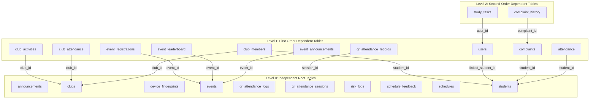
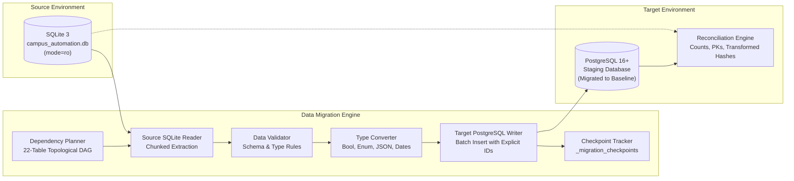

# Phase 19F.1 — Cross-Dialect Data Migration Architecture Audit

**Project:** Campus Automation System (MARVEL)  
**Workspace:** `C:\Users\ruetk\OneDrive\Desktop\Campus-Automation-System\MARVEL-main`  
**Branch:** `main`  
**Source Database:** SQLite 3 (`campus_automation.db`)  
**Target Database:** PostgreSQL 16+ (Staging / Production)  
**Mode:** READ-ONLY ARCHITECTURAL AUDIT & MIGRATION DESIGN (NO DATA MODIFIED)

---

## 1. Executive Summary

Phase 19F.1 provides a comprehensive, read-only architectural audit of the active application database (`campus_automation.db`) and defines a robust, deterministic, cross-dialect data migration design from SQLite 3 to PostgreSQL 16+.

### Key Audit Findings
1. **Source Database Immutability & Health:**
   - **File Path:** `MARVEL-main/campus_automation.db`
   - **File Size:** `290,816` bytes (exact match)
   - **SHA-256 Checksum:** `BACA55EBD284E474EF79C45D01F1B311C7C8E4F9A779BCB99A596A46798CE227` (exact match)
   - **`PRAGMA integrity_check`:** `ok`
   - **`PRAGMA foreign_key_check`:** `0` violations (pristine referential integrity)
   - **Total Domain Tables:** 22
   - **Total Records:** Exactly **60 rows** across all tables.
2. **Schema & Data Quality Assessment:**
   - **0** duplicate primary keys or duplicate unique constraint keys.
   - **0** orphaned foreign key references.
   - **0** string length violations against target PostgreSQL `VARCHAR(N)` definitions.
   - **0** nullability violations against target required columns.
   - **0** malformed JSON records across all JSON-like text columns.
   - **0** invalid enum values; raw SQLite enum strings (`'TECHNICAL'`, `'CULTURAL'`, `'SPORTS'`, `'REGISTRATION_OPEN'`) match the uppercase labels generated by Alembic baseline migration `0001_initial_baseline` for PostgreSQL native enums.
3. **Dependency Structure:**
   - The 22 domain tables form a strict **Directed Acyclic Graph (DAG)** with **0 circular dependencies** and **0 self-referential foreign keys**.
   - Tables sort into 3 distinct topological dependency levels (Level 0: 10 tables, Level 1: 10 tables, Level 2: 2 tables).
4. **Target Identity & Sequence Requirements:**
   - SQLite tables store primary keys as autoincrementing integers. PostgreSQL requires explicit sequence advancement (`SELECT setval(...)`) after explicit ID migration to prevent immediate primary key collisions during subsequent application inserts.

---

## 2. Source Database Inventory

The source database contains 22 domain tables holding a total of 60 records. All tables utilize single-column integer primary keys (`id`).

| # | Table Name | Row Count | Primary Key | Foreign Key Dependencies | Unique Constraints / Indexes | Sequence Restart Val |
| :--- | :--- | :---: | :--- | :--- | :--- | :---: |
| 1 | `announcements` | 3 | `id` (1..3) | None | `ix_announcements_id` | 4 |
| 2 | `clubs` | 7 | `id` (1..7) | None | `name` (unique), `ix_clubs_id` | 8 |
| 3 | `device_fingerprints` | 0 | `id` (empty) | None | `device_id` (unique), `ix_device_fingerprints_id`, `student_id` | 1 |
| 4 | `events` | 4 | `id` (1..4) | None | `ix_events_category`, `ix_events_id`, `ix_events_name` | 5 |
| 5 | `qr_attendance_logs` | 0 | `id` (empty) | None | `ix_qr_attendance_logs_id`, `session_id`, `student_id` | 1 |
| 6 | `qr_attendance_sessions` | 1 | `id` (1) | None | `session_id` (unique), `faculty_id`, `id` | 2 |
| 7 | `risk_logs` | 2 | `id` (1..2) | None | `ix_risk_logs_id` | 3 |
| 8 | `schedule_feedback` | 0 | `id` (empty) | None | `ix_schedule_feedback_id` | 1 |
| 9 | `schedules` | 6 | `id` (1..6) | None | `ix_schedules_id` | 7 |
| 10 | `students` | 6 | `id` (1..6) | None | `roll_no` (unique), `ix_students_id` | 7 |
| 11 | `club_activities` | 1 | `id` (1) | `club_id` $\rightarrow$ `clubs.id` | `ix_club_activities_id` | 2 |
| 12 | `club_attendance` | 0 | `id` (empty) | `club_id` $\rightarrow$ `clubs.id` | `ix_club_attendance_id` | 1 |
| 13 | `event_registrations` | 0 | `id` (empty) | `event_id` $\rightarrow$ `events.id` | `(event_id, student_id)` (unique), `id`, `student_id` | 1 |
| 14 | `event_leaderboard` | 0 | `id` (empty) | `event_id` $\rightarrow$ `events.id` | `ix_event_leaderboard_id` | 1 |
| 15 | `event_announcements` | 0 | `id` (empty) | `event_id` $\rightarrow$ `events.id` | `ix_event_announcements_id` | 1 |
| 16 | `qr_attendance_records` | 1 | `id` (1) | `session_id` $\rightarrow$ `qr_attendance_sessions.id` | `(session_id, roll_number)` (unique), `(session_id, student_id)` (unique), `id`, `student_id`, `roll_number` | 2 |
| 17 | `club_members` | 1 | `id` (1) | `club_id` $\rightarrow$ `clubs.id`, `student_id` $\rightarrow$ `students.id` | `(club_id, student_id)` (unique), `ix_club_members_id` | 2 |
| 18 | `users` | 4 | `id` (1..4) | `linked_student_id` $\rightarrow$ `students.id` | `username` (unique), `email` (unique), `ix_users_id` | 5 |
| 19 | `complaints` | 2 | `id` (1..2) | `student_id` $\rightarrow$ `students.id` | `ix_complaints_id` | 3 |
| 20 | `attendance` | 22 | `id` (1..22) | `student_id` $\rightarrow$ `students.id` | `ix_attendance_id` | 23 |
| 21 | `study_tasks` | 0 | `id` (empty) | `user_id` $\rightarrow$ `users.id` | `ix_study_tasks_id`, `user_id` | 1 |
| 22 | `complaint_history` | 0 | `id` (empty) | `complaint_id` $\rightarrow$ `complaints.id` | `ix_complaint_history_id`, `complaint_id` | 1 |
| **TOTAL** | **22 Tables** | **60** | — | **13 Explicit Foreign Keys** | **33 Indexes / Constraints** | — |

---

## 3. Data Quality & Integrity Audit Findings

A complete read-only data quality sweep across all 60 existing records produced the following results:

### A. Primary Key Integrity
- **Check:** `SELECT <pk>, COUNT(*) GROUP BY <pk> HAVING COUNT(*) > 1`
- **Result:** **PASSED.** Every table with rows exhibits unique primary keys matching exact contiguous or sparse positive integer sequences ($1..N$). Zero duplicate primary keys detected.

### B. Unique Constraints & Indexes
- **Check:** Verified unique columns (`users.username`, `users.email`, `students.roll_no`, `clubs.name`, `qr_attendance_sessions.session_id`, `club_members(club_id, student_id)`, `qr_attendance_records(session_id, roll_number)`).
- **Result:** **PASSED.** Zero unique constraint violations.

### C. Foreign Key Referential Integrity
- **Check:** `PRAGMA foreign_key_check;` and explicit cross-table join analysis.
- **Result:** **PASSED.** 0 orphaned foreign keys.
  - `attendance` (22 rows): All `student_id` values reference existing `students.id` ($1..6$).
  - `complaints` (2 rows): Both `student_id` values reference existing `students.id`.
  - `club_members` (1 row): References valid `club_id` and `student_id`.
  - `club_activities` (1 row): References valid `club_id`.
  - `users` (4 rows): User id=3 (`student1`) references `linked_student_id=1` (`Alex Johnson Updated`), while administrative and staff users have `NULL`.
  - `qr_attendance_records` (1 row): References valid `session_id=1`.

### D. Native Enum Values & Casing Nuance
- **Check:** Inspected `events.category` and `events.status`.
- **Result:**
  - `events.category`: Contains `'TECHNICAL'`, `'CULTURAL'`, `'SPORTS'`.
  - `events.status`: Contains `'REGISTRATION_OPEN'`.
  - **Alembic Baseline PostgreSQL Enum Definition:**
    - `eventcategory`: `('SPORTS', 'TECHNICAL', 'CULTURAL', 'GAMING', 'WORKSHOP', 'COMPETITION')`
    - `eventstatus`: `('UPCOMING', 'REGISTRATION_OPEN', 'REGISTRATION_CLOSED', 'ONGOING', 'COMPLETED', 'CANCELLED')`
  - **Assessment:** Raw values in SQLite match the uppercase labels in the PostgreSQL enum type created by Alembic. The migration writer must map strings directly to these native enum values without case transformation.

### E. Boolean Representation in SQLite vs PostgreSQL
- **Check:** Distinct values and types of boolean columns (`typeof(col)`).
- **Result:**
  - All boolean columns in SQLite store integer values `0` or `1`.
  - Model definitions hardened in Phase 19C designate true boolean types on PostgreSQL (`BOOLEAN`) for:
    - `users.is_active`
    - `clubs.is_active`, `clubs.accepting_members`
    - `club_members.is_active`
    - `events.requires_approval`, `events.team_event`
    - `qr_attendance_sessions.*` (5 boolean flags)
    - `qr_attendance_records.*` (9 boolean flags)
  - Columns deliberately preserved as `Integer` in both dialects:
    - `schedules.is_active` (Integer default 1)
    - `announcements.is_active` (Integer default 1)
    - `risk_logs.resolved` (Integer default 0)
  - **Assessment:** The migration type conversion layer must convert integer `1`/`0` to python `True`/`False` for designated `Boolean` columns, while leaving pure `Integer` columns as integers.

### F. JSON-Like Text Columns
- **Check:** Validated syntax with `json.loads()` for non-empty text fields:
  - `events.prizes`: Row 1 contains `'{"1st": "$2500", "2nd": "$1500", "3rd": "$1000"}'` (Valid JSON object).
  - `qr_attendance_sessions.qr_code_data`: Contains serialized session payload (Valid JSON object).
  - `clubs.gallery_images`, `clubs.social_media_links`, `events.gallery_images`, `event_registrations.team_members`: All `NULL` or empty in existing data.
- **Result:** **PASSED.** Zero JSON syntax errors.

### G. String Lengths vs PostgreSQL `VARCHAR(N)`
- **Check:** Evaluated max string length per column against SQLAlchemy model `String(length)` parameters.
- **Result:** **PASSED.** Zero string length overflows. All strings fall well within defined limits (e.g., `users.username` max 19 chars $\le 50$, `students.name` max 20 chars $\le 100$, `clubs.name` max 21 chars $\le 200$).

### H. Required (NOT NULL) Column Coverage
- **Check:** Scanned all columns declared as `nullable=False` in target models.
- **Result:** **PASSED.** Zero unexpected `NULL` values in existing records.

---

## 4. Foreign Key Dependency Graph & Topological Execution Order

To satisfy PostgreSQL foreign key constraints during batch insertion without disabling constraints or risking referential violations, tables must be loaded in strict topological order.

### Dependency Graph (DAG)

### Deterministic Insertion Order (22 Tables)
1. `announcements` (Level 0)
2. `clubs` (Level 0)
3. `device_fingerprints` (Level 0)
4. `events` (Level 0)
5. `qr_attendance_logs` (Level 0)
6. `qr_attendance_sessions` (Level 0)
7. `risk_logs` (Level 0)
8. `schedule_feedback` (Level 0)
9. `schedules` (Level 0)
10. `students` (Level 0)
11. `club_activities` (Level 1 $\rightarrow$ `clubs`)
12. `club_attendance` (Level 1 $\rightarrow$ `clubs`)
13. `event_registrations` (Level 1 $\rightarrow$ `events`)
14. `event_leaderboard` (Level 1 $\rightarrow$ `events`)
15. `event_announcements` (Level 1 $\rightarrow$ `events`)
16. `qr_attendance_records` (Level 1 $\rightarrow$ `qr_attendance_sessions`)
17. `club_members` (Level 1 $\rightarrow$ `clubs`, `students`)
18. `users` (Level 1 $\rightarrow$ `students`)
19. `complaints` (Level 1 $\rightarrow$ `students`)
20. `attendance` (Level 1 $\rightarrow$ `students`)
21. `study_tasks` (Level 2 $\rightarrow$ `users`)
22. `complaint_history` (Level 2 $\rightarrow$ `complaints`)

*Note: Cycle count = 0. All 22 tables can be cleanly inserted without temporary foreign-key suspension.*

---

## 5. Cross-Dialect Data Type Conversion Matrix

| SQLite Representation | Target PostgreSQL Representation | Required Conversion Logic & Guardrails |
| :--- | :--- | :--- |
| `INTEGER PRIMARY KEY` | `INTEGER` / `BIGINT` with Sequence | Insert existing ID explicitly (`OVERRIDING SYSTEM VALUE` if identity, or direct insert for sequences). After table insertion, execute sequence advancement: `SELECT setval(pg_get_serial_sequence('tbl', 'id'), coalesce(max(id), 0) + 1, false)`. |
| Boolean-like `INTEGER` (`0`, `1`) | `BOOLEAN` | For fields designated as `Boolean` in SQLAlchemy models, convert `1` $\rightarrow$ `True`, `0` $\rightarrow$ `False`, `None` $\rightarrow$ `None`. Reject any integer values other than `0`, `1`, or `NULL`. |
| Preserved `INTEGER` (`0`, `1`) | `INTEGER` | For fields defined as `Integer` in models (`schedules.is_active`, `announcements.is_active`, `risk_logs.resolved`), preserve integer values (`1`, `0`) unchanged. |
| Text Enum (`'TECHNICAL'`, `'SPORTS'`, etc.) | Native PostgreSQL `ENUM` (`eventcategory`, `eventstatus`, `registrationstatus`) | Validate against target Python `enum.Enum` members. Maintain exact casing matching PostgreSQL enum labels. PostgreSQL rejects unknown enum strings with fatal error. |
| JSON-like `TEXT` | `TEXT` or `JSONB` | Validate with `json.loads(val)` before insertion. Preserve valid JSON strings. Insert `None` for empty/null strings. |
| `DATETIME` as Text (`'YYYY-MM-DD HH:MM:SS.ffffff'`) | `TIMESTAMP WITHOUT TIME ZONE` / `TIMESTAMP WITH TIME ZONE` | Parse with `datetime.fromisoformat` or `datetime.strptime`. Preserve microsecond precision. For `timezone=True` columns (`schedule_feedback`, `announcements`), normalize to UTC timezone-aware datetimes. |
| `FLOAT` | `DOUBLE PRECISION` | Cast to standard Python `float`. Verify valid numeric values (latitude/longitude coordinates, event entry fees, scores). |
| `NULL` / Empty string in nullable field | `NULL` | Maintain `None` as SQL `NULL`. Do not convert `NULL` to empty string or empty string to `NULL` unless specified by column contract. |
| Foreign Key Integers | PostgreSQL `FOREIGN KEY` | Ensure referenced parent records have already been migrated via topological sort. |

---

## 6. Migration Architecture Design

### Modular Components
1. **Source SQLite Reader (`SQLiteReader`):**
   - Connects strictly in URI read-only mode (`file:<path>?mode=ro`).
   - Streams table data in deterministic primary key order (`ORDER BY id ASC`).
   - Extracts rows as mapped dictionaries with column data types.
2. **Table Dependency Planner (`DependencyPlanner`):**
   - Enforces the verified 22-table topological sort.
   - Rejects unlisted tables and detects dependency cycles.
3. **Type Conversion Layer (`TypeConverter`):**
   - Applies the Conversion Matrix rules.
   - Enforces boolean translation, enum validation, JSON verification, and datetime parsing.
4. **Data Validation Layer (`PreflightValidator`):**
   - Pre-flight checks before target write: checks required fields, string length caps, and foreign key reference existence.
5. **Target PostgreSQL Writer (`PostgreSQLWriter`):**
   - Connects using psycopg3 / SQLAlchemy engine.
   - Executes parameterized batch inserts (`executemany` or PostgreSQL `COPY`) within explicit per-table transaction boundaries.
   - Synchronizes identity sequences post-table: `SELECT setval(...)`.
6. **Migration Checkpoint Tracker (`CheckpointTracker`):**
   - Maintains a checkpoint table in PostgreSQL (`_migration_checkpoints`):
     - `table_name` (VARCHAR PK)
     - `status` (`PENDING`, `IN_PROGRESS`, `COMPLETED`, `FAILED`)
     - `rows_migrated` (INTEGER)
     - `started_at`, `completed_at` (TIMESTAMP)
     - `source_checksum`, `target_checksum` (VARCHAR)
   - Enables clean resumption without re-migrating already completed tables.
7. **Reconciliation Engine (`ReconciliationEngine`):**
   - Performs independent mathematical reconciliation comparing source and destination.
8. **Migration Manifest Generator:**
   - Produces a timestamped, signed JSON manifest documenting migration execution, checksums, and verification metrics.

---

## 7. Migration Safety Controls & Guardrails

The migration engine must enforce twelve non-negotiable safety guardrails:
1. **Read-Only Source Enforcement:** The SQLite file is opened exclusively via SQLite URI with `mode=ro`. File permissions on disk are verified prior to execution.
2. **Zero Source Deletion:** Under no circumstance does the migration process issue `DELETE`, `DROP`, `UPDATE`, or `VACUUM` queries against the source database.
3. **Explicit Destination Specification:** The destination PostgreSQL connection string must be explicitly provided via CLI flag or dedicated environment variable. Inferred, default, or empty targets are rejected.
4. **Production Target Protection:** Integrates `is_production_database_target()`. If destination host or database contains markers (`prod`, `production`, `live`, `supabase`, `rds.amazonaws.com`), execution halts immediately with `BackupError`.
5. **No Automatic Schema Alteration:** The migration engine will not execute DDL (`CREATE TABLE`, `ALTER TABLE`, `DROP TABLE`). The destination PostgreSQL database must already exist, be stamped, and match the target Alembic baseline (`0001_initial_baseline`).
6. **Target Emptiness Verification:** Before beginning table migration, the engine verifies that destination tables are empty (`COUNT(*) == 0`). Overwriting populated tables without explicit destructive authorization is prohibited.
7. **Per-Table Transaction Isolation:** Each table batch runs inside an isolated database transaction. If an error occurs midway through a table, that table's transaction is rolled back completely, leaving zero orphan rows.
8. **Restartability & Idempotency:** The checkpoint tracker allows resuming failed or interrupted migrations from the exact table where failure occurred, without duplicating earlier tables.
9. **No Silently Dropped Records:** Every source record must either be successfully inserted into PostgreSQL or cause a migration halt. Truncating, skipping, or silently dropping rows is strictly forbidden.
10. **Post-Load Sequence Advancement:** Automatically executes `setval()` on all primary key sequences to ensure future application inserts succeed without key conflicts.
11. **Credential Isolation:** Passwords and secrets are sanitized from all logs, terminal messages, and manifests via `sanitize_text()`.
12. **Mandatory Post-Migration Verification:** The migration run cannot report success unless all 22 tables pass exact row-count and checksum reconciliation.

---

## 8. Migration Reconciliation Design

To verify 100% data fidelity between SQLite and PostgreSQL across data type transformations, reconciliation operates across three tiers:

### Tier 1: Per-Table Row Count Equality
- Condition: $\forall T \in \text{Tables}: \text{Count}_{\text{dest}}(T) = \text{Count}_{\text{source}}(T)$.
- Total expected records: exactly **60**.

### Tier 2: Primary Key Set Equality
- Condition: $\forall T \in \text{Tables}: \text{Set}(\text{PK}_{\text{source}}) = \text{Set}(\text{PK}_{\text{dest}})$.
- Confirms zero missing IDs, zero phantom records, and exact ID mapping.

### Tier 3: Deterministic Canonical Checksum Matching
Because SQLite and PostgreSQL represent types differently (e.g. integer `1` vs boolean `true`, string timestamp vs PostgreSQL timestamp), a raw byte-for-byte database checksum is impossible. 

Instead, the reconciliation engine utilizes a **Canonical Transformation Hash**:
1. For each row, sort columns alphabetically by column name.
2. Format each value into a canonical string:
   - `NULL` $\rightarrow$ `"<NULL>"`
   - `Boolean` $\rightarrow$ `"TRUE"` or `"FALSE"`
   - `Integer` $\rightarrow$ Decimal string (e.g., `"42"`)
   - `Float` $\rightarrow$ Standard string formatted to 6 decimal places (for geographic coordinates) or formatted float
   - `DateTime` $\rightarrow$ Normalized UTC ISO-8601 string: `YYYY-MM-DDTHH:MM:SS.ffffff`
   - `Text/String` $\rightarrow$ UTF-8 string with whitespace trimmed
3. Concatenate formatted column strings separated by pipe delimiters: `col1=val1|col2=val2|...`
4. Compute SHA-256 for each row.
5. Combine row hashes ordered by primary key to generate a single deterministic **Table Canonical Checksum**:
   $$\text{Hash}_{\text{table}} = \text{SHA256}\left(\sum_{r \in \text{Rows}} \text{SHA256}(r)\right)$$
6. Compare $\text{Hash}_{\text{table}}^{\text{source}} = \text{Hash}_{\text{table}}^{\text{target}}$.

---

## 9. Operational Runbook (Future Migration Execution)

When migrating data in Phase 19F.2, operators must follow this 11-step procedure:

1. **Step 1: Source Database Preflight**
   - Verify `campus_automation.db` exists.
   - Calculate and verify SHA-256 (`BACA55EBD284E474EF79C45D01F1B311C7C8E4F9A779BCB99A596A46798CE227`).
   - Run `PRAGMA integrity_check` and `PRAGMA foreign_key_check`.
2. **Step 2: SQLite Online Backup**
   - Create a fresh, verifiable online backup using `SQLiteBackupAdapter` with companion `.manifest.json`.
3. **Step 3: Destination PostgreSQL Preflight**
   - Connect to isolated staging PostgreSQL instance.
   - Execute connectivity heartbeat (`SELECT 1;`).
   - Verify destination identity is non-production (`is_production_database_target` check).
4. **Step 4: Target Schema Verification**
   - Run `DatabaseVerifier.verify(engine)` against target PostgreSQL.
   - Confirm target status is `MIGRATED` with revision `0001_initial_baseline`.
   - Confirm all 22 domain tables and native enums exist and are empty (`count == 0`).
5. **Step 5: Initialize Migration Checkpoints**
   - Create `_migration_checkpoints` table in PostgreSQL.
6. **Step 6: Execute Topological Batch Transfer**
   - Run `DataMigrator` iterating Level 0 $\rightarrow$ Level 1 $\rightarrow$ Level 2.
   - For each table: extract from SQLite, apply type conversion, write batch inside transaction, update checkpoint.
7. **Step 7: Synchronize Identity Sequences**
   - For every table, query `MAX(id)` and execute `SELECT setval(pg_get_serial_sequence(table, 'id'), MAX(id) + 1, false)`.
8. **Step 8: Referential Integrity Verification**
   - Execute foreign key constraint validation across all 22 tables in PostgreSQL.
9. **Step 9: Run Three-Tier Reconciliation**
   - Verify per-table row counts (total 60 rows).
   - Verify primary key set equality.
   - Verify canonical transformation checksums match 100%.
10. **Step 10: Generate Migration Manifest & Sign-Off**
    - Generate `migration_manifest_2026xxxx.json` capturing execution metadata, checksums, and operator sign-off.
11. **Step 11: Rollback Strategy (If Aborted)**
    - If reconciliation fails or an unrecoverable error occurs:
      - Truncate all tables in reverse topological order: `TRUNCATE TABLE complaint_history, study_tasks, ... CASCADE;`
      - Drop checkpoint table.
      - Source SQLite database remains pristine and untouched throughout.

---

## 10. Future Testing Strategy

A comprehensive test suite must be developed for Phase 19F.2 covering:
- **Unit Tests:**
  - Value conversions: Integer `0`/`1` to Boolean `False`/`True`.
  - Enum value validation and uppercase mapping.
  - Datetime string parsing and UTC normalization.
  - Canonical row checksum generation and determinism.
- **SQLite Integration Tests:**
  - Read-only connection rejection of write operations (`sqlite3.OperationalError: attempt to write a readonly database`).
  - Topological sorter DAG resolution on actual 22 models.
- **Simulated / Mocked PostgreSQL Tests:**
  - Transaction rollback on simulated batch insert error.
  - Resume from checkpoint after interrupted table.
  - Production URL rejection (`is_production_database_target`).
  - Sequence synchronization SQL generation.
- **Real Staging Integration Tests (Task 19F.2):**
  - Full end-to-end migration into a live, disposable PostgreSQL 16+ test database.
  - Sequence advancement verification: insert new record post-migration and verify no ID collision occurs.
  - Full three-tier reconciliation pass.

---

## 11. Known Risks and Mitigations

| Risk | Impact | Mitigation Strategy |
| :--- | :--- | :--- |
| **Primary key sequence collision post-migration** | Future `INSERT` queries fail due to PK violation | Mandatory Step 7: execute `setval()` for every table to `max(id) + 1`. |
| **Accidental execution against production database** | Data corruption in live system | Automated `is_production_database_target()` halts execution on any production marker. |
| **Silent truncation of string columns** | Loss of user text or descriptions | Pre-flight validation checks string lengths against target model length caps. |
| **Case mismatch in Enum values** | PostgreSQL rejects row on invalid enum | Verified that existing SQLite values match uppercase baseline enum labels. Migration layer preserves exact casing. |
| **Inconsistent boolean serialization** | Reconciler checksum mismatches | Canonical serialization normalizes all booleans to `"TRUE"`/`"FALSE"` prior to hashing. |
| **Interrupted network connection midway through migration** | Partially migrated target database | Checkpoint tracker records progress per table; per-table transactions ensure no partial table states. |

---

## 12. Verification of Source Database Immutability

Following the completion of this read-only audit, `campus_automation.db` was re-verified:
- **File Length:** `290,816` bytes (exact match)
- **SHA-256:** `BACA55EBD284E474EF79C45D01F1B311C7C8E4F9A779BCB99A596A46798CE227` (exact match)
- **Status:** **Untouched and pristine.** Zero writes, updates, stamps, or schema modifications occurred.
